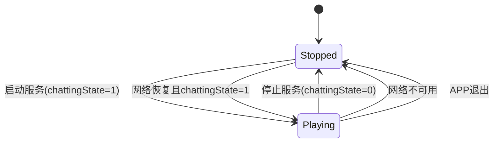
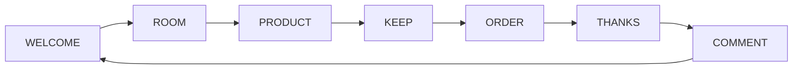
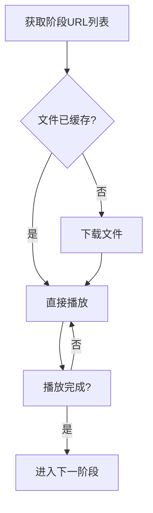

# AI直播语音播放服务设计文档

## 1. 概述

AI直播语音播放服务（LiveChattingService）是一个在Android应用后台运行的前台服务，负责播放从服务端获取的语音文件。该服务根据不同的直播阶段循环播放语音内容，为用户提供AI直播体验。

## 2. 架构设计

### 2.1 整体架构

```
┌─────────────────────────────────────────────────────────────┐
│                    AILiveScreen界面                         │
│  ┌───────────────────────────────────────────────────────┐  │
│  │  AI直播开关控制                                          │  │
│  └───────────────────────────────────────────────────────┘  │
└─────────────────────────┬───────────────────────────────────┘
                          │ 启动/停止控制
                          ▼
┌─────────────────────────────────────────────────────────────┐
│                  LiveChattingService服务                    │
│                                                             │
│  ┌───────────────────────────────────────────────────────┐  │
│  │  服务状态管理 (chattingState)                            │  │
│  └───────────────────────────────────────────────────────┘  │
│                                                             │
│  ┌───────────────────────────────────────────────────────┐  │
│  │  播放阶段管理器                                        │  │
│  │  WELCOME → ROOM → PRODUCT → KEEP → ORDER → THANKS      │  │
│  └───────────────────────────────────────────────────────┘  │
│                                                             │
│  ┌───────────────────────────────────────────────────────┐  │
│  │  语音文件管理器                                        │  │
│  │  ├── 获取语音URL列表                                   │  │
│  │  ├── 缓存管理                                          │  │
│  │  ├── 下载管理                                          │  │
│  │  └── 播放控制                                          │  │
│  └───────────────────────────────────────────────────────┘  │
│                                                             │
│  ┌───────────────────────────────────────────────────────┐  │
│  │  网络状态监听器                                        │  │
│  └───────────────────────────────────────────────────────┘  │
└─────────────────────────┬───────────────────────────────────┘
                          │ API调用
                          ▼
┌─────────────────────────────────────────────────────────────┐
│                    服务端API接口                            │
│  ┌───────────────────────────────────────────────────────┐  │
│  │  获取语音文件URL列表接口                                │  │
│  └───────────────────────────────────────────────────────┘  │
└─────────────────────────────────────────────────────────────┘
```

### 2.2 服务生命周期



## 3. 核心组件设计

### 3.1 LiveChattingService服务类

#### 3.1.1 类定义
```kotlin
class LiveChattingService : Service() {
    companion object {
        const val CHATTING_STATE_STOPPED = 0
        const val CHATTING_STATE_PLAYING = 1
        
        // 通知相关常量
        private const val NOTIFICATION_ID = 1002
        private const val CHANNEL_ID = "live_chatting"
        private const val CHANNEL_NAME = "AI直播语音播放"
        private const val CHANNEL_DESCRIPTION = "AI直播语音播放服务"
        
        // 服务状态流
        private val _chattingStateFlow = MutableStateFlow(CHATTING_STATE_STOPPED)
        val chattingStateFlow: StateFlow<Int> = _chattingStateFlow.asStateFlow()
        
        fun startService(context: Context)
        fun stopService(context: Context)
        fun getCurrentChattingState(): Int
    }
}
```

#### 3.1.2 核心属性
- `chattingState`: 语音播放状态（0=未播放，1=播放中）
- `currentStage`: 当前播放阶段
- `isServiceRunning`: 服务运行状态标志
- `networkAvailable`: 网络可用性状态

#### 3.1.3 核心方法
- `onCreate()`: 初始化服务组件
- `onStartCommand()`: 启动前台服务
- `onDestroy()`: 清理资源
- `startVoicePlayback()`: 启动语音播放流程
- `stopVoicePlayback()`: 停止语音播放
- `playStageVoice(stage: String)`: 播放指定阶段语音

### 3.2 播放阶段管理器

#### 3.2.1 播放阶段枚举
```kotlin
enum class PlaybackStage {
    WELCOME,    // 欢迎阶段
    ROOM,       // 直播间介绍阶段
    PRODUCT,    // 产品介绍阶段
    KEEP,       // 留人话术阶段
    ORDER,      // 促单阶段
    THANKS,     // 感谢阶段
    COMMENT     // 评论互动阶段
}
```

#### 3.2.2 阶段播放流程


### 3.3 语音文件管理器

#### 3.3.1 功能模块
1. **URL获取模块**: 从服务端获取指定阶段的语音文件URL列表
2. **缓存管理模块**: 检查本地是否已缓存语音文件
3. **下载管理模块**: 下载未缓存的语音文件
4. **播放控制模块**: 控制语音文件的播放

#### 3.3.2 工作流程


## 4. API接口设计

### 4.1 获取语音文件URL列表接口
```
GET /api/v1/voice/stage
参数:
  - stage: 播放阶段 (WELCOME, ROOM, PRODUCT, KEEP, ORDER, THANKS, COMMENT)
返回:
  {
    "code": 200,
    "data": [
      {
        "id": "voice_001",
        "url": "https://example.com/voice/welcome_01.mp3",
        "duration": 5000
      },
      {
        "id": "voice_002", 
        "url": "https://example.com/voice/welcome_02.mp3",
        "duration": 3500
      }
    ]
  }
```

## 5. 数据模型设计

### 5.1 语音文件信息模型
```kotlin
data class VoiceFileInfo(
    val id: String,
    val url: String,
    val duration: Long,  // 毫秒
    val cached: Boolean = false
)
```

### 5.2 播放阶段模型
```kotlin
data class PlaybackStageInfo(
    val stage: PlaybackStage,
    val voiceFiles: List<VoiceFileInfo>,
    val loop: Boolean = false
)
```

## 6. 状态管理设计

### 6.1 服务状态流
```kotlin
// 服务状态变化通过StateFlow暴露给UI层
val chattingStateFlow: StateFlow<Int>
```

### 6.2 网络状态监听
- 监听系统网络状态变化
- 网络不可用时自动暂停播放
- 网络恢复时根据chattingState状态决定是否恢复播放

## 7. 异常处理设计

### 7.1 播放异常处理
- 播放失败时记录日志并尝试重新播放
- 连续失败超过阈值时暂停服务并通知用户
- 支持自动恢复机制

### 7.2 网络异常处理
- 网络断开时暂停播放
- 网络恢复时检查服务状态决定是否恢复播放
- 提供网络状态变化的回调通知

## 8. 性能优化设计

### 8.1 缓存策略
- 语音文件本地缓存，避免重复下载
- 设置缓存过期时间，定期清理旧文件
- 控制缓存大小，避免占用过多存储空间

### 8.2 内存管理
- 及时释放播放完成的语音资源
- 合理控制协程作用域生命周期
- 避免内存泄漏

## 9. 安全设计

### 9.1 权限管理
- 声明前台服务权限
- 声明网络访问权限
- 声明存储访问权限（用于缓存）

### 9.2 数据安全
- 语音文件URL通过HTTPS传输
- 本地缓存文件进行适当保护

## 10. 测试策略

### 10.1 单元测试
- 服务状态切换测试
- 播放阶段循环测试
- 网络状态响应测试
- 异常处理测试

### 10.2 集成测试
- 与AILiveScreen界面联动测试
- 服务生命周期测试
- 前后台切换测试

## 11. 部署与配置

### 11.1 AndroidManifest配置
```xml
<service
    android:name=".service.LiveChattingService"
    android:enabled="true"
    android:exported="false"
    android:foregroundServiceType="mediaPlayback" />
```

### 11.2 权限声明
```xml
<uses-permission android:name="android.permission.FOREGROUND_SERVICE" />
<uses-permission android:name="android.permission.INTERNET" />
<uses-permission android:name="android.permission.FOREGROUND_SERVICE_MEDIA_PLAYBACK" />
```