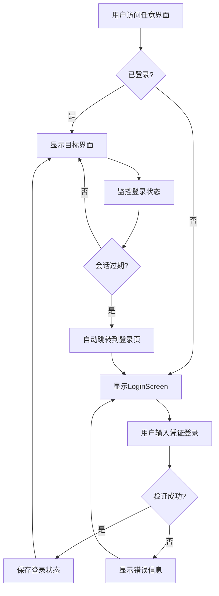

# BaseScreen 登录状态管理系统实现文档

## 📋 功能概述

本系统为ailive项目实现了统一的登录状态管理机制，确保除了`LoginScreen`之外的所有界面都需要登录验证才能访问。当用户未登录或会话过期时，系统会自动跳转到登录页面。

## 🏗️ 架构设计

### 核心组件

1. **BaseScreenManager** - 登录状态管理服务类
2. **BaseScreen** - 基础界面组件，提供登录保护
3. **WithLoginProtection** - 高阶组件，为现有Screen添加登录保护
4. **修改后的AppNavigation** - 集成登录状态检查的导航系统

### 工作流程



## 📁 文件结构

```
app/src/main/java/com/danshuang/AiLive/
├── service/
│   └── BaseScreenManager.kt           # 登录状态管理服务
├── ui/components/
│   └── BaseScreen.kt                  # 基础登录保护组件
└── navigation/
    ├── AppNavigation.kt               # 主导航（已修改）
    └── Navigation.kt                  # 页面导航（已修改）
```

## 🔧 核心功能

### 1. BaseScreenManager 服务类

**功能特点：**
- 单例模式，全局统一管理
- 封装LoginRepository，提供统一的登录状态API
- 支持登录状态监控和会话管理

**主要方法：**
```kotlin
class BaseScreenManager {
    fun getLoginStatusFlow(): Flow<Boolean>
    fun getAuthTokenFlow(): Flow<String?>
    suspend fun isLoggedIn(): Boolean
    suspend fun logout()
    suspend fun saveLoginInfo(token: String, phone: String)
}
```

### 2. BaseScreen 组件

**功能特点：**
- 自动检查登录状态
- 提供加载状态显示
- 支持会话过期监控
- 可配置是否需要登录保护

**使用示例：**
```kotlin
@Composable
fun MyScreen() {
    BaseScreen(
        requireLogin = true,
        onLoginSuccess = { /* 登录成功回调 */ },
        onSessionExpired = { /* 会话过期回调 */ }
    ) {
        // 受保护的界面内容
        Text("这是需要登录才能看到的内容")
    }
}
```

### 3. WithLoginProtection 高阶组件

**功能特点：**
- 无侵入式为现有Screen添加登录保护
- 支持屏幕名称标识（便于调试）
- 自动处理登录状态变化

**使用示例：**
```kotlin
WithLoginProtection(
    screenName = "Home",
    onLogout = { /* 注销处理 */ }
) {
    HomeScreen(navController = navigationState)
}
```

## 🔒 登录保护范围

所有Screen都已添加登录保护，除了`LoginScreen`本身：

- ✅ HomeScreen
- ✅ ModelScreen  
- ✅ AILiveScreen
- ✅ KnowledgeScreen
- ✅ ProfileScreen
- ✅ ChangePasswordScreen
- ✅ HelpScreen
- ✅ ContentEditScreen
- ✅ LiveScriptScreen
- ✅ GreetingSettingsScreen
- ✅ NicknameRestrictions
- ✅ CommentRestrictions
- ✅ VoiceSettingsScreen
- ✅ VoiceCloningScreen
- ✅ AccountBindingScreen
- ✅ CardActivationScreen

## 🔄 会话管理机制

### 自动会话监控
系统实时监控登录状态，当检测到以下情况时自动跳转到登录页：
- 用户主动注销
- 认证令牌过期
- 认证令牌被清除

### 状态同步
- 使用Flow进行响应式状态管理
- 保证UI与登录状态实时同步
- 支持多个界面同时监控登录状态

## 🚀 使用方法

### 基本使用
系统已自动集成到所有现有界面，无需额外配置。用户访问任何界面时都会自动进行登录检查。

### 添加新的受保护界面
对于新增的界面，使用`WithLoginProtection`组件包装：

```kotlin
@Composable
fun NewScreen() {
    WithLoginProtection(
        screenName = "NewScreen",
        onLogout = { /* 注销处理 */ }
    ) {
        // 新界面的内容
        YourScreenContent()
    }
}
```

### 添加不需要登录的界面
如果某个界面不需要登录保护，设置`requireLogin = false`：

```kotlin
WithLoginProtection(
    requireLogin = false
) {
    // 公开访问的内容
    PublicContent()
}
```

## ⚙️ 配置选项

### 自定义加载界面
```kotlin
BaseScreen(
    loadingContent = {
        // 自定义加载界面
        Box(modifier = Modifier.fillMaxSize()) {
            CircularProgressIndicator()
            Text("正在验证...")
        }
    }
) {
    // 主要内容
}
```

### 会话过期处理
```kotlin
BaseScreen(
    onSessionExpired = {
        // 自定义会话过期处理
        showSessionExpiredDialog()
    }
) {
    // 主要内容  
}
```

## 🛠️ 调试和日志

### 状态检查
可以使用`BaseScreenManager`检查当前登录状态：

```kotlin
val baseScreenManager = rememberBaseScreenManager()
val isLoggedIn by baseScreenManager.getLoginStatusFlow().collectAsState()
Log.d("LoginStatus", "Current login status: $isLoggedIn")
```

### 屏幕标识
每个受保护的界面都有`screenName`标识，便于调试时定位问题。

## 🔐 安全特性

1. **自动重定向**: 未登录用户自动跳转到登录页
2. **会话监控**: 实时监控登录状态变化
3. **令牌管理**: 安全的令牌存储和清理
4. **状态同步**: 确保UI与登录状态始终一致

## 📊 性能优化

1. **单例模式**: BaseScreenManager使用单例，避免重复创建
2. **Flow缓存**: 登录状态使用Flow缓存，减少重复查询
3. **惰性加载**: 只在需要时才检查登录状态
4. **组件复用**: 可复用的登录保护组件

## 🎯 最佳实践

1. **统一使用**: 所有新界面都应使用登录保护机制
2. **错误处理**: 合理处理登录失败和网络错误
3. **用户体验**: 提供清晰的加载状态和错误提示
4. **测试覆盖**: 确保登录流程的完整测试覆盖

## 🔧 故障排除

### 常见问题

1. **界面一直显示加载状态**
   - 检查LoginRepository的实现
   - 确认DataStore配置正确

2. **登录后仍然跳转到登录页**
   - 检查登录成功后是否正确保存了令牌
   - 确认isLoggedInFlow()返回正确值

3. **会话过期不自动跳转**
   - 检查onSessionExpired回调是否正确设置
   - 确认登录状态监控正常工作

## 🚀 后续扩展

1. **自动刷新令牌**: 在令牌即将过期时自动刷新
2. **离线模式**: 支持离线状态下的有限功能访问
3. **多账户支持**: 支持多个账户的切换
4. **细粒度权限**: 基于用户角色的界面访问控制

---

## 📝 变更记录

- **v1.0**: 实现基础的登录状态管理系统
- 创建BaseScreenManager服务类
- 实现BaseScreen和WithLoginProtection组件
- 修改所有现有界面添加登录保护
- 添加会话过期自动处理机制