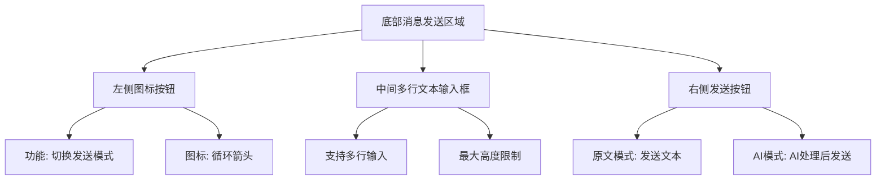
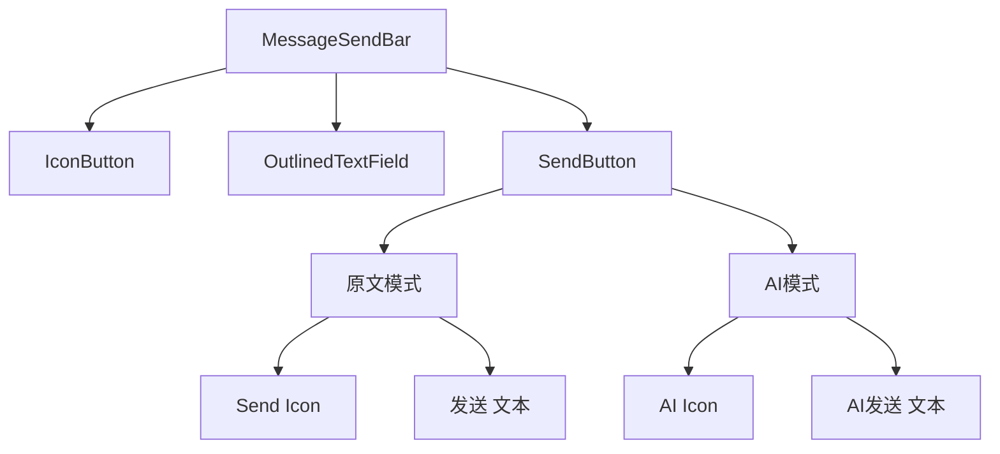
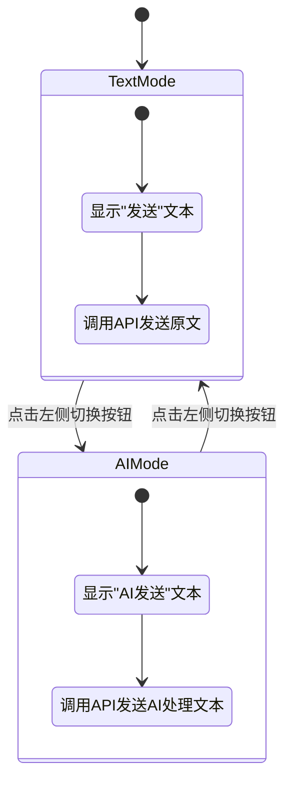

# 底部消息发送控件设计文档

## 1. 概述

本设计文档描述在AILiveScreen界面底部添加消息发送功能的需求和实现方案。该功能类似于即时通讯软件的消息发送界面，包含三个主要组件：左侧切换按钮、中间多行文本输入框和右侧发送按钮。

## 2. 功能需求

### 2.1 界面组件
- 左侧图标按钮：用于切换发送按钮的显示模式
- 中间文本输入框：支持多行输入的文本框
- 右侧发送按钮：根据模式显示不同图标和文本，支持两种发送模式

### 2.2 交互逻辑
- 左侧按钮点击切换右侧发送按钮的显示模式（原文模式 ↔ AI模式）
- 右侧发送按钮根据当前模式显示不同图标和文本
- 点击发送按钮调用`ServerApiUtilsV2.addHostComment`接口发送消息

### 2.3 用户体验要求
- 输入框应支持多行文本输入，自动适应内容高度
- 发送按钮在输入内容为空时应禁用
- 支持通过软键盘的"发送"按键触发发送操作
- 发送过程中应显示加载状态，防止重复点击
- 发送成功后应清空输入框内容
- 发送失败时应保留输入内容并显示错误提示
- 在不同屏幕方向（横屏/竖屏）下应正常显示

## 3. 设计方案

### 3.1 UI组件设计



### 3.2 组件层次结构



### 3.2 状态管理



### 3.3 组件详细设计

#### 3.3.1 左侧图标按钮
- 图标：循环箭头图标（表示模式切换）
- 功能：点击后在原文模式和AI模式之间切换
- 样式：Material Design图标按钮

#### 3.3.2 中间文本输入框
- 类型：多行文本输入框（TextField）
- 特性：
  - 支持换行显示多行文本
  - 最大行数限制（例如5行）
  - 输入内容为空时禁用发送按钮
  - 支持滚动查看超出显示区域的内容

#### 3.3.3 右侧发送按钮
- 类型：图标按钮
- 模式：
  - 原文模式：
    - 图标：发送图标
    - 文本："发送"
  - AI模式：
    - 图标：AI图标
    - 文本："AI发送"
- 功能：点击后调用`ServerApiUtilsV2.addHostComment`发送消息

## 4. 技术实现

### 4.1 状态管理
使用Compose的`mutableStateOf`管理以下状态：
- `sendMode`: 当前发送模式（原文/AI）
- `messageText`: 输入框中的文本内容
- `isSendEnabled`: 发送按钮是否可用状态
- `isSending`: 是否正在发送消息（用于显示加载状态）

状态初始化：
- `sendMode`默认为原文模式（text）
- `messageText`默认为空字符串
- `isSendEnabled`默认为false
- `isSending`默认为false

### 4.2 API调用
发送按钮点击时调用`ServerApiUtilsV2.addHostComment`方法，根据当前模式传递相应参数：
- `douyinId`: 当前绑定账户的抖音ID
- `roomId`: 当前直播间ID
- `type`: 消息类型（"text"表示原文模式，"ai"表示AI模式）
- `content`: 用户输入的文本内容

API调用需要在协程作用域中执行，使用`viewModelScope`或`CoroutineScope(Dispatchers.IO)`。

#### 4.2.1 依赖注入
使用现有的依赖注入机制获取ServerApiUtilsV2实例：
```kotlin
val loginRepository = remember { LoginRepository(context) }
val tokenManager = remember { TokenManager(loginRepository) }
val serverApiUtils = remember { ServerApiUtilsV2.createFromContext(context, tokenManager, loginRepository) }
```

#### 4.2.2 成功处理
- 清空输入框内容
- 显示成功消息（可选）
- 将发送的消息添加到本地消息列表显示

#### 4.2.3 错误处理
- 网络错误：显示Snackbar提示"发送失败，请检查网络连接"
- 认证错误：显示Snackbar提示"发送失败，用户未登录"
- 服务器错误：显示Snackbar提示"发送失败，服务器错误"
- 其他错误：显示Snackbar提示"发送失败，请重试"

错误处理实现：
1. 使用SnackbarHost和SnackbarHostState管理Snackbar显示
2. 根据API返回的错误码判断错误类型
3. 使用CoroutineScope(Dispatchers.Main)在主线程显示Snackbar
4. 设置适当的显示时长（SnackbarDuration.Short）

### 4.3 UI布局
使用Row布局容器水平排列三个组件，合理分配宽度：
- 左侧按钮：固定宽度48dp
- 中间输入框：占据剩余空间
- 右侧按钮：固定宽度48dp

整体布局应添加适当的内边距和背景色，与现有界面风格保持一致。

#### 4.3.1 与AILiveScreen集成
消息发送控件应作为AILiveScreen的底部组件，放置在现有LazyColumn之外，确保始终可见。

集成要点：
1. 获取当前绑定账户信息（douyinId和roomId）
2. 使用现有的ServerApiUtilsV2实例
3. 与现有消息列表保持视觉一致性
4. 确保在不同屏幕尺寸下正常显示

在AILiveScreen的Scaffold中，消息发送控件应作为底部组件添加，位于LazyColumn之后。需要修改Scaffold的content部分，将消息发送控件添加到布局中，确保它始终固定在屏幕底部。

实现方案：
1. 在Scaffold的content部分，使用Column布局包装现有的LazyColumn和新的消息发送控件
2. 将消息发送控件放置在Column的底部，使用weight(1f)让LazyColumn占据剩余空间
3. 确保消息发送控件始终可见且固定在底部

### 4.4 组件实现细节

#### 4.4.1 左侧图标按钮
使用`IconButton`组件，图标使用`Icons.Default.Cached`（循环箭头图标），点击事件切换发送模式。

#### 4.4.2 中间文本输入框
使用`OutlinedTextField`组件，设置`maxLines`为5，`minLines`为1，启用垂直滚动。

输入框应支持以下特性：
- 支持多行输入，自动换行
- 输入内容为空时禁用发送按钮
- 支持通过键盘的"发送"按键触发发送操作
- 添加适当的占位符文本，如"请输入要发送的消息..."
- 支持通过Modifier.weight(1f)自适应宽度

#### 4.4.3 右侧发送按钮
使用`IconButton`组件，根据当前模式显示不同图标和文本：
- 原文模式：`Icons.Default.Send`图标 + "发送"文本
- AI模式：`Icons.Default.SmartToy`图标 + "AI发送"文本

发送按钮应支持以下特性：
- 输入内容为空时禁用
- 点击时显示加载状态（如旋转进度条）
- 发送完成后恢复原始状态
- 使用Modifier.size(48.dp)固定按钮大小

## 5. 样式规范

### 5.1 颜色规范
- 输入框背景色：Material Design surface variant
- 按钮颜色：遵循Material Design主题色
- 文本颜色：根据主题自动适配
- 发送按钮激活状态：使用primary color
- 发送按钮禁用状态：使用outline color

### 5.2 尺寸规范
- 整体高度：适应内容，最小高度56dp
- 按钮尺寸：48dp x 48dp
- 输入框内边距：16dp水平，12dp垂直
- 组件间距：8dp

### 5.3 动画效果
- 模式切换时应有平滑的图标过渡动画
- 发送按钮点击时应有波纹效果
- 输入框聚焦时应有明显的轮廓变化

## 6. 错误处理

### 6.1 网络错误
- 显示Snackbar提示用户发送失败
- 保留输入内容，方便用户重试

### 6.2 输入验证
- 空内容时禁用发送按钮
- 超长内容截断或提示

## 7. 测试方案

### 7.1 单元测试
- 测试模式切换功能：验证点击左侧按钮能否正确在text模式和ai模式间切换
- 测试发送按钮状态管理：验证输入框为空时发送按钮禁用，输入内容后启用
- 测试API调用参数正确性：验证不同模式下调用addHostComment方法的参数是否正确
- 测试错误处理：验证网络错误、认证错误等异常情况下的处理逻辑

### 7.2 UI测试
- 验证组件布局正确性：检查三个组件是否正确水平排列，尺寸是否符合设计
- 验证交互响应正确性：测试点击各组件的响应是否符合预期
- 验证不同屏幕尺寸适配：在不同屏幕尺寸下检查布局是否正常
- 验证主题适配：检查在深色/浅色主题下组件显示是否正常

### 7.3 集成测试
- 测试与AILiveScreen的集成：验证消息发送控件是否正确显示在界面底部
- 测试消息发送流程：验证从输入文本到调用API的完整流程
- 测试本地消息显示：验证发送的消息是否正确显示在消息列表中