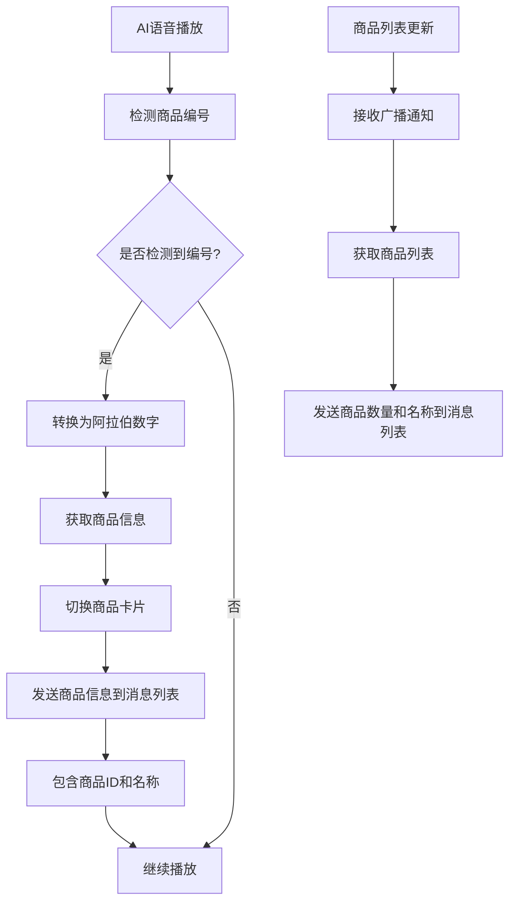

# 商品卡片切换时发送消息到LiveMessageManager功能设计

## 1. 概述

本设计文档描述了在LiveChattingService中实现当检测到商品编号并切换商品卡片时，将商品ID和名称发送到LiveMessageManager.insertMessage的功能。同时，在parseProductList处理完成后，服务收到广播通知后，在LiveMessageManager插入当前直播间商品数量及各序号的商品名称。该功能将增强直播过程中商品推荐的可视化效果，使观众能够更清楚地了解AI主播当前推荐的商品。

## 2. 功能需求

系统需要实现两个主要功能：

1. 当AI主播语音内容中包含商品编号信息时：
   - 自动提取商品编号
   - 切换到对应的商品卡片
   - 将商品ID和名称发送到LiveMessageManager，显示在直播消息列表中

2. 在parseProductList处理完成后，服务收到广播通知后：
   - 在LiveMessageManager插入当前直播间商品数量
   - 插入各序号的商品名称

## 3. 设计方案

### 3.1 现有功能分析

当前系统中已经实现了以下功能：
1. 在`LiveChattingService`中通过`checkAndSwitchProductCard`方法检测商品编号
2. 使用正则表达式提取商品编号
3. 将中文数字转换为阿拉伯数字
4. 调用`backgroundWebViewManager.switchCard(productId)`切换商品卡片

### 3.2 新增功能设计

需要在现有功能基础上增加以下步骤：
1. 在切换商品卡片前，从`ProductListManager`中获取对应商品信息
2. 调用`LiveMessageManager.insertMessage`将商品信息发送到消息列表
3. 消息内容应包含商品ID和商品名称

此外，还需要实现广播接收器来处理商品列表更新通知：
1. 注册广播接收器监听`com.danshuang.AiLive.PRODUCT_LIST_UPDATED`广播
2. 在接收到广播后，获取当前商品列表
3. 将商品数量和各商品名称发送到LiveMessageManager

### 3.3 流程图



## 4. 实现细节

### 4.1 修改checkAndSwitchProductCard方法

在现有的`checkAndSwitchProductCard`方法中增加以下功能：

```kotlin
/**
 * 检查文本是否包含商品编号信息，如果包含则提取编号并切换商品卡片
 * 同时将商品信息发送到LiveMessageManager
 */
private fun checkAndSwitchProductCard(text: String) {
    val productNumberStr = extractProductNumber(text)
    if (productNumberStr != null) {
        val productId = convertChineseToArabic(productNumberStr)
        Log.d(TAG, "检测到商品编号: $productNumberStr, 转换为: $productId")
        
        // 获取商品信息
        val productInfo = ProductListManager.getProductById(productId.toString())
        
        // 切换商品卡片
        backgroundWebViewManager.switchCard(productId)
        
        // 发送商品信息到消息列表
        if (productInfo != null) {
            LiveMessageManager.insertMessage(
                type = MessageType.SYSTEM,
                content = "查看商品: ${productId}号 ${productInfo.name}",
                userName = "AI主播"
            )
        } else {
            // 如果未找到商品信息，发送默认消息
            LiveMessageManager.insertMessage(
                type = MessageType.SYSTEM,
                content = "正在查看${productId}号商品",
                userName = "AI主播"
            )
        }
    }
}
```

### 4.2 新增广播接收器处理商品列表更新

在LiveChattingService中注册广播接收器，监听商品列表更新通知：

```kotlin
// 在LiveChattingService类中添加广播接收器
private lateinit var productListUpdateReceiver: BroadcastReceiver

// 在onCreate方法中注册广播接收器
private fun registerProductListUpdateReceiver() {
    productListUpdateReceiver = object : BroadcastReceiver() {
        override fun onReceive(context: Context, intent: Intent) {
            if (intent.action == "com.danshuang.AiLive.PRODUCT_LIST_UPDATED") {
                // 处理商品列表更新
                handleProductListUpdate()
            }
        }
    }
    
    val filter = IntentFilter("com.danshuang.AiLive.PRODUCT_LIST_UPDATED")
    ContextCompat.registerReceiver(this, productListUpdateReceiver, filter, ContextCompat.RECEIVER_NOT_EXPORTED)
}

// 处理商品列表更新
private fun handleProductListUpdate() {
    val products = ProductListManager.products
    
    // 发送商品数量消息
    LiveMessageManager.insertMessage(
        type = MessageType.SYSTEM,
        content = "当前直播间共有 ${products.size} 件商品",
        userName = "系统"
    )
    
    // 发送各商品信息
    for ((index, product) in products.withIndex()) {
        LiveMessageManager.insertMessage(
            type = MessageType.SYSTEM,
            content = "${index + 1}号商品: ${product.name}",
            userName = "系统"
        )
    }
}
```

### 4.3 注意事项

1. 需要确保`ProductListManager`中已加载商品信息
2. 如果未找到对应商品信息，应发送默认消息而不是跳过
3. 消息类型使用`MessageType.SYSTEM`，用户名设置为"AI主播"或"系统"
4. 需要在适当的时候注册和注销广播接收器

## 5. 测试方案

### 5.1 单元测试

1. 测试`checkAndSwitchProductCard`方法对包含商品编号文本的处理
2. 验证商品信息正确发送到`LiveMessageManager`
3. 验证消息内容包含商品ID和名称
4. 测试未找到商品信息时的默认消息处理
5. 测试广播接收器正确接收商品列表更新通知
6. 验证商品数量和各商品名称正确发送到`LiveMessageManager`

### 5.2 集成测试

1. 在实际直播环境中测试功能
2. 验证商品卡片正确切换
3. 验证消息正确显示在直播消息列表中
4. 验证消息内容包含商品ID和名称
5. 验证商品列表更新后，商品数量和各商品名称正确显示在直播消息列表中

## 6. 依赖组件

- `LiveChattingService`: 主服务类
- `ProductListManager`: 商品信息管理类
- `LiveMessageManager`: 消息管理类
- `BackgroundWebViewManager`: 后台WebView管理类
- `WebViewJsInterface`: WebView JavaScript接口类