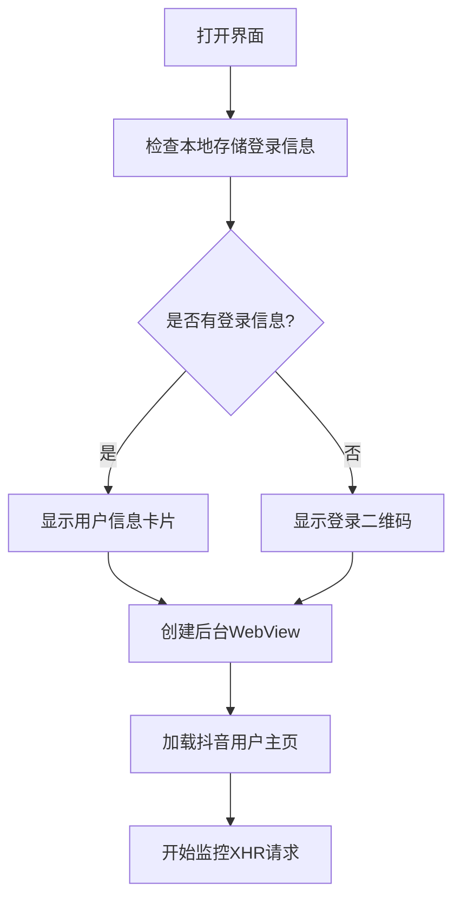
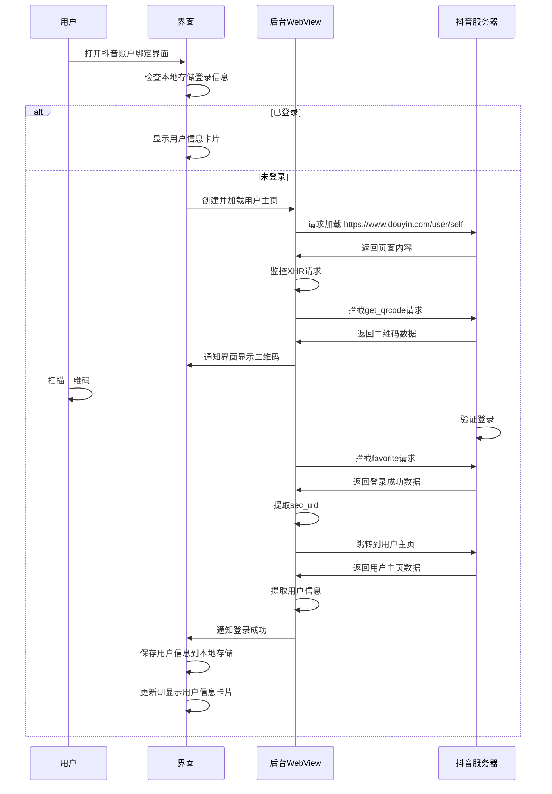

# 抖音账户绑定界面重构设计文档

## 1. 概述

本文档描述了对抖音账户绑定界面(DouyinAccountBindingScreen)的重构设计方案。新的设计将实现一个后台运行的WebView来处理抖音账户的登录流程，通过监控XHR请求来获取登录二维码和验证登录状态。

## 2. 架构设计

### 2.1 整体架构

新的抖音账户绑定界面将采用以下架构：

```
DouyinAccountBindingScreen (Composable)
├── LoginRepository (数据存储)
├── 后台WebView (用于登录流程)
│   ├── XHR监控 (获取二维码和验证登录)
│   └── 页面导航 (登录成功后跳转)
└── 状态管理 (登录状态、UI状态)
```

### 2.2 核心组件

1. **UI组件**:
   - 登录状态显示卡片(头像、昵称、退出登录按钮)
   - 登录二维码显示区域
   - 状态提示信息

2. **后台WebView**:
   - 单实例后台运行
   - 加载抖音用户主页
   - 监控XHR请求
   - 处理页面跳转

3. **数据存储**:
   - 使用LoginRepository存储用户信息
   - 本地持久化存储登录状态和用户信息

## 3. 功能实现

### 3.1 初始化流程



### 3.2 登录流程



## 4. 技术实现细节

### 4.1 WebView实现

1. **单实例管理**:
   - 使用`remember`创建单实例WebView
   - WebView在后台运行，不显示在UI界面上
   - 通过透明度控制隐藏WebView而不是移除

2. **页面加载**:
   - 初始加载URL: `https://www.douyin.com/user/self?from_tab_name=main`
   - 登录成功后跳转到: `https://www.douyin.com/user/{$sec_uid}?from_tab_name=main`

3. **XHR监控**:
   - 参考`LiveRoomPullingService`中的实现方式
   - 注入JavaScript代码拦截XMLHttpRequest
   - 监控特定URL前缀的请求:
     - 二维码请求: `https://login.douyin.com/passport/web/get_qrcode/`
     - 登录验证请求: `https://www.douyin.com/aweme/v1/aweme/favorite/`

### 4.2 数据处理

1. **二维码处理**:
   - 从`get_qrcode`响应中提取`data.qrcode`字段
   - `qrcode`为base64格式的图片数据
   - 在UI中显示二维码图片

2. **登录验证**:
   - 监控`favorite`接口响应
   - 提取`data.sec_uid`字段
   - 若`sec_uid`有值则说明登录成功

3. **用户信息提取**:
   - 登录成功后跳转到用户主页
   - 从页面中提取用户昵称、头像、UID等信息
   - 保存到本地存储

### 4.3 状态管理

使用Jetpack Compose的状态管理机制:

1. **登录状态**:
   - `isUserLoggedIn`: Boolean
   - 根据本地存储信息初始化

2. **UI状态**:
   - `showUserInfoCard`: Boolean (显示用户信息卡片)
   - `showQRCode`: Boolean (显示登录二维码)
   - `qrCodeData`: String (二维码图片数据)
   - `loadingState`: Boolean (加载状态)

3. **WebView状态**:
   - `webViewInstance`: WebView? (WebView实例)
   - `webViewLoaded`: Boolean (WebView是否加载完成)

## 5. UI设计

### 5.1 已登录状态

当用户已登录时，界面显示用户信息卡片:

- 用户头像 (圆形显示)
- 用户昵称 (大字体)
- 退出登录按钮 (危险操作样式)

### 5.2 未登录状态

当用户未登录时，界面显示:

- 登录提示文本
- 二维码显示区域
- 状态说明文本

## 6. 数据模型

### 6.1 用户信息数据类

```kotlin
data class UserAccountInfo(
    val avatar: String,     // 用户头像URL
    val nickname: String,   // 用户昵称
    val userId: String,     // 用户ID
    val secUid: String,     // 用户sec_uid
    val homeUrl: String     // 用户主页URL
)
```

### 6.2 登录状态枚举

```kotlin
enum class LoginState {
    LOGGED_IN,      // 已登录
    NOT_LOGGED_IN,  // 未登录
    LOGGING_IN      // 登录中
}
```

## 7. 存储设计

### 7.1 本地存储字段

在`LoginRepository`中扩展以下存储字段:

- `DOUYIN_ACCOUNT_AVATAR_KEY`: 用户头像
- `DOUYIN_ACCOUNT_NICKNAME_KEY`: 用户昵称
- `DOUYIN_ACCOUNT_USER_ID_KEY`: 用户ID
- `DOUYIN_ACCOUNT_SEC_UID_KEY`: 用户sec_uid
- `DOUYIN_ACCOUNT_HOME_URL_KEY`: 用户主页URL
- `DOUYIN_ACCOUNT_BIND_TIME_KEY`: 绑定时间

### 7.2 存储操作

1. **读取登录信息**:
   - 启动界面时从DataStore读取用户信息
   - 根据是否存在用户信息判断登录状态

2. **保存登录信息**:
   - 登录成功后保存用户信息到DataStore
   - 更新本地存储的绑定时间

3. **清除登录信息**:
   - 点击退出登录按钮时清除用户信息
   - 更新UI状态为未登录

## 8. 错误处理

### 8.1 网络错误

- WebView加载失败时显示错误提示
- XHR监控失败时重试机制
- 提供手动刷新选项

### 8.2 数据解析错误

- 二维码数据解析失败时显示错误提示
- 用户信息解析失败时显示错误提示
- 提供重新登录选项

### 8.3 用户操作错误

- 二维码过期时自动重新获取
- 登录超时提示用户重新扫码
- 提供操作指引和帮助信息