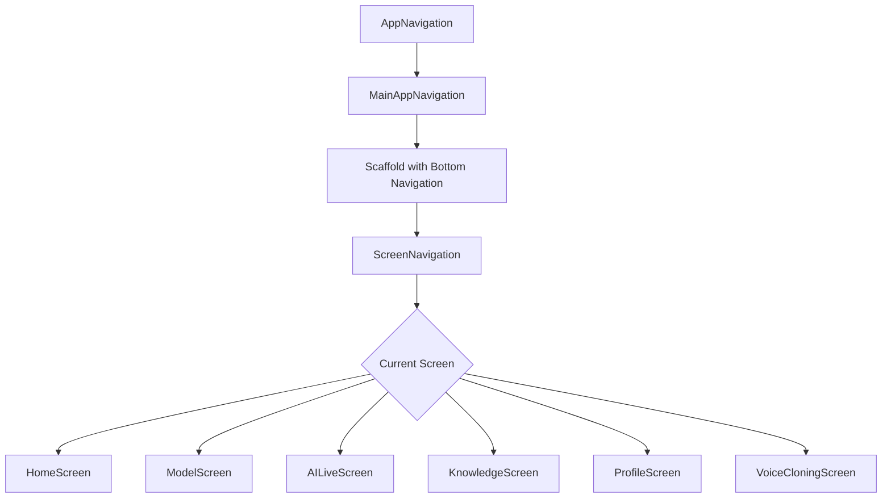
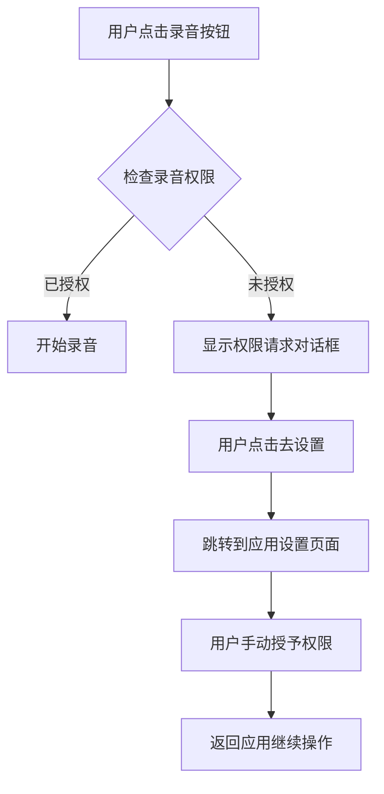

# 导航功能实现设计文档

## 修订记录

| 版本 | 日期 | 作者 | 说明 |
|------|------|------|------|
| 1.0 | 2024-01-06 | Qoder | 初始版本 |
| 1.1 | 2024-01-06 | Qoder | 更新实现细节和代码示例 |

## 1. 概述

本文档描述了在AI Live项目中实现导航功能的设计方案，特别是针对VoiceCloningScreen中需要添加打开应用设置页面的功能。该功能将允许用户在录音权限被拒绝时，能够直接跳转到应用设置页面手动授予权限。此功能已在代码中实现，通过Android Intent机制打开应用的系统设置页面。

## 2. 架构设计

### 2.1 当前导航架构

项目采用自定义导航系统，主要组件包括：

- `NavigationState`：管理当前屏幕状态和导航操作
- `Screen`：密封类，定义所有可导航的屏幕
- `AppNavigation`：主应用导航组件
- `ScreenNavigation`：根据当前屏幕状态渲染对应界面

### 2.2 导航流程



## 3. 功能实现设计

### 3.1 需求分析

在VoiceCloningScreen中，当用户拒绝录音权限时，会显示一个对话框提示用户需要授予权限。当前实现仅显示错误信息，但未提供直接跳转到应用设置页面的功能。需要实现以下功能：

1. 在权限拒绝对话框中添加"去设置"按钮
2. 点击按钮后直接跳转到应用设置页面
3. 保持现有UI和用户体验的一致性

### 3.2 技术实现方案

#### 3.2.1 Android Intent实现

使用Android Intent打开应用设置页面，关键代码如下：

```kotlin
val intent = Intent(Settings.ACTION_APPLICATION_DETAILS_SETTINGS)
val uri = Uri.fromParts("package", context.packageName, null)
intent.data = uri
context.startActivity(intent)
```

在实际实现中，我们还需要添加必要的导入语句：

```kotlin
import android.provider.Settings
import android.content.Intent
import android.net.Uri
```

#### 3.2.2 Compose集成

在VoiceCloningScreen中，通过Context获取包名并构建Intent，使用Context.startActivity()方法启动设置页面。

### 3.3 代码修改点

1. **VoiceCloningScreen.kt**：
   - 修改权限拒绝对话框中的"去设置"按钮点击处理逻辑
   - 添加打开应用设置页面的功能实现

## 4. UI/UX设计

### 4.1 对话框设计

保持现有AlertDialog的设计风格，仅修改按钮行为：

- 标题："需要录音权限"
- 内容："此功能需要录音权限来录制您的声音。请在设置中授予录音权限。"
- 确认按钮："去设置"（跳转到应用设置页面）
- 取消按钮："取消"（关闭对话框）

### 4.2 用户流程



## 5. 数据模型

无需新增数据模型，使用现有的Android Context和Intent机制。

## 6. 业务逻辑层

### 6.1 权限处理逻辑

1. 检查录音权限状态
2. 如果未授权，显示权限请求对话框
3. 用户点击"去设置"按钮时，构建并启动应用设置页面Intent
4. 用户返回应用后，重新检查权限状态

### 6.2 导航逻辑

使用Android原生Intent机制，不通过Compose导航系统，直接跳转到系统设置页面。

## 7. 测试策略

### 7.1 单元测试

1. 测试权限检查函数在不同权限状态下的返回值
2. 测试Intent构建逻辑的正确性
3. 测试Context获取和Intent启动流程
4. 验证点击"去设置"按钮后是否正确构建了Intent

### 7.2 集成测试

1. 在模拟器或真机上测试权限拒绝场景
2. 验证点击"去设置"按钮能正确跳转到应用设置页面
3. 验证从设置页面返回应用后的行为
4. 测试不同Android版本的兼容性

## 8. 安全考虑

1. 确保只访问应用自身的设置页面，不访问其他应用或系统敏感设置
2. 遵循最小权限原则，仅请求必要的录音权限
3. 正确处理权限请求结果，避免安全漏洞

## 9. 性能影响

该功能实现对应用性能影响极小，仅在用户明确请求时才构建和启动Intent，不会增加应用的内存占用或CPU使用率。

## 10. 实现步骤

1. 在VoiceCloningScreen.kt文件中添加必要的导入语句：
   ```kotlin
   import android.provider.Settings
   import android.content.Intent
   import android.net.Uri
   ```

2. 修改权限对话框中"去设置"按钮的点击处理逻辑：
   ```kotlin
   TextButton(
       onClick = {
           showPermissionDialog = false
           // 打开应用设置页面
           val intent = Intent(Settings.ACTION_APPLICATION_DETAILS_SETTINGS)
           val uri = Uri.fromParts("package", context.packageName, null)
           intent.data = uri
           context.startActivity(intent)
       }
   ) {
       Text("去设置")
   }
   ```

## 11. 注意事项

1. 确保在AndroidManifest.xml中声明了必要的权限
2. 测试不同Android版本的兼容性
3. 验证从设置页面返回应用后的行为是否符合预期