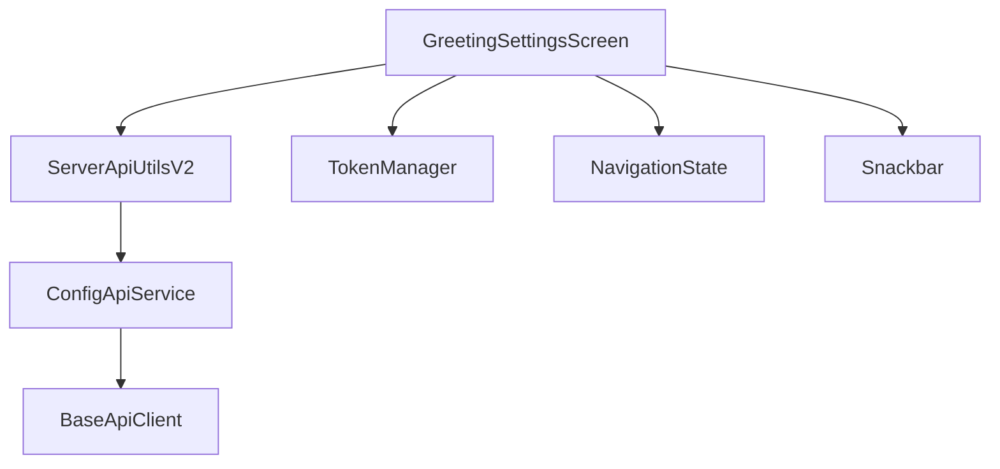
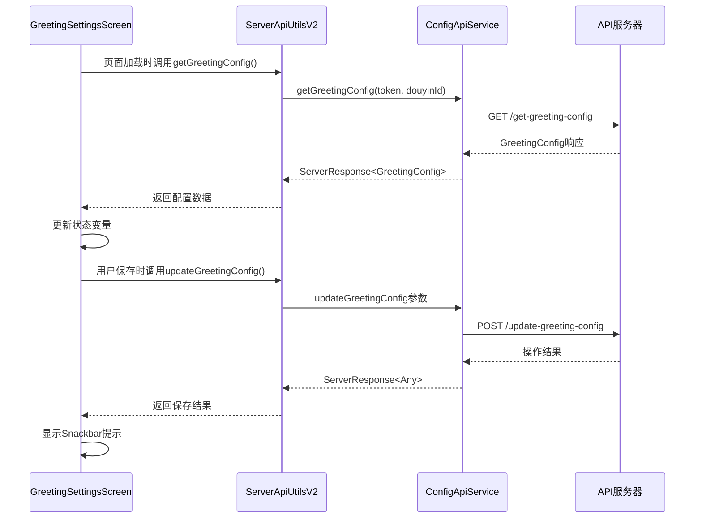
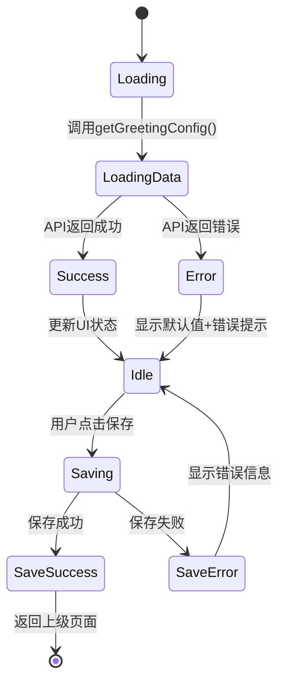
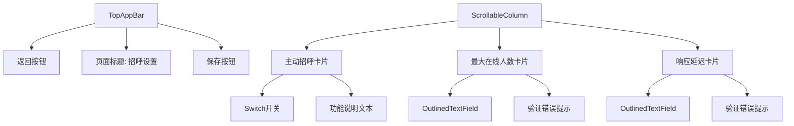
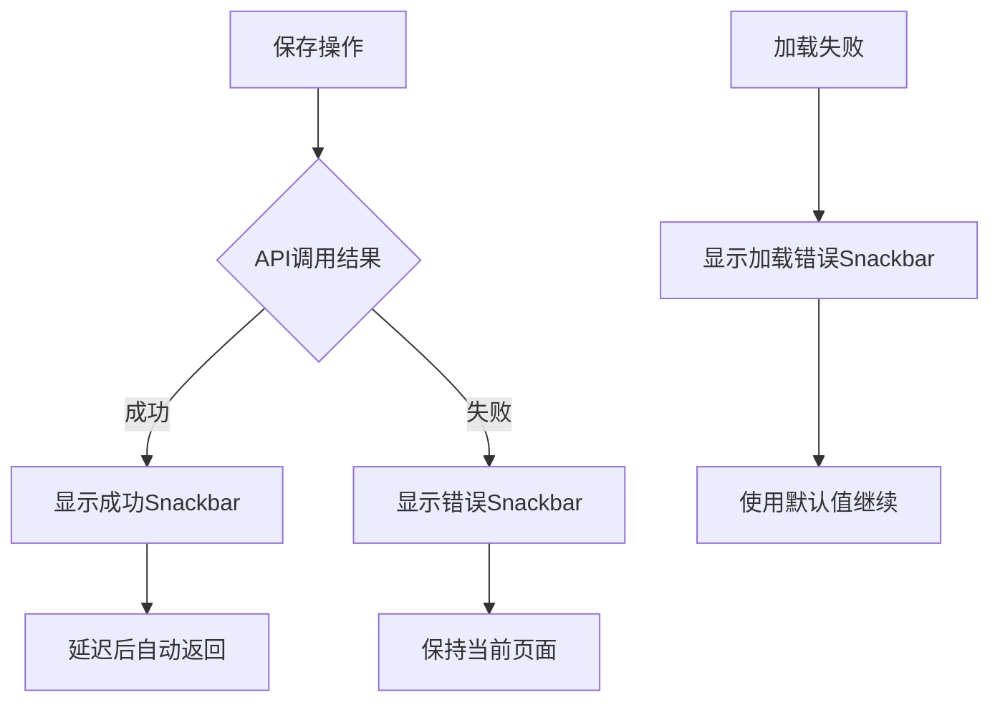
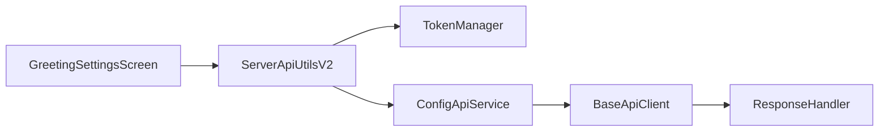

# 招呼设置管理功能设计

## 概述

招呼设置管理功能允许用户配置AI主播在直播间的自动招呼行为参数。该功能包括设置开关控制、在线人数上限配置和响应延迟调整，通过与服务器API的集成实现数据持久化管理。

## 技术架构

### 组件层次结构


### 数据流架构


## 功能设计

### 状态管理
采用Jetpack Compose的remember和mutableStateOf进行本地状态管理：

```kotlin
// 招呼设置状态
var isActiveGreeting by remember { mutableStateOf(true) }
var maxOnlineUsers by remember { mutableStateOf("20") }
var responseDelay by remember { mutableStateOf("5") }

// 加载和错误状态
var isLoading by remember { mutableStateOf(false) }
var maxOnlineUsersError by remember { mutableStateOf(false) }
var responseDelayError by remember { mutableStateOf(false) }
```

### 数据加载流程


### API集成设计

#### 数据模型
```kotlin
data class GreetingConfig(
    val greetStatus: Int,    // 招呼开关状态 (0=关闭, 1=开启)
    val maxOnline: Int,      // 最大在线人数
    val delaySeconds: Int    // 响应延迟秒数
)
```

#### API接口映射
| 功能 | API方法 | 端点 | 参数 |
|------|---------|------|------|
| 加载配置 | getGreetingConfig | /get-greeting-config | douyin_id |
| 保存配置 | updateGreetingConfig | /update-greeting-config | douyin_id, greet_status, max_online, delay_seconds |

### UI交互设计

#### 页面结构


#### 输入验证规则
| 字段 | 验证规则 | 错误提示 |
|------|----------|----------|
| 最大在线人数 | 0-100之间的整数 | "请输入0-100之间的数字" |
| 响应延迟 | 0-20之间的整数 | "请输入0-20之间的数字" |

### 状态反馈机制

#### Snackbar提示设计


#### 状态提示文案
- 加载成功：静默加载，无提示
- 加载失败：`"加载招呼设置失败: {错误信息}"`
- 保存成功：`"招呼设置保存成功"`
- 保存失败：`"保存失败: {错误信息}"`

## 实现要点

### 页面生命周期管理
```kotlin
LaunchedEffect(Unit) {
    // 页面初始化时加载数据
    isLoading = true
    scope.launch {
        try {
            val result = serverApiUtils.getGreetingConfig(douyinId)
            if (result.isSuccess && result.data != null) {
                val config = result.data
                isActiveGreeting = config.greetStatus == 1
                maxOnlineUsers = config.maxOnline.toString()
                responseDelay = config.delaySeconds.toString()
            } else {
                // 加载失败时显示错误提示
                snackbarHostState.showSnackbar("加载招呼设置失败: ${result.msg}")
            }
        } catch (e: Exception) {
            snackbarHostState.showSnackbar("加载招呼设置失败: ${e.message}")
        } finally {
            isLoading = false
        }
    }
}
```

### 保存操作处理
```kotlin
private suspend fun saveSettings(
    serverApiUtils: ServerApiUtilsV2,
    douyinId: String,
    isActiveGreeting: Boolean,
    maxOnlineUsers: String,
    responseDelay: String,
    snackbarHostState: SnackbarHostState,
    navController: NavigationState
) {
    try {
        val result = serverApiUtils.updateGreetingConfig(
            douyinId = douyinId,
            greetStatus = if (isActiveGreeting) 1 else 0,
            maxOnline = maxOnlineUsers.toInt(),
            delaySeconds = responseDelay.toInt()
        )
        
        if (result.isSuccess) {
            snackbarHostState.showSnackbar("招呼设置保存成功")
            delay(1500) // 让用户看到成功提示
            navController.navigateUp()
        } else {
            snackbarHostState.showSnackbar("保存失败: ${result.msg}")
        }
    } catch (e: Exception) {
        snackbarHostState.showSnackbar("保存失败: ${e.message}")
    }
}
```

### 加载状态处理
- 显示加载遮罩：使用`CircularProgressIndicator`覆盖整个页面内容
- 禁用交互：加载期间禁用所有输入控件和保存按钮
- 超时处理：设置合理的超时时间，避免长时间卡死

### 错误恢复机制
- 网络错误：显示重试选项或使用缓存的默认值
- 数据格式错误：回退到安全的默认配置
- 服务器错误：记录错误日志，向用户展示友好的错误信息

## 依赖关系

### 核心依赖
- `ServerApiUtilsV2`: API调用统一入口
- `ConfigApiService`: 配置管理专用API服务
- `TokenManager`: 用户身份认证管理
- `NavigationState`: 页面导航控制
- `SnackbarHostState`: 消息提示管理

### 数据流依赖


## 测试策略

### 单元测试覆盖
- 输入验证逻辑测试
- API响应处理测试  
- 状态变更逻辑测试
- 错误处理分支测试

### 集成测试场景
- 完整的加载-编辑-保存流程
- 网络异常情况处理
- 不同用户权限下的行为验证
- 并发操作的安全性测试