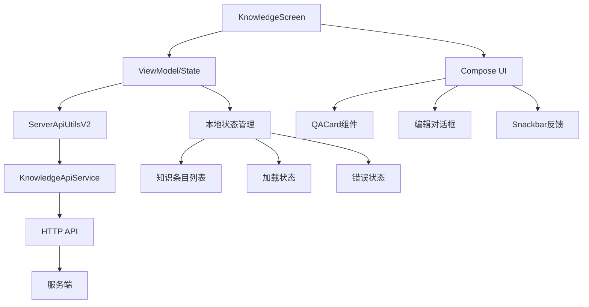
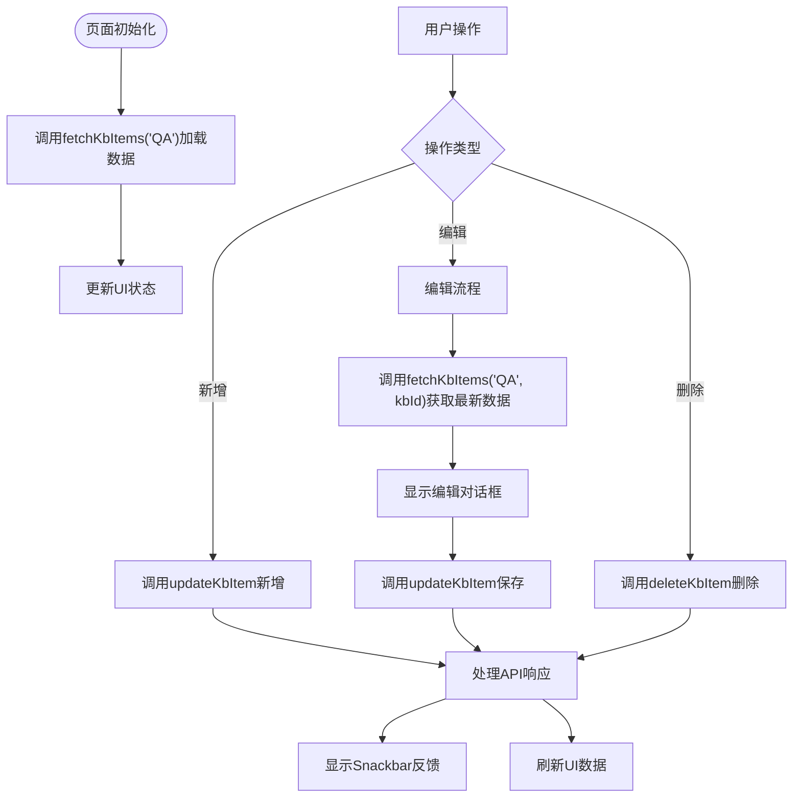
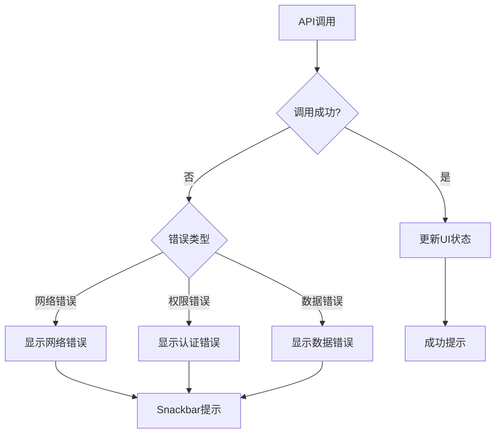
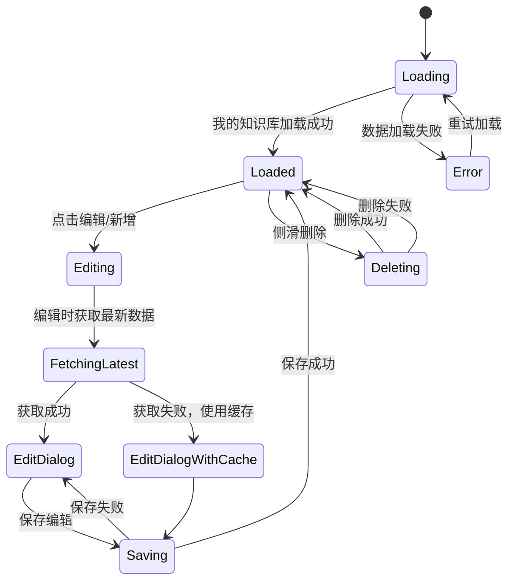
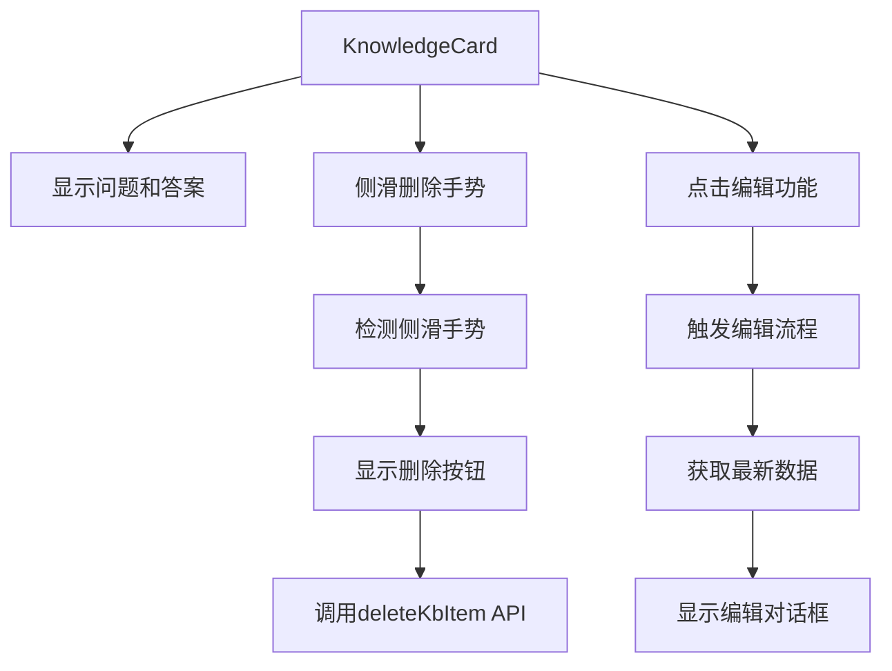
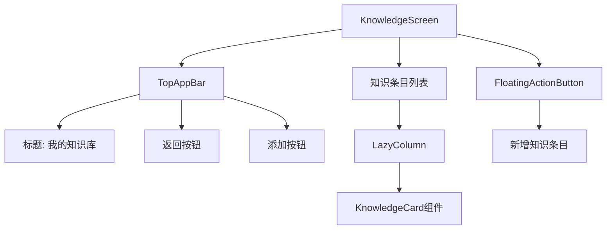
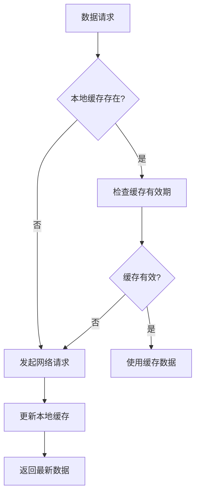

# 知识条目管理功能设计

## 概述

本设计文档描述了将KnowledgeScreen页面与服务端API完全集成的知识条目管理功能。该功能实现了知识库条目的查看、新增、编辑和删除操作，所有数据操作都通过服务端API进行，确保数据的持久化和一致性。

## 架构设计

### 整体架构



### 数据流架构



## 数据模型设计

### KnowledgeItem数据模型

```kotlin
data class KnowledgeItem(
    val id: String,
    val typeId: String,
    val question: String,
    val answer: String,
    val createTime: Long,
    val updateTime: Long
)
```

### UI状态模型

```kotlin
data class KnowledgeScreenState(
    val items: List<KnowledgeItem> = emptyList(),
    val isLoading: Boolean = false,
    val showEditDialog: Boolean = false,
    val editingItem: KnowledgeItem? = null,
    val errorMessage: String? = null,
    val snackbarMessage: String? = null,
    val editQuestion: String = "",
    val editAnswer: String = ""
)
```

## API集成设计

### 接口调用规范

| 操作 | API方法 | 参数 | 说明 |
|------|---------|------|------|
| 加载数据 | `fetchKbItems("QA")` | typeId="QA" | 页面初始化加载我的知识库 |
| 获取单条 | `fetchKbItems("QA", kbId)` | typeId="QA", kbId | 编辑前获取最新数据 |
| 新增/更新 | `updateKbItem()` | 完整条目信息 | 新增和编辑都使用此接口 |
| 删除 | `deleteKbItem()` | douyinId, itemId | 删除指定条目 |

### 错误处理策略



## UI交互设计

### 页面状态管理



### 用户反馈机制

| 操作 | 成功反馈 | 失败反馈 | 加载状态 |
|------|----------|----------|----------|
| 加载知识库 | 显示条目列表 | "加载我的知识库失败，请重试" | Loading遮罩 |
| 新增条目 | "添加成功" | "添加失败：错误信息" | 按钮禁用 |
| 编辑条目 | "更新成功" | "更新失败：错误信息" | 保存按钮禁用 |
| 删除条目 | "删除成功" | "删除失败：错误信息" | 删除按钮禁用 |

## 核心功能实现

### 1. 页面初始化加载

```kotlin
// 页面进入时加载知识库条目
LaunchedEffect(Unit) {
    scope.launch {
        isLoading = true
        try {
            val response = serverApiUtils.fetchKbItems("QA")
            if (response.isSuccess && response.data != null) {
                qaList = response.data
            } else {
                snackbarMessage = "加载我的知识库失败：${response.msg}"
            }
        } catch (e: Exception) {
            snackbarMessage = "加载我的知识库失败：${e.message}"
        } finally {
            isLoading = false
        }
    }
}
```

### 2. 新增条目功能

```kotlin
// 新增条目时调用API
suspend fun addNewItem(question: String, answer: String) {
    scope.launch {
        try {
            val response = serverApiUtils.updateKbItem(
                douyinId = currentUser.douyinId,
                typeId = "QA",
                id = "", // 新增时id为空
                question = question,
                answer = answer
            )
            if (response.isSuccess) {
                snackbarMessage = "添加成功"
                refreshData() // 重新加载数据
            } else {
                snackbarMessage = "添加失败：${response.msg}"
            }
        } catch (e: Exception) {
            snackbarMessage = "添加失败：${e.message}"
        }
    }
}
```

### 3. 编辑条目功能

```kotlin
// 编辑前获取最新数据
suspend fun editItem(item: KnowledgeItem) {
    scope.launch {
        try {
            // 先获取最新数据
            val response = serverApiUtils.fetchKbItems("QA", item.id)
            if (response.isSuccess && response.data?.isNotEmpty() == true) {
                val latestItem = response.data.first()
                editingItem = latestItem
                editQuestion = latestItem.question
                editAnswer = latestItem.answer
            } else {
                // 获取失败时使用缓存数据
                editingItem = item
                editQuestion = item.question
                editAnswer = item.answer
                snackbarMessage = "获取最新数据失败，使用缓存数据"
            }
            showEditDialog = true
        } catch (e: Exception) {
            editingItem = item
            editQuestion = item.question
            editAnswer = item.answer
            showEditDialog = true
            snackbarMessage = "获取最新数据失败：${e.message}"
        }
    }
}

// 保存编辑
suspend fun saveEdit() {
    scope.launch {
        try {
            val response = serverApiUtils.updateKbItem(
                douyinId = currentUser.douyinId,
                typeId = "QA",
                id = editingItem!!.id,
                question = editQuestion,
                answer = editAnswer
            )
            if (response.isSuccess) {
                snackbarMessage = "更新成功"
                showEditDialog = false
                refreshData()
            } else {
                snackbarMessage = "更新失败：${response.msg}"
            }
        } catch (e: Exception) {
            snackbarMessage = "更新失败：${e.message}"
        }
    }
}
```

### 4. 删除条目功能

```kotlin
// 删除条目
suspend fun deleteItem(item: KnowledgeItem) {
    scope.launch {
        try {
            val response = serverApiUtils.deleteKbItem(
                douyinId = currentUser.douyinId,
                id = item.id
            )
            if (response.isSuccess) {
                snackbarMessage = "删除成功"
                qaList = qaList.filterNot { it.id == item.id }
            } else {
                snackbarMessage = "删除失败：${response.msg}"
            }
        } catch (e: Exception) {
            snackbarMessage = "删除失败：${e.message}"
        }
    }
}
```

## 状态管理规范

### Loading状态管理

```kotlin
// 统一的Loading状态管理
var isLoading by remember { mutableStateOf(false) }

// 在需要Loading的操作中
scope.launch {
    isLoading = true
    try {
        // API操作
    } finally {
        isLoading = false
    }
}

// UI中显示Loading
if (isLoading) {
    Box(
        modifier = Modifier.fillMaxSize(),
        contentAlignment = Alignment.Center
    ) {
        CircularProgressIndicator()
    }
}
```

### Snackbar反馈管理

```kotlin
// Snackbar状态管理
var snackbarMessage by remember { mutableStateOf<String?>(null) }

// 显示Snackbar
snackbarMessage?.let { message ->
    LaunchedEffect(message) {
        snackbarHostState.showSnackbar(
            message = message,
            duration = SnackbarDuration.Short
        )
        snackbarMessage = null
    }
}
```

## 组件设计

### KnowledgeCard组件设计



### 页面布局设计



### 编辑对话框设计

```kotlin
@Composable
fun EditKnowledgeDialog(
    item: KnowledgeItem?,
    question: String,
    answer: String,
    onQuestionChange: (String) -> Unit,
    onAnswerChange: (String) -> Unit,
    onSave: () -> Unit,
    onDismiss: () -> Unit,
    isSaving: Boolean = false
) {
    AlertDialog(
        onDismissRequest = onDismiss,
        title = { Text(if (item != null) "编辑知识条目" else "新增知识条目") },
        text = {
            Column(
                verticalArrangement = Arrangement.spacedBy(16.dp)
            ) {
                OutlinedTextField(
                    value = question,
                    onValueChange = onQuestionChange,
                    label = { Text("问题") },
                    modifier = Modifier.fillMaxWidth()
                )
                OutlinedTextField(
                    value = answer,
                    onValueChange = onAnswerChange,
                    label = { Text("答案") },
                    modifier = Modifier.fillMaxWidth(),
                    maxLines = 5
                )
            }
        },
        confirmButton = {
            Button(
                onClick = onSave,
                enabled = !isSaving && question.isNotBlank() && answer.isNotBlank()
            ) {
                if (isSaving) {
                    CircularProgressIndicator(
                        modifier = Modifier.size(16.dp)
                    )
                } else {
                    Text("保存")
                }
            }
        },
        dismissButton = {
            TextButton(
                onClick = onDismiss,
                enabled = !isSaving
            ) {
                Text("取消")
            }
        }
    )
}
```

## 性能优化

### 1. 数据缓存策略



### 2. UI性能优化

- 使用`LazyColumn`进行列表虚拟化
- 通过`key`参数优化列表重组
- 合理使用`remember`避免不必要的重新计算
- 使用`derivedStateOf`优化计算状态

### 3. 网络请求优化

- 合并批量操作减少请求次数
- 实现请求去重避免重复调用
- 使用协程管理并发请求
- 实现重试机制提高成功率

## 测试策略

### 单元测试

```kotlin
@Test
fun `测试知识条目加载功能`() = runTest {
    // Given
    val mockApiUtils = mockk<ServerApiUtilsV2>()
    val expectedItems = listOf(
        KnowledgeItem("1", "QA", "问题1", "答案1", 0L, 0L)
    )
    coEvery { mockApiUtils.fetchKbItems("QA") } returns 
        ServerResponse(1, "成功", expectedItems)
    
    // When
    val result = mockApiUtils.fetchKbItems("QA")
    
    // Then
    assertEquals(true, result.isSuccess)
    assertEquals(expectedItems, result.data)
}
```

### UI测试

```kotlin
@Test
fun `测试编辑对话框显示和隐藏`() {
    composeTestRule.setContent {
        KnowledgeScreen()
    }
    
    // 点击编辑按钮
    composeTestRule.onNodeWithText("编辑").performClick()
    
    // 验证对话框显示
    composeTestRule.onNodeWithText("编辑知识条目").assertIsDisplayed()
    
    // 点击取消按钮
    composeTestRule.onNodeWithText("取消").performClick()
    
    // 验证对话框隐藏
    composeTestRule.onNodeWithText("编辑知识条目").assertDoesNotExist()
}
```