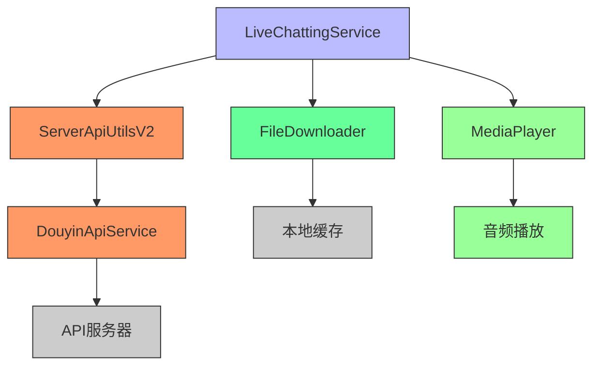
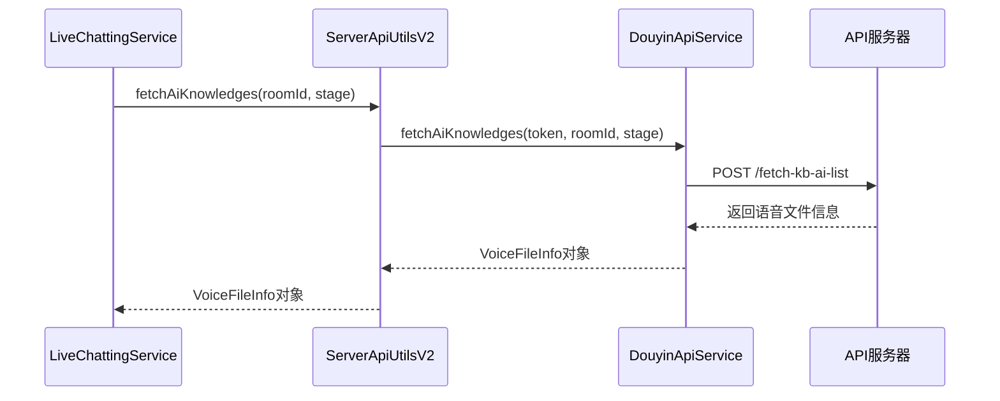
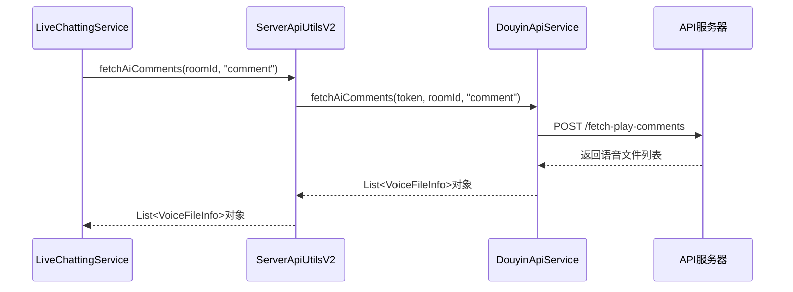
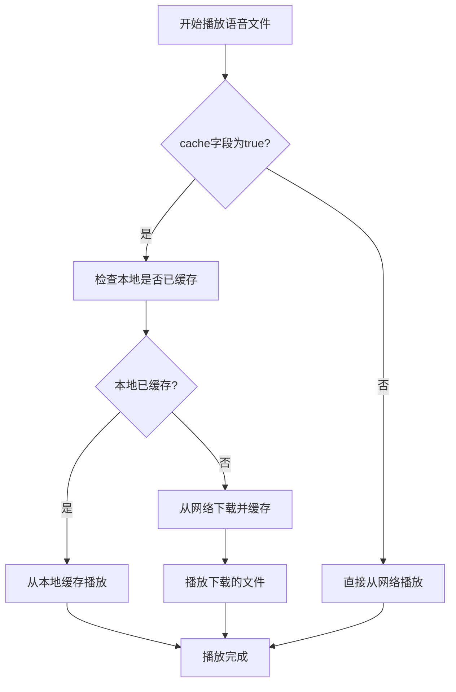
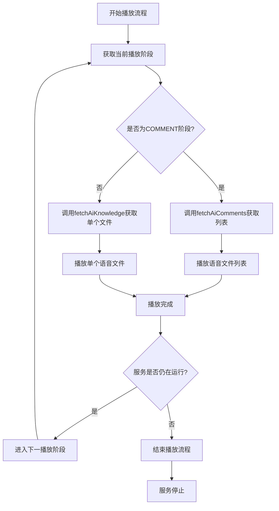

# LiveChattingService业务实现设计文档

## 1. 概述

本设计文档旨在描述如何完成LiveChattingService的业务实现，主要包括两个核心功能：
1. `fetchAiKnowledge` - 获取AI知识库信息
2. `fetchAiComments` - 获取AI评论列表

同时，根据VoiceFileInfo中的`cache`字段实现音频文件的缓存机制。

## 2. 系统架构

### 2.1 整体架构图


### 2.2 核心组件说明

1. **LiveChattingService**: Android后台服务，负责管理直播语音播放流程
2. **ServerApiUtilsV2**: API门面类，提供统一的接口访问
3. **DouyinApiService**: 抖音相关API服务实现
4. **FileDownloader**: 文件下载和缓存管理组件
5. **MediaPlayer**: Android音频播放器

## 3. 数据模型设计

### 3.1 VoiceFileInfo (语音文件信息)
```kotlin
data class VoiceFileInfo(
    val id: String,
    val text: String,
    val url: String,
    val cache: Boolean = false
)
```

字段说明：
- `id`: 语音文件唯一标识符
- `text`: 语音文件对应的文本内容
- `url`: 语音文件的URL地址
- `cache`: 是否需要缓存该文件

## 4. 核心功能实现设计

### 4.1 fetchAiKnowledge 实现

#### 4.1.1 功能描述
获取播放音频内容，用于除COMMENT阶段外的所有播放阶段。

#### 4.1.2 调用流程


#### 4.1.2 数据结构
API返回格式：
```json
{
  "id": "1000",
  "text": "语音文件对应的文本内容",
  "url": "https://host/to/audio.mp3",
  "cache": true
}
```

### 4.2 fetchAiComments 实现

#### 4.2.1 功能描述
获取AI评论音频内容列表，专门用于COMMENT播放阶段。

#### 4.2.2 调用流程


#### 4.2.3 数据结构
API返回格式：
```json
[
  {
    "id": "1000",
    "text": "语音文件对应的文本内容",
    "url": "https://host/to/audio.mp3",
    "cache": false
  },
  {
    "id": "1001",
    "text": "另一条语音文件对应的文本内容",
    "url": "https://host/to/audio2.mp3",
    "cache": true
  }
]
```

## 5. 缓存机制设计

### 5.1 缓存策略
根据VoiceFileInfo中的`cache`字段决定是否缓存音频文件：
- `cache = true`: 需要缓存到本地，下次播放时优先从本地读取
- `cache = false`: 不需要缓存，每次播放都从网络获取

### 5.2 缓存流程


### 5.3 FileDownloader组件设计
```kotlin
class FileDownloader(private val context: Context) {
    /**
     * 下载并缓存文件
     */
    fun downloadAndCacheFile(voiceFile: VoiceFileInfo): String? {
        return try {
            // 如果文件标记为已缓存且本地存在，则直接返回路径
            if (voiceFile.cache && isFileCached(voiceFile.id)) {
                return getCacheFilePath(voiceFile.id)
            }
            
            // 下载文件
            val url = URL(voiceFile.url)
            val connection = url.openConnection()
            connection.connect()
            
            val input = connection.getInputStream()
            val cacheFile = File(getCacheDir(), voiceFile.id)
            val output = FileOutputStream(cacheFile)
            
            input.copyTo(output)
            input.close()
            output.close()
            
            cacheFile.absolutePath
        } catch (e: Exception) {
            null
        }
    }
}
```

## 6. 播放流程设计

### 6.1 播放阶段循环
```
WELCOME -> ROOM -> PRODUCT -> KEEP -> ORDER -> THANKS -> COMMENT -> WELCOME (循环)
```

### 6.2 播放流程图


## 7. 依赖注入设计

### 7.1 依赖关系
LiveChattingService需要依赖以下组件：
- ServerApiUtilsV2: 用于调用API获取语音文件信息
- FileDownloader: 用于下载和缓存音频文件
- TokenManager: 用于获取用户认证token
- LoginRepository: 用于获取用户登录信息

### 7.2 注入方式
通过Application类或Service初始化时创建依赖实例：

```kotlin
class LiveChattingService : Service() {
    private lateinit var serverApiUtils: ServerApiUtilsV2
    private lateinit var fileDownloader: FileDownloader
    
    override fun onCreate() {
        super.onCreate()
        // 初始化依赖组件
        val tokenManager = TokenManager(LoginRepository(this))
        serverApiUtils = ServerApiUtilsV2.createFromContext(
            this, tokenManager, LoginRepository(this)
        )
        fileDownloader = FileDownloader(this)
    }
}
```

## 8. 错误处理设计

### 8.1 网络异常处理
- 网络不可用时暂停播放流程
- API调用失败时记录日志并跳过当前播放阶段
- 文件下载失败时尝试重新下载或跳过

### 8.2 文件播放异常处理
- 音频文件损坏时跳过播放
- 播放器初始化失败时记录日志
- 播放过程中断时尝试重新播放

## 9. 性能优化建议

1. **缓存优化**: 对于标记为需要缓存的文件，优先从本地读取
2. **并发处理**: 使用协程并发处理多个音频文件的下载
3. **内存管理**: 及时释放MediaPlayer资源
4. **网络优化**: 对于不需要缓存的文件，使用流式播放减少内存占用

## 10. 测试策略

### 10.1 单元测试
- 测试fetchAiKnowledge和fetchAiComments方法的正确性
- 测试缓存机制的正确性
- 测试播放流程的各个阶段

### 10.2 集成测试
- 测试与API服务器的集成
- 测试文件下载和缓存功能
- 测试音频播放功能

### 10.3 UI测试
- 测试服务启动和停止功能
- 测试播放状态的UI更新