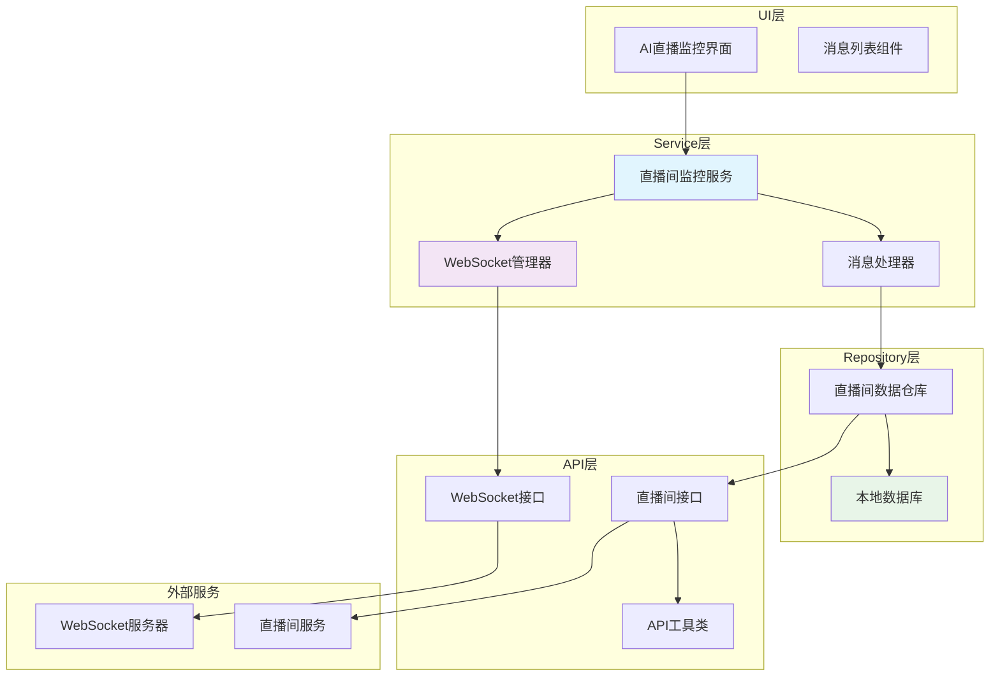
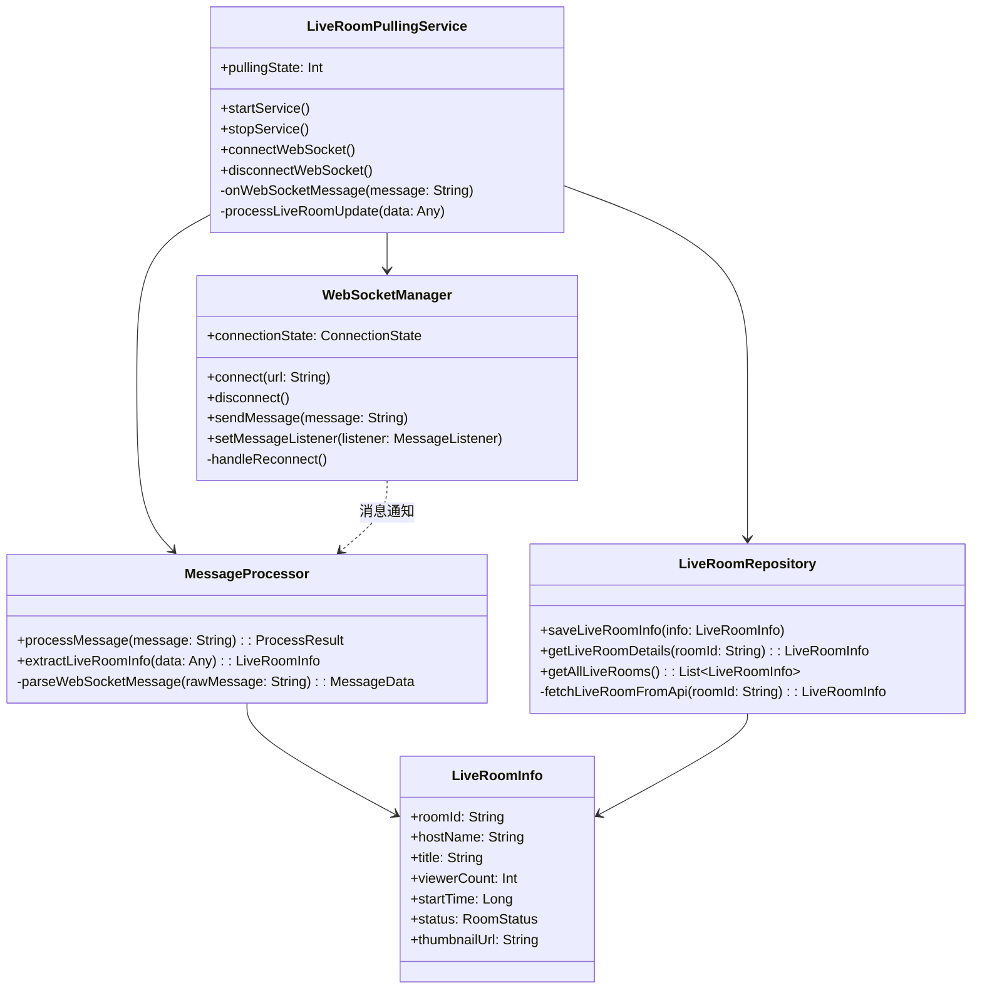
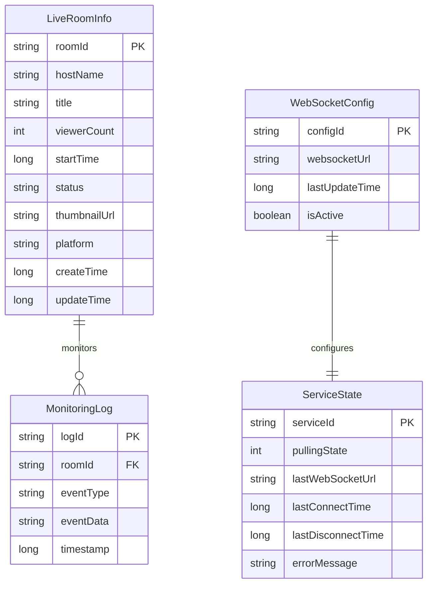
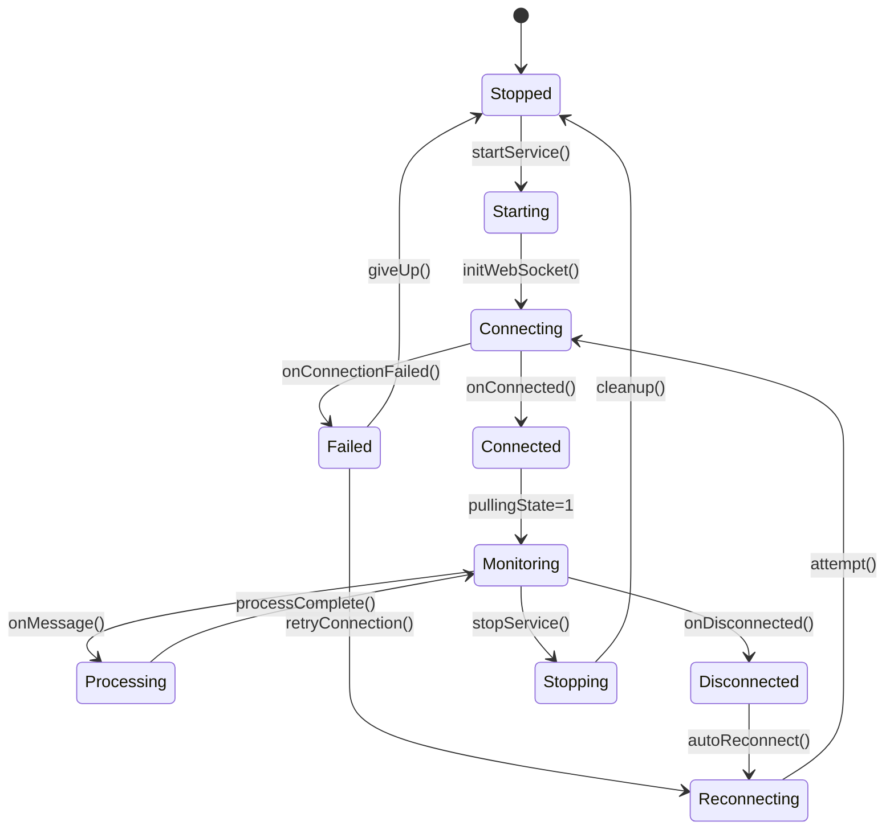
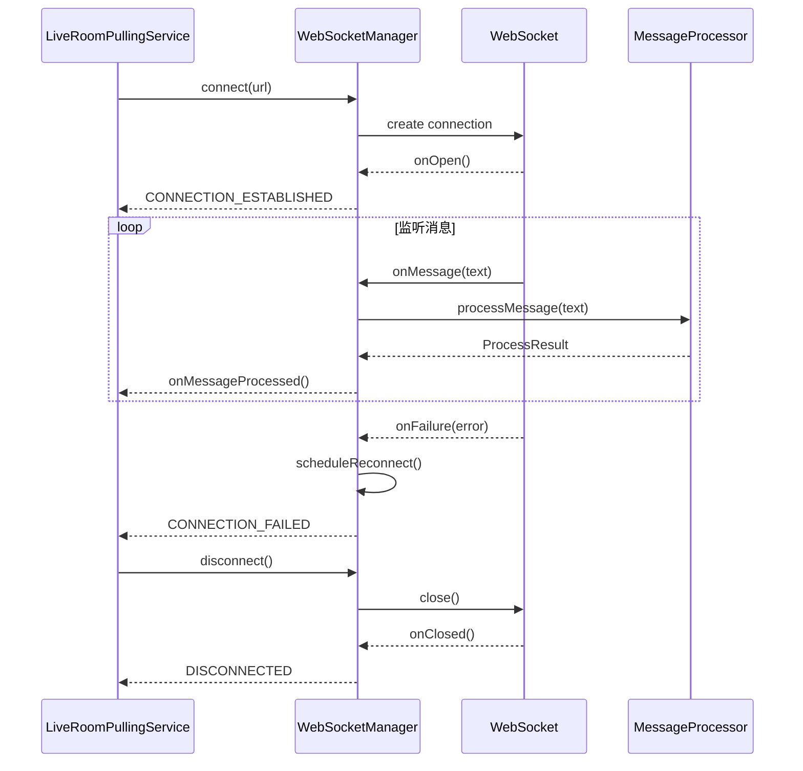
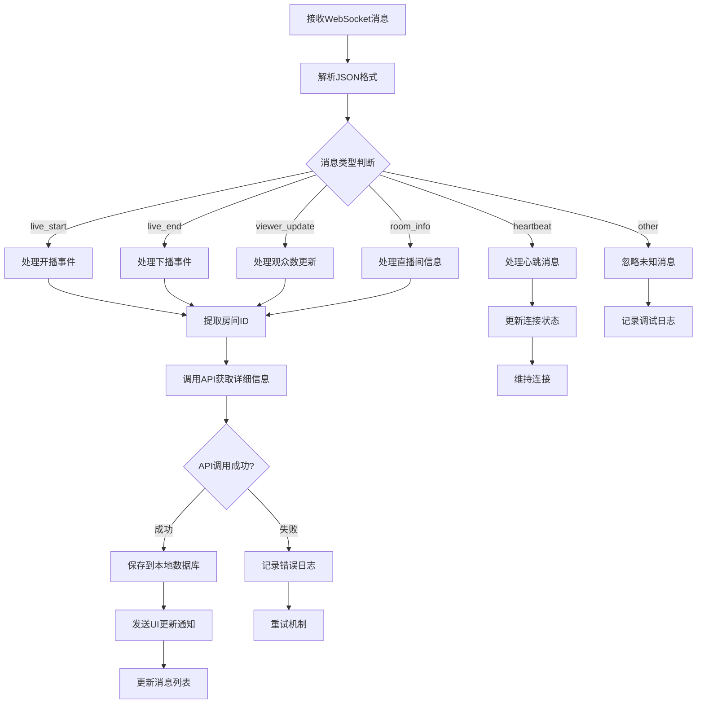
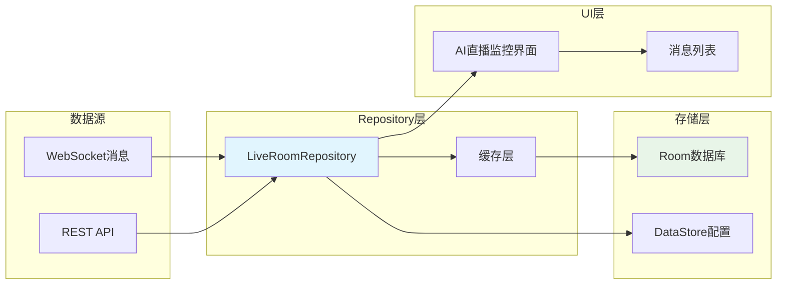
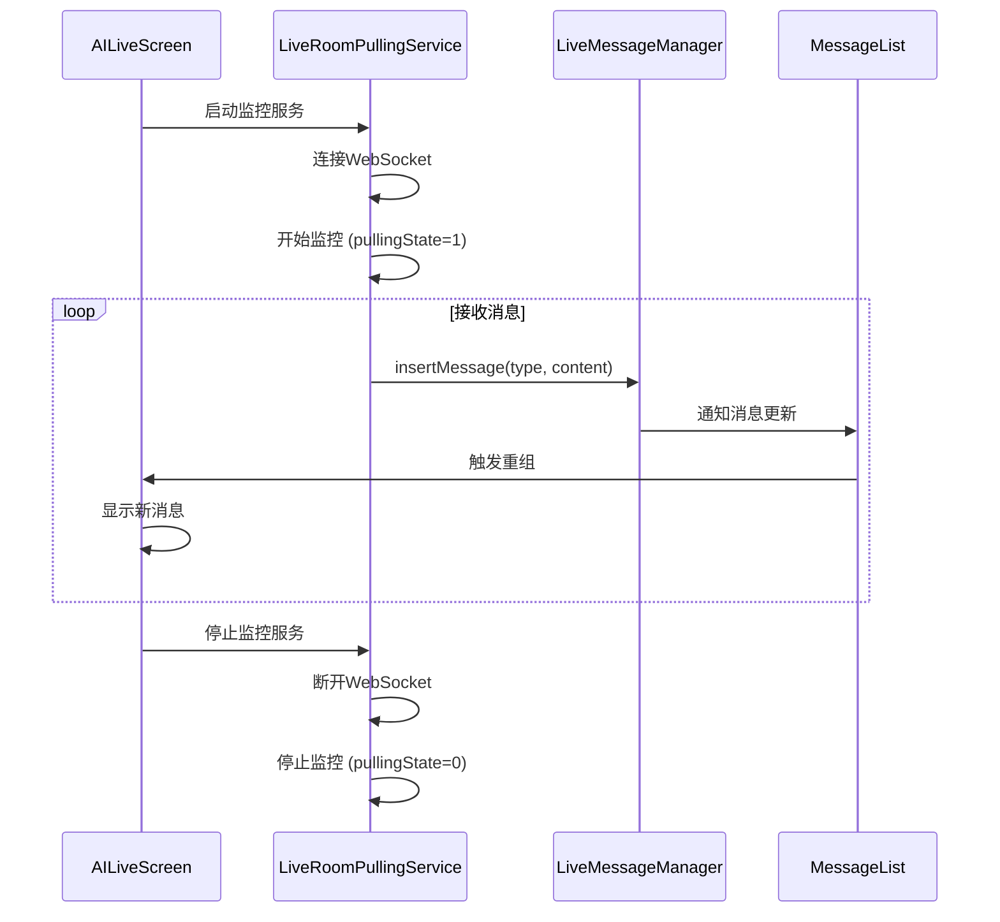
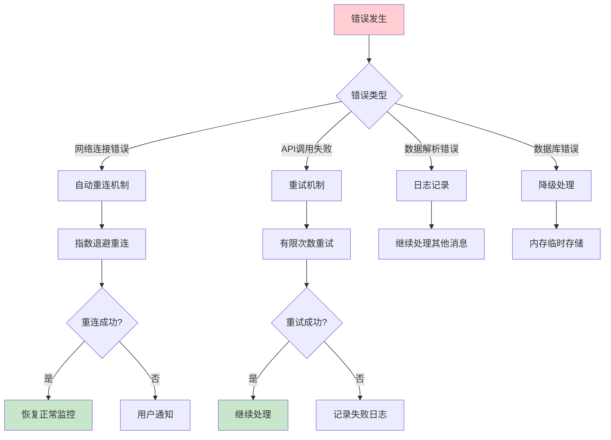

# 直播间监控服务设计文档

## 概述

本文档描述了在AI直播应用中实现直播间监控服务的详细设计方案。该服务通过WebSocket连接实现对直播间状态的实时监控，并将监控到的直播间信息存储到本地数据库，同时在AI直播监控界面中实时展示动态信息。

### 核心功能
- 后台运行的直播间监控服务
- WebSocket连接管理和自动重连
- 直播间信息获取和存储
- 实时消息展示和管理
- 监控状态管理和通知

## 架构设计

### 系统架构图



### 核心组件关系



## 数据模型设计

### 核心数据模型



### 数据类定义

```kotlin
// 直播间信息数据类
data class LiveRoomInfo(
    val roomId: String,
    val hostName: String,
    val title: String,
    val viewerCount: Int,
    val startTime: Long,
    val status: RoomStatus,
    val thumbnailUrl: String,
    val platform: String = "douyin",
    val createTime: Long = System.currentTimeMillis(),
    val updateTime: Long = System.currentTimeMillis()
)

// 直播间状态枚举
enum class RoomStatus {
    LIVE,       // 直播中
    OFFLINE,    // 已下播
    PREPARING   // 准备中
}

// WebSocket配置数据类
data class WebSocketConfig(
    val configId: String = "default",
    val websocketUrl: String,
    val lastUpdateTime: Long = System.currentTimeMillis(),
    val isActive: Boolean = true
)

// 服务状态数据类
data class ServiceState(
    val serviceId: String = "live_room_pulling",
    val pullingState: Int,
    val lastWebSocketUrl: String?,
    val lastConnectTime: Long?,
    val lastDisconnectTime: Long?,
    val errorMessage: String?
)

// WebSocket消息数据类
data class WebSocketMessage(
    val type: String,
    val data: Any?,
    val timestamp: Long = System.currentTimeMillis()
)
```

## 核心功能模块

### 1. 直播间监控服务 (LiveRoomPullingService)



#### 核心实现逻辑

```kotlin
class LiveRoomPullingService : Service() {
    
    companion object {
        const val PULLING_STATE_STOPPED = 0
        const val PULLING_STATE_MONITORING = 1
        
        private const val NOTIFICATION_ID = 1001
        private const val CHANNEL_ID = "live_room_monitoring"
        
        val pullingStateFlow = MutableStateFlow(PULLING_STATE_STOPPED)
    }
    
    private var pullingState = PULLING_STATE_STOPPED
        set(value) {
            field = value
            pullingStateFlow.value = value
        }
    
    private lateinit var webSocketManager: WebSocketManager
    private lateinit var messageProcessor: MessageProcessor
    private lateinit var liveRoomRepository: LiveRoomRepository
    
    override fun onCreate() {
        super.onCreate()
        initializeComponents()
        createNotificationChannel()
    }
    
    override fun onStartCommand(intent: Intent?, flags: Int, startId: Int): Int {
        startForegroundService()
        initializeWebSocketConnection()
        return START_STICKY // 服务被杀死后自动重启
    }
    
    private fun initializeWebSocketConnection() {
        CoroutineScope(Dispatchers.IO).launch {
            try {
                val config = liveRoomRepository.fetchWebSocketConfig()
                connectWebSocket(config.websocketUrl)
            } catch (e: Exception) {
                handleConnectionError(e)
            }
        }
    }
    
    private fun connectWebSocket(url: String) {
        webSocketManager.connect(url) { connectionState ->
            when (connectionState) {
                ConnectionState.CONNECTED -> {
                    pullingState = PULLING_STATE_MONITORING
                    notifyStateChange()
                }
                ConnectionState.DISCONNECTED -> {
                    pullingState = PULLING_STATE_STOPPED
                    notifyStateChange()
                }
                ConnectionState.ERROR -> {
                    handleReconnection()
                }
            }
        }
    }
    
    private fun startForegroundService() {
        val notification = createNotification()
        startForeground(NOTIFICATION_ID, notification)
    }
    
    private fun createNotification(): Notification {
        return NotificationCompat.Builder(this, CHANNEL_ID)
            .setContentTitle("直播间监控服务")
            .setContentText("正在监控直播间动态...")
            .setSmallIcon(R.drawable.ic_live_monitoring)
            .setPriority(NotificationCompat.PRIORITY_LOW)
            .build()
    }
}
```

### 2. WebSocket管理器 (WebSocketManager)



#### WebSocket连接管理

```kotlin
class WebSocketManager {
    
    private var webSocket: WebSocket? = null
    private var currentUrl: String? = null
    private var reconnectAttempts = 0
    private val maxReconnectAttempts = 5
    private val reconnectDelay = 5000L // 5秒
    private var messageListener: ((String) -> Unit)? = null
    
    fun connect(url: String, stateCallback: (ConnectionState) -> Unit) {
        currentUrl = url
        
        val request = Request.Builder()
            .url(url)
            .addHeader("User-Agent", "AiLive/1.0")
            .build()
        
        val client = OkHttpClient.Builder()
            .connectTimeout(30, TimeUnit.SECONDS)
            .readTimeout(0, TimeUnit.SECONDS) // 无限读取超时，保持长连接
            .build()
        
        webSocket = client.newWebSocket(request, object : WebSocketListener() {
            override fun onOpen(webSocket: WebSocket, response: Response) {
                reconnectAttempts = 0
                stateCallback(ConnectionState.CONNECTED)
            }
            
            override fun onMessage(webSocket: WebSocket, text: String) {
                messageListener?.invoke(text)
            }
            
            override fun onFailure(webSocket: WebSocket, t: Throwable, response: Response?) {
                handleConnectionFailure(t, stateCallback)
            }
            
            override fun onClosed(webSocket: WebSocket, code: Int, reason: String) {
                stateCallback(ConnectionState.DISCONNECTED)
            }
        })
    }
    
    fun setMessageListener(listener: (String) -> Unit) {
        messageListener = listener
    }
    
    fun disconnect() {
        webSocket?.close(1000, "Service stopped")
        webSocket = null
    }
    
    private fun handleConnectionFailure(error: Throwable, stateCallback: (ConnectionState) -> Unit) {
        if (reconnectAttempts < maxReconnectAttempts) {
            scheduleReconnect(stateCallback)
        } else {
            stateCallback(ConnectionState.ERROR)
        }
    }
    
    private fun scheduleReconnect(stateCallback: (ConnectionState) -> Unit) {
        CoroutineScope(Dispatchers.IO).launch {
            delay(reconnectDelay * (reconnectAttempts + 1)) // 递增延迟
            reconnectAttempts++
            currentUrl?.let { connect(it, stateCallback) }
        }
    }
}

enum class ConnectionState {
    CONNECTING,
    CONNECTED,
    DISCONNECTED,
    ERROR
}
```

### 3. 消息处理器 (MessageProcessor)

#### 消息处理流程



#### 消息处理实现

```kotlin
class MessageProcessor(
    private val liveRoomRepository: LiveRoomRepository
) {
    
    suspend fun processMessage(rawMessage: String): ProcessResult {
        return try {
            val messageData = parseWebSocketMessage(rawMessage)
            
            when (messageData.type) {
                "live_start" -> handleLiveStart(messageData)
                "live_end" -> handleLiveEnd(messageData)
                "viewer_update" -> handleViewerUpdate(messageData)
                "room_info" -> handleRoomInfo(messageData)
                "heartbeat" -> handleHeartbeat(messageData)
                else -> ProcessResult.Ignored("Unknown message type: ${messageData.type}")
            }
        } catch (e: Exception) {
            ProcessResult.Error("Failed to process message: ${e.message}")
        }
    }
    
    private suspend fun handleLiveStart(messageData: MessageData): ProcessResult {
        val roomId = extractRoomId(messageData) ?: return ProcessResult.Error("Missing room ID")
        
        // 获取直播间详细信息
        val roomInfo = liveRoomRepository.fetchLiveRoomDetails(roomId)
        
        // 保存到本地数据库
        liveRoomRepository.saveLiveRoomInfo(roomInfo)
        
        // 插入消息到UI
        LiveMessageManager.insertMessage(
            type = MessageType.SYSTEM,
            content = "${roomInfo.hostName} 开始直播：${roomInfo.title}",
            userName = null
        )
        
        return ProcessResult.Success("Live room started: $roomId")
    }
    
    private suspend fun handleViewerUpdate(messageData: MessageData): ProcessResult {
        val roomId = extractRoomId(messageData) ?: return ProcessResult.Error("Missing room ID")
        val viewerCount = extractViewerCount(messageData) ?: return ProcessResult.Error("Missing viewer count")
        
        // 更新观众数
        liveRoomRepository.updateViewerCount(roomId, viewerCount)
        
        // 插入消息到UI
        LiveMessageManager.insertMessage(
            type = MessageType.SYSTEM,
            content = "直播间观众数更新：$viewerCount 人在线",
            userName = null
        )
        
        return ProcessResult.Success("Viewer count updated: $viewerCount")
    }
    
    private fun parseWebSocketMessage(rawMessage: String): MessageData {
        return Json.decodeFromString<MessageData>(rawMessage)
    }
    
    private fun extractRoomId(messageData: MessageData): String? {
        return (messageData.data as? Map<*, *>)?.get("roomId") as? String
    }
    
    private fun extractViewerCount(messageData: MessageData): Int? {
        return (messageData.data as? Map<*, *>)?.get("viewerCount") as? Int
    }
}

sealed class ProcessResult {
    data class Success(val message: String) : ProcessResult()
    data class Error(val error: String) : ProcessResult()
    data class Ignored(val reason: String) : ProcessResult()
}

data class MessageData(
    val type: String,
    val data: Any?,
    val timestamp: Long
)
```

### 4. 直播间数据仓库 (LiveRoomRepository)

#### 数据流架构



#### Repository实现

```kotlin
class LiveRoomRepository(
    private val liveRoomDao: LiveRoomDao,
    private val apiService: LiveRoomApiService,
    private val configDataStore: DataStore<Preferences>
) {
    
    suspend fun fetchLiveRoomDetails(roomId: String): LiveRoomInfo {
        return try {
            // 首先尝试从API获取最新信息
            val apiResponse = apiService.getLiveRoomInfo(roomId)
            
            val liveRoomInfo = LiveRoomInfo(
                roomId = roomId,
                hostName = apiResponse.hostName,
                title = apiResponse.title,
                viewerCount = apiResponse.viewerCount,
                startTime = apiResponse.startTime,
                status = RoomStatus.valueOf(apiResponse.status),
                thumbnailUrl = apiResponse.thumbnailUrl,
                platform = apiResponse.platform
            )
            
            // 保存到本地数据库
            saveLiveRoomInfo(liveRoomInfo)
            
            liveRoomInfo
        } catch (e: Exception) {
            // API调用失败时，尝试从本地数据库获取
            liveRoomDao.getLiveRoomById(roomId) 
                ?: throw Exception("Room not found: $roomId")
        }
    }
    
    suspend fun saveLiveRoomInfo(roomInfo: LiveRoomInfo) {
        val entity = roomInfo.toEntity()
        liveRoomDao.insertOrUpdate(entity)
    }
    
    suspend fun updateViewerCount(roomId: String, viewerCount: Int) {
        liveRoomDao.updateViewerCount(roomId, viewerCount, System.currentTimeMillis())
    }
    
    fun getAllLiveRoomsFlow(): Flow<List<LiveRoomInfo>> {
        return liveRoomDao.getAllLiveRoomsFlow().map { entities ->
            entities.map { it.toModel() }
        }
    }
    
    suspend fun fetchWebSocketConfig(): WebSocketConfig {
        return try {
            val response = apiService.getWebSocketConfig()
            val config = WebSocketConfig(
                websocketUrl = response.websocketUrl,
                lastUpdateTime = System.currentTimeMillis()
            )
            
            // 保存配置到DataStore
            saveWebSocketConfig(config)
            config
        } catch (e: Exception) {
            // 从本地获取配置
            getLocalWebSocketConfig() 
                ?: throw Exception("No WebSocket configuration available")
        }
    }
    
    private suspend fun saveWebSocketConfig(config: WebSocketConfig) {
        configDataStore.edit { preferences ->
            preferences[stringPreferencesKey("websocket_url")] = config.websocketUrl
            preferences[longPreferencesKey("last_update_time")] = config.lastUpdateTime
        }
    }
    
    private suspend fun getLocalWebSocketConfig(): WebSocketConfig? {
        return configDataStore.data.first().let { preferences ->
            val url = preferences[stringPreferencesKey("websocket_url")]
            val updateTime = preferences[longPreferencesKey("last_update_time")] ?: 0L
            
            if (url != null) {
                WebSocketConfig(websocketUrl = url, lastUpdateTime = updateTime)
            } else null
        }
    }
}
```

## 数据库设计

### Room数据库实体

```kotlin
@Entity(tableName = "live_rooms")
data class LiveRoomEntity(
    @PrimaryKey val roomId: String,
    val hostName: String,
    val title: String,
    val viewerCount: Int,
    val startTime: Long,
    val status: String,
    val thumbnailUrl: String,
    val platform: String,
    val createTime: Long,
    val updateTime: Long
)

@Dao
interface LiveRoomDao {
    @Query("SELECT * FROM live_rooms ORDER BY updateTime DESC")
    fun getAllLiveRoomsFlow(): Flow<List<LiveRoomEntity>>
    
    @Query("SELECT * FROM live_rooms WHERE roomId = :roomId")
    suspend fun getLiveRoomById(roomId: String): LiveRoomEntity?
    
    @Insert(onConflict = OnConflictStrategy.REPLACE)
    suspend fun insertOrUpdate(room: LiveRoomEntity)
    
    @Query("UPDATE live_rooms SET viewerCount = :viewerCount, updateTime = :updateTime WHERE roomId = :roomId")
    suspend fun updateViewerCount(roomId: String, viewerCount: Int, updateTime: Long)
    
    @Query("DELETE FROM live_rooms WHERE updateTime < :cutoffTime")
    suspend fun deleteOldRecords(cutoffTime: Long)
}

@Database(
    entities = [LiveRoomEntity::class],
    version = 1,
    exportSchema = false
)
abstract class LiveRoomDatabase : RoomDatabase() {
    abstract fun liveRoomDao(): LiveRoomDao
    
    companion object {
        @Volatile
        private var INSTANCE: LiveRoomDatabase? = null
        
        fun getDatabase(context: Context): LiveRoomDatabase {
            return INSTANCE ?: synchronized(this) {
                val instance = Room.databaseBuilder(
                    context.applicationContext,
                    LiveRoomDatabase::class.java,
                    "live_room_database"
                ).build()
                INSTANCE = instance
                instance
            }
        }
    }
}
```

## API接口设计

### WebSocket配置接口

```kotlin
interface LiveRoomApiService {
    
    @GET("websocket/config")
    suspend fun getWebSocketConfig(): WebSocketConfigResponse
    
    @GET("liveroom/{roomId}")
    suspend fun getLiveRoomInfo(@Path("roomId") roomId: String): LiveRoomInfoResponse
    
    @GET("liveroom/list")
    suspend fun getAllLiveRooms(): LiveRoomListResponse
}

data class WebSocketConfigResponse(
    val websocketUrl: String,
    val heartbeatInterval: Int,
    val reconnectInterval: Int
)

data class LiveRoomInfoResponse(
    val roomId: String,
    val hostName: String,
    val title: String,
    val viewerCount: Int,
    val startTime: Long,
    val status: String,
    val thumbnailUrl: String,
    val platform: String
)

data class LiveRoomListResponse(
    val rooms: List<LiveRoomInfoResponse>
)
```

## UI集成方案

### AI直播监控界面集成



### 状态同步机制

```kotlin
// AILiveScreen中的状态管理
@Composable
fun AILiveScreen(navController: NavigationState? = null) {
    var liveMonitorEnabled by remember { mutableStateOf(false) }
    var pullingState by remember { mutableStateOf(LiveRoomPullingService.PULLING_STATE_STOPPED) }
    val context = LocalContext.current
    
    // 监听服务状态变化
    LaunchedEffect(Unit) {
        LiveRoomPullingService.pullingStateFlow.collect { state ->
            pullingState = state
            liveMonitorEnabled = (state == LiveRoomPullingService.PULLING_STATE_MONITORING)
        }
    }
    
    // 当用户切换开关时
    LaunchedEffect(liveMonitorEnabled) {
        if (liveMonitorEnabled) {
            context.startLiveRoomPullingService()
        } else {
            context.stopLiveRoomPullingService()
        }
    }
    
    // 现有UI组件保持不变
    // ...
}

// 服务启动/停止扩展函数
fun Context.startLiveRoomPullingService() {
    val intent = Intent(this, LiveRoomPullingService::class.java)
    if (Build.VERSION.SDK_INT >= Build.VERSION_CODES.O) {
        startForegroundService(intent)
    } else {
        startService(intent)
    }
}

fun Context.stopLiveRoomPullingService() {
    val intent = Intent(this, LiveRoomPullingService::class.java)
    stopService(intent)
}
```

## 错误处理与重试机制

### 错误处理策略



### 重试机制实现

```kotlin
class RetryHandler {
    
    companion object {
        private const val MAX_RETRY_ATTEMPTS = 3
        private const val BASE_DELAY_MS = 1000L
    }
    
    suspend fun <T> retryWithExponentialBackoff(
        maxAttempts: Int = MAX_RETRY_ATTEMPTS,
        baseDelayMs: Long = BASE_DELAY_MS,
        operation: suspend () -> T
    ): Result<T> {
        repeat(maxAttempts) { attempt ->
            try {
                return Result.success(operation())
            } catch (e: Exception) {
                if (attempt == maxAttempts - 1) {
                    return Result.failure(e)
                }
                
                val delay = baseDelayMs * (1L shl attempt) // 指数退避
                delay(delay)
            }
        }
        return Result.failure(RuntimeException("Max retry attempts reached"))
    }
}
```

## 性能优化与测试

### 内存管理

```kotlin
class LiveRoomPullingService : Service() {
    
    // 使用有界队列避免内存溢出
    private val messageQueue = ArrayDeque<String>(100)
    
    // 定期清理旧数据
    private fun scheduleCleanupTask() {
        CoroutineScope(Dispatchers.IO).launch {
            while (isActive) {
                delay(TimeUnit.HOURS.toMillis(1)) // 每小时清理一次
                
                // 清理超过24小时的记录
                val cutoffTime = System.currentTimeMillis() - TimeUnit.DAYS.toMillis(1)
                liveRoomDao.deleteOldRecords(cutoffTime)
                
                // 限制消息队列大小
                while (messageQueue.size > 50) {
                    messageQueue.removeFirst()
                }
            }
        }
    }
}
```

### 单元测试

```kotlin
@RunWith(JUnit4::class)
class MessageProcessorTest {
    
    @Mock
    private lateinit var liveRoomRepository: LiveRoomRepository
    
    private lateinit var messageProcessor: MessageProcessor
    
    @Before
    fun setUp() {
        MockitoAnnotations.openMocks(this)
        messageProcessor = MessageProcessor(liveRoomRepository)
    }
    
    @Test
    fun `processMessage should handle live_start correctly`() = runTest {
        // Given
        val message = """{"type":"live_start","data":{"roomId":"123"}}"""
        val mockRoomInfo = LiveRoomInfo(
            roomId = "123",
            hostName = "测试主播",
            title = "测试直播间",
            viewerCount = 100,
            startTime = System.currentTimeMillis(),
            status = RoomStatus.LIVE,
            thumbnailUrl = "https://example.com/thumb.jpg"
        )
        
        `when`(liveRoomRepository.fetchLiveRoomDetails("123")).thenReturn(mockRoomInfo)
        
        // When
        val result = messageProcessor.processMessage(message)
        
        // Then
        assertTrue(result is ProcessResult.Success)
        verify(liveRoomRepository).saveLiveRoomInfo(mockRoomInfo)
    }
}
```