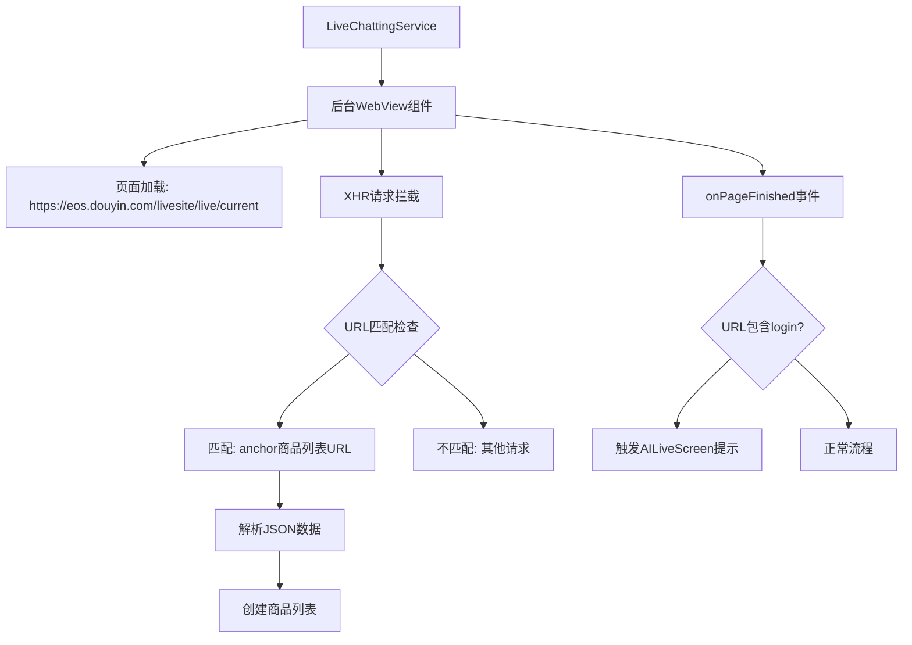

# LiveChattingService后台WebView集成设计文档

## 1. 概述

本设计文档旨在描述如何在LiveChattingService服务启动时创建一个后台运行的WebView，用于加载抖音直播间页面并捕获相关的XHR请求和页面加载完成事件。该功能将用于获取直播商品列表信息，并在特定条件下触发AILiveScreen中的提示信息。

## 2. 需求分析

### 2.1 功能需求
1. 在LiveChattingService服务启动时创建一个后台WebView组件
2. WebView需加载页面：https://eos.douyin.com/livesite/live/current
3. 拦截并分析XHR请求，识别包含"https://eos.douyin.com/data/life/live/shelves/anchor"的URL
4. 当识别到上述URL时，解析返回的JSON数据并创建商品列表
5. 监听onPageFinished事件，当URL包含"login"时，在AILiveScreen触发提示："来客直播商品获取失败，请登录"

### 2.2 技术参考
- XHR请求拦截机制参考LkAccountBindingScreen的实现方式
- 提示触发机制需在AILiveScreen中实现相应接口

### 2.3 数据参考
- 商品列表数据结构参考`app/src/main/assets/json/anchor.json`文件

## 3. 设计方案

### 3.1 架构设计



### 3.2 核心组件设计

#### 3.2.1 后台WebView组件
- 组件名称：BackgroundWebViewManager
- 功能：
  - 创建并管理后台WebView实例
  - 实现页面加载逻辑
  - 拦截并分析XHR请求
  - 监听页面加载完成事件
  - 确保WebView在后台运行，不占用UI资源
  - 实现资源的正确释放，防止内存泄漏

#### 3.2.2 XHR请求拦截器
- 基于JavaScript注入技术实现
- 拦截XMLHttpRequest对象的open和send方法
- 分析请求URL并根据规则处理

#### 3.2.3 商品列表解析器
- 解析从XHR响应中获取的JSON数据
- 参考anchor.json的数据结构
- 创建对应的商品数据模型

#### 3.2.4 登录状态检测器
- 监听onPageFinished事件
- 检查页面URL是否包含"login"
- 触发相应的提示机制

## 4. 实现细节

### 4.1 BackgroundWebViewManager实现

```kotlin
class BackgroundWebViewManager(private val context: Context) {
    private var webView: WebView? = null
    private var isWebViewInitialized = false
    
    fun initializeWebView() {
        if (isWebViewInitialized) return
        
        webView = WebView(context).apply {
            settings.javaScriptEnabled = true
            settings.domStorageEnabled = true
            settings.databaseEnabled = true
            settings.userAgentString = "Mozilla/5.0 (Windows NT 10.0; Win64; x64) AppleWebKit/537.36 Chrome/91.0.4472.124 Safari/537.36"
            
            // 启用WebView调试（仅在调试模式下）
            if (BuildConfig.DEBUG) {
                WebView.setWebContentsDebuggingEnabled(true)
            }
            
            webViewClient = object : WebViewClient() {
                override fun onPageFinished(view: WebView?, url: String?) {
                    super.onPageFinished(view, url)
                    handlePageFinished(url)
                    injectXhrInterceptor()
                }
                
                override fun onReceivedError(view: WebView?, request: WebResourceRequest?, error: WebResourceError?) {
                    super.onReceivedError(view, request, error)
                    // 处理页面加载错误
                    Log.e("BackgroundWebView", "页面加载错误: ${error?.description}")
                }
            }
        }
        
        isWebViewInitialized = true
    }
    
    fun loadLivePage() {
        webView?.loadUrl("https://eos.douyin.com/livesite/live/current")
    }
    
    private fun injectXhrInterceptor() {
        val jsCode = """
            (function() {
                var originalOpen = XMLHttpRequest.prototype.open;
                var originalSend = XMLHttpRequest.prototype.send;
                
                XMLHttpRequest.prototype.open = function(method, url) {
                    this._url = url;
                    this._method = method;
                    return originalOpen.apply(this, arguments);
                };
                
                XMLHttpRequest.prototype.send = function(data) {
                    var self = this;
                    this.addEventListener('load', function() {
                        var response = self.response;
                        if (typeof response === 'object') {
                            response = JSON.stringify(response);
                        }
                        // 发送拦截到的XHR信息到Android
                        try {
                            Android.onXhrResponse(self._method, self._url, self.status, response);
                        } catch (e) {
                            console.error('调用Android接口失败:', e);
                        }
                    });
                    
                    // 拦截错误响应
                    this.addEventListener('error', function() {
                        try {
                            Android.onXhrResponse(self._method, self._url, -1, 'ERROR');
                        } catch (e) {
                            console.error('调用Android接口失败:', e);
                        }
                    });
                    
                    return originalSend.apply(this, arguments);
                };
            })();
        """.trimIndent()
        
        webView?.evaluateJavascript(jsCode, null)
    }
    
    private fun handlePageFinished(url: String?) {
        url?.let {
            if (it.contains("login")) {
                // 触发AILiveScreen提示
                triggerLoginPrompt()
            }
        }
    }
    
    private fun triggerLoginPrompt() {
        // 通过广播或其他机制通知AILiveScreen显示提示
        val intent = Intent("com.danshuang.AiLive.LIVE_LOGIN_PROMPT")
        intent.putExtra("message", "来客直播商品获取失败，请登录")
        context.sendBroadcast(intent)
    }
    
    fun getWebView(): WebView? {
        return webView
    }
    
    fun destroy() {
        webView?.stopLoading()
        webView?.destroy()
        webView = null
        isWebViewInitialized = false
    }
}
```

### 4.2 XHR请求处理

```kotlin
class WebAppInterface(
    private val context: Context,
    private val scope: CoroutineScope
) {
    @JavascriptInterface
    fun onXhrResponse(method: String?, url: String?, status: Int, response: String?) {
        scope.launch {
            try {
                // 检查是否为商品列表请求
                if (url?.contains("https://eos.douyin.com/data/life/live/shelves/anchor") == true && status == 200) {
                    // 解析商品列表数据
                    parseProductList(response)
                }
            } catch (e: Exception) {
                Log.e("BackgroundWebView", "处理XHR响应时出错", e)
            }
        }
    }
    
    private fun parseProductList(jsonResponse: String?) {
        jsonResponse?.let {
            try {
                val jsonObject = JSONObject(it)
                val cardList = jsonObject.getJSONArray("card_list")
                
                // 解析商品列表并存储
                val productList = mutableListOf<ProductInfo>()
                for (i in 0 until cardList.length()) {
                    val card = cardList.getJSONObject(i)
                    val productBaseInfo = card.getJSONObject("product_base_info")
                    
                    // 获取图片URL
                    var imageUrl: String? = null
                    if (productBaseInfo.has("image_info") && !productBaseInfo.isNull("image_info")) {
                        val imageInfoArray = productBaseInfo.getJSONArray("image_info")
                        if (imageInfoArray.length() > 0) {
                            val imageInfo = imageInfoArray.getJSONObject(0)
                            imageUrl = imageInfo.optString("web_url", null)
                        }
                    }
                    
                    // 获取折扣信息
                    var discount: String? = null
                    if (card.has("price_info") && !card.isNull("price_info")) {
                        val priceInfo = card.getJSONObject("price_info")
                        discount = priceInfo.optString("discount", null)
                    }
                    
                    val product = ProductInfo(
                        productId = productBaseInfo.getString("product_id"),
                        name = productBaseInfo.getString("name"),
                        price = card.getJSONObject("price_info").getLong("actual_price"),
                        imageUrl = imageUrl,
                        discount = discount
                    )
                    
                    productList.add(product)
                }
                
                // 存储商品列表供后续使用
                storeProductList(productList)
                
                // 发送广播通知商品列表已更新
                val intent = Intent("com.danshuang.AiLive.PRODUCT_LIST_UPDATED")
                context.sendBroadcast(intent)
            } catch (e: Exception) {
                Log.e("BackgroundWebView", "解析商品列表时出错", e)
            }
        }
    }
    
    private fun storeProductList(products: List<ProductInfo>) {
        // 实现商品列表存储逻辑
        ProductListManager.updateProducts(products)
    }
}
```

### 4.3 AILiveScreen提示机制

在AILiveScreen中添加广播接收器：

```kotlin
// 在AILiveScreen中添加
private val livePromptReceiver = object : BroadcastReceiver() {
    override fun onReceive(context: Context, intent: Intent) {
        when (intent.action) {
            "com.danshuang.AiLive.LIVE_LOGIN_PROMPT" -> {
                val message = intent.getStringExtra("message")
                message?.let {
                    // 显示提示信息
                    showSnackbar(it)
                }
            }
            "com.danshuang.AiLive.PRODUCT_LIST_UPDATED" -> {
                // 商品列表更新通知，可根据需要处理
                Log.d("AILiveScreen", "商品列表已更新")
            }
        }
    }
}

// 注册广播接收器
LaunchedEffect(Unit) {
    val filter = IntentFilter().apply {
        addAction("com.danshuang.AiLive.LIVE_LOGIN_PROMPT")
        addAction("com.danshuang.AiLive.PRODUCT_LIST_UPDATED")
    }
    ContextCompat.registerReceiver(context, livePromptReceiver, filter, ContextCompat.RECEIVER_NOT_EXPORTED)
}

// 在AILiveScreen的onDispose中注销广播接收器
// 注意：在Compose中应该使用DisposableEffect来处理
DisposableEffect(Unit) {
    val filter = IntentFilter().apply {
        addAction("com.danshuang.AiLive.LIVE_LOGIN_PROMPT")
        addAction("com.danshuang.AiLive.PRODUCT_LIST_UPDATED")
    }
    ContextCompat.registerReceiver(context, livePromptReceiver, filter, ContextCompat.RECEIVER_NOT_EXPORTED)
    
    onDispose {
        try {
            context.unregisterReceiver(livePromptReceiver)
        } catch (e: Exception) {
            Log.e("AILiveScreen", "注销广播接收器时出错", e)
        }
    }
}

// 显示Snackbar提示的方法
private fun showSnackbar(message: String) {
    // 根据AILiveScreen的具体实现来显示提示
    // 可以使用Snackbar或者Toast等方式
    Toast.makeText(context, message, Toast.LENGTH_LONG).show()
}
```

## 5. 数据模型设计

### 5.1 商品信息数据类

```kotlin
data class ProductInfo(
    val productId: String,
    val name: String,
    val price: Long, // 实际价格，单位为分
    val originalPrice: Long? = null, // 原价，单位为分
    val imageUrl: String? = null,
    val discount: String? = null, // 折扣信息，如"9.7折"
    val soldCount: String? = null, // 已售数量
    val stock: String? = null, // 库存信息
    val labels: List<String> = emptyList() // 商品标签，如["周一至周日可用", "随时退"]
)
```

### 5.2 商品列表管理类

```kotlin
object ProductListManager {
    private val _products = mutableStateListOf<ProductInfo>()
    val products: List<ProductInfo> get() = _products
    
    fun updateProducts(newProducts: List<ProductInfo>) {
        _products.clear()
        _products.addAll(newProducts)
    }
    
    fun clearProducts() {
        _products.clear()
    }
    
    fun getProductById(productId: String): ProductInfo? {
        return _products.find { it.productId == productId }
    }
    
    val productCount: Int get() = _products.size
}
```

## 6. 集成方案

### 6.1 LiveChattingService集成

在LiveChattingService中添加BackgroundWebViewManager：

```kotlin
class LiveChattingService : Service() {
    private lateinit var backgroundWebViewManager: BackgroundWebViewManager
    
    override fun onCreate() {
        super.onCreate()
        // ... 其他初始化代码
        
        // 初始化后台WebView
        backgroundWebViewManager = BackgroundWebViewManager(this)
        backgroundWebViewManager.initializeWebView()
        
        // 添加JavaScript接口
        val webAppInterface = WebAppInterface(this, serviceScope)
        // 假设在BackgroundWebViewManager中暴露webView实例
        backgroundWebViewManager.getWebView()?.addJavascriptInterface(webAppInterface, "Android")
    }
    
    override fun onStartCommand(intent: Intent?, flags: Int, startId: Int): Int {
        // ... 其他代码
        
        // 启动时加载直播页面
        backgroundWebViewManager.loadLivePage()
        
        return START_STICKY
    }
    
    override fun onDestroy() {
        super.onDestroy()
        // ... 其他清理代码
        
        // 清理WebView资源
        backgroundWebViewManager.destroy()
    }
}
```

## 7. 安全与性能考虑

### 7.1 安全性
1. WebView使用后台运行模式，不显示在UI界面上
2. 限制WebView访问权限，仅允许必要的网络请求
3. 对JavaScript接口进行安全检查，防止恶意调用
4. 设置合适的User-Agent，模拟桌面浏览器访问
5. 禁止WebView访问本地文件系统

### 7.2 性能优化
1. WebView实例复用，避免重复创建和销毁
2. 及时释放WebView资源，防止内存泄漏
3. XHR拦截器仅处理必要的请求，避免影响页面正常加载
4. 后台WebView设置合适的尺寸，避免占用过多内存
5. 在服务停止时及时销毁WebView资源

### 7.3 异常处理
1. 网络异常处理：当无法访问目标页面时，应有适当的重试机制
2. JSON解析异常处理：当返回的数据格式不符合预期时，应记录日志并继续运行
3. WebView加载错误处理：当页面加载失败时，应记录错误信息
4. 广播发送异常处理：确保广播发送不会影响主流程

## 8. 测试方案

### 8.1 单元测试
1. 测试BackgroundWebViewManager的初始化和销毁逻辑
2. 测试XHR请求拦截和解析功能
3. 测试商品列表解析和存储功能
4. 测试URL匹配逻辑的正确性
5. 测试异常情况下的错误处理机制

### 8.2 集成测试
1. 验证LiveChattingService启动时WebView正确加载页面
2. 验证XHR请求正确拦截和处理
3. 验证AILiveScreen提示功能正常工作
4. 验证商品列表数据正确解析和存储
5. 验证服务停止时资源正确释放

### 8.3 特殊场景测试
1. 网络不可用时的行为测试
2. 页面加载超时的处理测试
3. JSON数据格式异常时的容错测试
4. 多次启动服务时WebView的正确处理
5. 应用切换到后台时WebView的行为测试

## 9. 依赖关系

### 9.1 文件依赖
- LiveChattingService.kt: 主服务文件，需要添加WebView集成
- AILiveScreen.kt: 需要添加提示接收机制
- anchor.json: 商品数据结构参考

### 9.2 外部依赖
- Android WebView组件
- Kotlin Coroutines
- AndroidX相关库
- Android ContextCompat（用于安全注册广播接收器）

### 9.3 版本兼容性
1. Android API级别兼容性：确保在API 21及以上版本正常工作
2. WebView版本兼容性：考虑到不同Android版本的WebView实现差异
3. JavaScript兼容性：确保注入的JavaScript代码在不同WebView版本中正常工作
4. 广播接收器安全性：使用ContextCompat.registerReceiver确保在Android 14等新版本中的兼容性