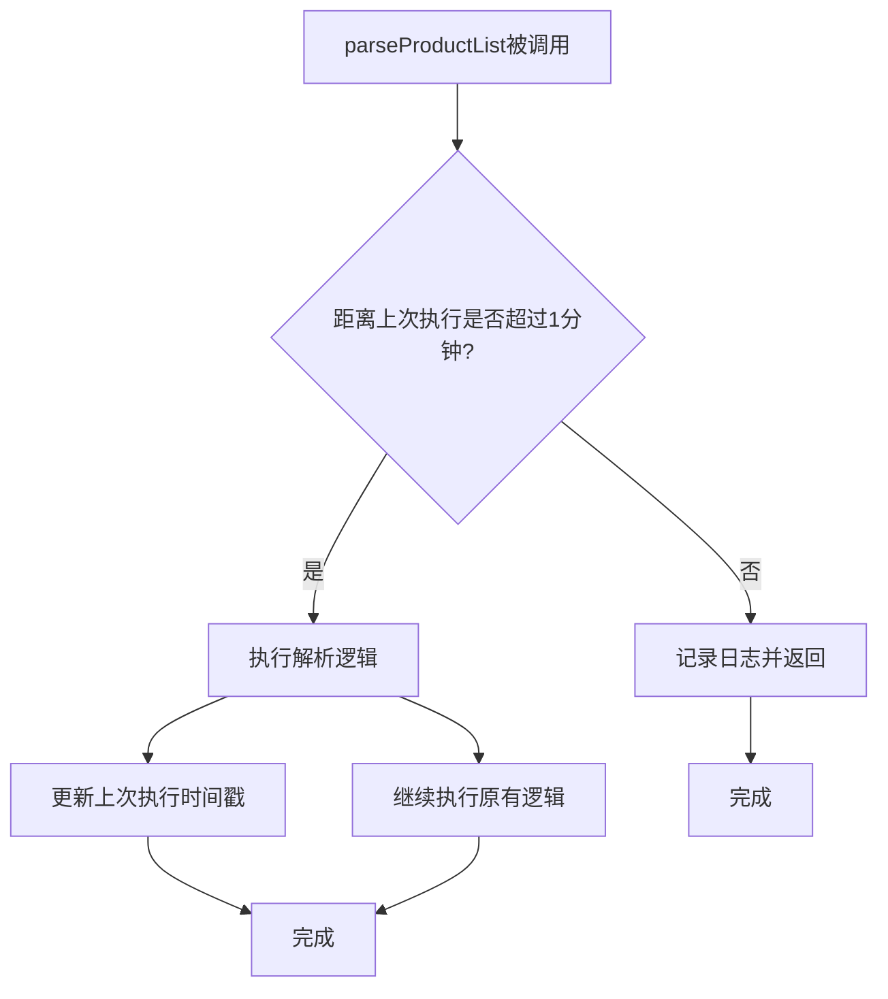

# WebView商品列表解析频率限制设计文档

## 1. 概述

本设计文档旨在解决`WebViewJsInterface.kt`中`parseProductList`方法执行频率过高的问题。当前实现中，每次接收到商品列表的XHR响应时都会立即解析并更新商品列表，这可能导致系统资源过度消耗。本方案将实现一个机制，限制该方法在1分钟内最多执行一次。

## 2. 设计目标

- 限制`parseProductList`方法在1分钟内最多执行一次
- 当方法被调用但被限制时，应记录日志以便调试
- 不影响现有功能逻辑，确保商品列表仍能正确更新
- 实现方案应易于维护和扩展

## 3. 技术方案

### 3.1 实现思路

在`WebViewJsInterface`类中添加一个时间戳记录器和一个检查方法，用于控制`parseProductList`方法的执行频率。

### 3.2 核心组件

1. **时间戳记录**：使用`System.currentTimeMillis()`记录上次执行时间
2. **频率检查**：实现一个检查方法，判断是否满足1分钟间隔要求
3. **日志记录**：记录被限制执行的情况，便于调试和监控

### 3.3 限制逻辑流程图



## 4. 实现细节

### 4.1 类结构修改

在`WebViewJsInterface`类中添加以下成员：

```kotlin
companion object {
    private const val TAG = "WebViewJsInterface"
    private const val PRODUCT_LIST_URL = "/data/life/live/shelves/anchor/"
    private const val MIN_INTERVAL_MS = 60 * 1000L // 1分钟间隔
}

private var lastParseTime = 0L
```

### 4.2 方法修改

修改`parseProductList`方法，在方法开始处添加频率检查逻辑：

```kotlin
private fun parseProductList(jsonResponse: String?) {
    // 频率限制检查
    val currentTime = System.currentTimeMillis()
    if (currentTime - lastParseTime < MIN_INTERVAL_MS) {
        Log.w(TAG, "parseProductList调用频率过高，已限制执行。距离上次执行: ${currentTime - lastParseTime}ms")
        return
    }
    
    // 更新上次执行时间
    lastParseTime = currentTime
    
    // 原有逻辑保持不变
    jsonResponse?.let {
        try {
            val jsonObject = JSONObject(it)
            val cardList = jsonObject.getJSONArray("card_list")

            // 解析商品列表并存储
            val productList = mutableListOf<ProductInfo>()
            for (i in 0 until cardList.length()) {
                val card = cardList.getJSONObject(i)
                val productBaseInfo = card.getJSONObject("product_base_info")

                // 获取图片URL
                var imageUrl: String? = null
                if (productBaseInfo.has("image_info") && !productBaseInfo.isNull("image_info")) {
                    val imageInfoArray = productBaseInfo.getJSONArray("image_info")
                    if (imageInfoArray.length() > 0) {
                        val imageInfo = imageInfoArray.getJSONObject(0)
                        imageUrl = imageInfo.optString("web_url", "")
                        // 如果获取到的URL为空字符串，则设为null
                        if (imageUrl?.isEmpty() == true) {
                            imageUrl = null
                        }
                    }
                }

                // 获取折扣信息
                var discount: String? = null
                if (card.has("price_info") && !card.isNull("price_info")) {
                    val priceInfo = card.getJSONObject("price_info")
                    discount = priceInfo.optString("discount", "")
                    // 如果获取到的折扣信息为空字符串，则设为null
                    if (discount?.isEmpty() == true) {
                        discount = null
                    }
                }

                // 获取已售数量
                var soldCount: String? = null
                if (card.has("stock_info") && !card.isNull("stock_info")) {
                    val stockInfo = card.getJSONObject("stock_info")
                    if (stockInfo.has("sold") && !stockInfo.isNull("sold")) {
                        val soldArray = stockInfo.getJSONArray("sold")
                        if (soldArray.length() > 1) {
                            soldCount = soldArray.optString(1, "")
                        }
                    }
                }

                // 获取库存信息
                var stock: String? = null
                if (card.has("stock_info") && !card.isNull("stock_info")) {
                    val stockInfo = card.getJSONObject("stock_info")
                    if (stockInfo.has("stock") && !stockInfo.isNull("stock")) {
                        val stockArray = stockInfo.getJSONArray("stock")
                        if (stockArray.length() > 1) {
                            stock = stockArray.optString(1, "")
                        }
                    }
                }

                // 获取标签信息
                val labels = mutableListOf<String>()
                if (card.has("label_info") && !card.isNull("label_info")) {
                    val labelInfo = card.getJSONObject("label_info")
                    if (labelInfo.has("right_list") && !labelInfo.isNull("right_list")) {
                        val rightList = labelInfo.getJSONArray("right_list")
                        for (j in 0 until rightList.length()) {
                            labels.add(rightList.getString(j))
                        }
                    }
                }

                val product = ProductInfo(
                    productId = productBaseInfo.getString("product_id"),
                    name = productBaseInfo.getString("name"),
                    price = card.getJSONObject("price_info").getLong("actual_price"),
                    originalPrice = if (card.getJSONObject("price_info").has("origin_price")) 
                        card.getJSONObject("price_info").getLong("origin_price") else null,
                    imageUrl = imageUrl,
                    discount = discount,
                    soldCount = soldCount,
                    stock = stock,
                    labels = labels
                )

                productList.add(product)
            }

            // 存储商品列表供后续使用
            storeProductList(productList)
            Log.d(TAG, "商品列表已更新，包含 ${productList.size} 个商品")
            Log.d(TAG, productList.toString())

            // 发送广播通知商品列表已更新
            val intent = Intent("com.danshuang.AiLive.PRODUCT_LIST_UPDATED")
            intent.setPackage(context.packageName)
            context.sendBroadcast(intent)
        } catch (e: Exception) {
            Log.e(TAG, "解析商品列表时出错", e)
        }
    }
}
```

## 5. 测试方案

### 5.1 单元测试

1. 测试在1分钟内连续调用`parseProductList`方法，验证第二次及后续调用被正确限制
2. 测试间隔超过1分钟后调用，验证方法能够正常执行
3. 测试时间戳记录的准确性

以下是单元测试示例：

```kotlin
class WebViewJsInterfaceTest {
    private lateinit var webViewJsInterface: WebViewJsInterface
    private lateinit var context: Context
    private lateinit var scope: CoroutineScope
    
    @Before
    fun setup() {
        context = mock()
        scope = CoroutineScope(Dispatchers.Main)
        webViewJsInterface = WebViewJsInterface(context, scope)
    }
    
    @Test
    fun `parseProductList should execute normally when called after 1 minute`() {
        // 第一次调用应该正常执行
        webViewJsInterface.parseProductList(sampleJsonResponse)
        // 验证商品列表被更新
        // ...
    }
    
    @Test
    fun `parseProductList should be limited when called within 1 minute`() {
        // 第一次调用
        webViewJsInterface.parseProductList(sampleJsonResponse)
        
        // 立即再次调用，应该被限制
        webViewJsInterface.parseProductList(sampleJsonResponse)
        
        // 验证只更新了一次商品列表
        // ...
    }
}
```

### 5.2 集成测试

1. 在实际WebView环境中模拟商品列表请求，验证限制机制正常工作
2. 验证商品列表仍能正确更新和显示
3. 检查日志输出是否符合预期

### 5.3 性能测试

1. 监控系统资源使用情况，验证限制机制有效减少了资源消耗
2. 测试高频率请求场景下的系统稳定性

## 6. 性能影响评估

- 时间戳记录和比较操作耗时极小，对性能无明显影响
- 通过限制执行频率，反而能减少系统资源消耗
- 日志记录操作在被限制时才执行，对性能影响可忽略

## 7. 安全性和兼容性

- 实现方案不涉及系统底层API，兼容性良好
- 不改变现有接口和数据结构，对其他模块无影响
- 通过日志记录便于问题排查和监控

## 8. 文件修改示例

以下是完整修改后的`WebViewJsInterface.kt`文件示例：

```kotlin
package com.danshuang.AiLive.service

import android.content.Context
import android.content.Intent
import android.util.Log
import android.webkit.JavascriptInterface
import kotlinx.coroutines.CoroutineScope
import kotlinx.coroutines.launch
import org.json.JSONObject

/**
 * WebView JavaScript接口
 * 用于处理WebView中拦截到的XHR请求
 */
class WebViewJsInterface(
    private val context: Context,
    private val scope: CoroutineScope
) {
    companion object {
        private const val TAG = "WebViewJsInterface"
        private const val PRODUCT_LIST_URL = "/data/life/live/shelves/anchor/"
        private const val MIN_INTERVAL_MS = 60 * 1000L // 1分钟间隔
    }

    private var lastParseTime = 0L

    @JavascriptInterface
    fun onXhrResponse(method: String?, url: String?, status: Int, response: String?) {
        scope.launch {
            try {
                Log.d(TAG, "XHR Response - Method: $method, URL: $url, Status: $status, Response: $response")
                // 检查是否为商品列表请求
                if (url?.contains(PRODUCT_LIST_URL) == true && status == 200) {
                    // 解析商品列表数据
                    parseProductList(response)
                }
            } catch (e: Exception) {
                Log.e(TAG, "处理XHR响应时出错", e)
            }
        }
    }

    private fun parseProductList(jsonResponse: String?) {
        // 频率限制检查
        val currentTime = System.currentTimeMillis()
        if (currentTime - lastParseTime < MIN_INTERVAL_MS) {
            Log.w(TAG, "parseProductList调用频率过高，已限制执行。距离上次执行: ${currentTime - lastParseTime}ms")
            return
        }
        
        // 更新上次执行时间
        lastParseTime = currentTime
        
        // 原有逻辑保持不变
        jsonResponse?.let {
            try {
                val jsonObject = JSONObject(it)
                val cardList = jsonObject.getJSONArray("card_list")

                // 解析商品列表并存储
                val productList = mutableListOf<ProductInfo>()
                for (i in 0 until cardList.length()) {
                    val card = cardList.getJSONObject(i)
                    val productBaseInfo = card.getJSONObject("product_base_info")

                    // 获取图片URL
                    var imageUrl: String? = null
                    if (productBaseInfo.has("image_info") && !productBaseInfo.isNull("image_info")) {
                        val imageInfoArray = productBaseInfo.getJSONArray("image_info")
                        if (imageInfoArray.length() > 0) {
                            val imageInfo = imageInfoArray.getJSONObject(0)
                            imageUrl = imageInfo.optString("web_url", "")
                            // 如果获取到的URL为空字符串，则设为null
                            if (imageUrl?.isEmpty() == true) {
                                imageUrl = null
                            }
                        }
                    }

                    // 获取折扣信息
                    var discount: String? = null
                    if (card.has("price_info") && !card.isNull("price_info")) {
                        val priceInfo = card.getJSONObject("price_info")
                        discount = priceInfo.optString("discount", "")
                        // 如果获取到的折扣信息为空字符串，则设为null
                        if (discount?.isEmpty() == true) {
                            discount = null
                        }
                    }

                    // 获取已售数量
                    var soldCount: String? = null
                    if (card.has("stock_info") && !card.isNull("stock_info")) {
                        val stockInfo = card.getJSONObject("stock_info")
                        if (stockInfo.has("sold") && !stockInfo.isNull("sold")) {
                            val soldArray = stockInfo.getJSONArray("sold")
                            if (soldArray.length() > 1) {
                                soldCount = soldArray.optString(1, "")
                            }
                        }
                    }

                    // 获取库存信息
                    var stock: String? = null
                    if (card.has("stock_info") && !card.isNull("stock_info")) {
                        val stockInfo = card.getJSONObject("stock_info")
                        if (stockInfo.has("stock") && !stockInfo.isNull("stock")) {
                            val stockArray = stockInfo.getJSONArray("stock")
                            if (stockArray.length() > 1) {
                                stock = stockArray.optString(1, "")
                            }
                        }
                    }

                    // 获取标签信息
                    val labels = mutableListOf<String>()
                    if (card.has("label_info") && !card.isNull("label_info")) {
                        val labelInfo = card.getJSONObject("label_info")
                        if (labelInfo.has("right_list") && !labelInfo.isNull("right_list")) {
                            val rightList = labelInfo.getJSONArray("right_list")
                            for (j in 0 until rightList.length()) {
                                labels.add(rightList.getString(j))
                            }
                        }
                    }

                    val product = ProductInfo(
                        productId = productBaseInfo.getString("product_id"),
                        name = productBaseInfo.getString("name"),
                        price = card.getJSONObject("price_info").getLong("actual_price"),
                        originalPrice = if (card.getJSONObject("price_info").has("origin_price")) 
                            card.getJSONObject("price_info").getLong("origin_price") else null,
                        imageUrl = imageUrl,
                        discount = discount,
                        soldCount = soldCount,
                        stock = stock,
                        labels = labels
                    )

                    productList.add(product)
                }

                // 存储商品列表供后续使用
                storeProductList(productList)
                Log.d(TAG, "商品列表已更新，包含 ${productList.size} 个商品")
                Log.d(TAG, productList.toString())

                // 发送广播通知商品列表已更新
                val intent = Intent("com.danshuang.AiLive.PRODUCT_LIST_UPDATED")
                intent.setPackage(context.packageName)
                context.sendBroadcast(intent)
            } catch (e: Exception) {
                Log.e(TAG, "解析商品列表时出错", e)
            }
        }
    }

    private fun storeProductList(products: List<ProductInfo>) {
        // 实现商品列表存储逻辑
        ProductListManager.updateProducts(products)
    }
}
```