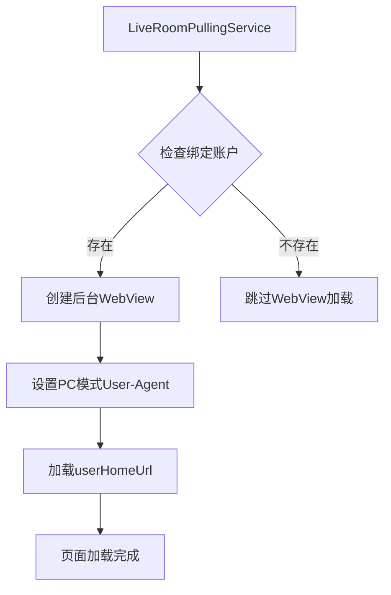
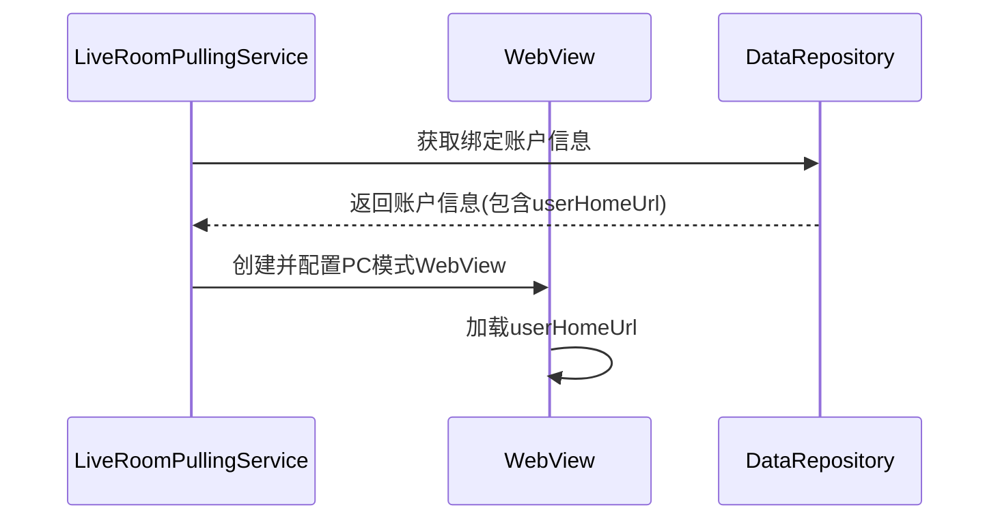

# PC模式WebView加载绑定账户userHomeUrl设计文档

## 1. 概述

本文档描述了在[LiveRoomPullingService.kt](file://d:\Qoder_projects\ailive\app\src\main\java\com\danshuang\AiLive\service\LiveRoomPullingService.kt)的[onStartCommand](file://d:\Qoder_projects\ailive\app\src\main\java\com\danshuang\AiLive\service\LiveRoomPullingService.kt#L199-L248)方法中添加PC模式WebView加载绑定账户的userHomeUrl功能的设计方案。该功能旨在通过WebView以PC浏览器模式加载用户主页URL。

## 2. 功能需求

### 2.1 核心功能
- 在[LiveRoomPullingService](file://d:\Qoder_projects\ailive\app\src\main\java\com\danshuang\AiLive\service\LiveRoomPullingService.kt#L50-L533)启动时，检查是否存在绑定的抖音账户
- 若存在绑定账户，则以PC模式加载该账户的userHomeUrl

### 2.2 技术要求
- 使用Android WebView组件实现页面加载
- 设置User-Agent为PC浏览器模式
- 确保功能在服务后台运行时正常工作

## 3. 设计方案

### 3.1 架构设计



### 3.2 核心组件

#### 3.2.1 WebView配置
- 启用JavaScript支持
- 设置PC浏览器User-Agent:
  ```
  Mozilla/5.0 (Windows NT 10.0; Win64; x64) AppleWebKit/537.36 (KHTML, like Gecko) Chrome/120.0.0.0 Safari/537.36
  ```
- 启用DOM存储和数据库功能
- 禁用缩放控件，启用内容访问

## 4. 实现细节

### 4.1 onStartCommand修改

在[onStartCommand](file://d:\Qoder_projects\ailive\app\src\main\java\com\danshuang\AiLive\service\LiveRoomPullingService.kt#L199-L248)方法中添加以下逻辑：

1. 检查是否有绑定的抖音账户信息
2. 若存在绑定账户，获取userHomeUrl
3. 创建后台WebView实例（隐藏显示）
4. 配置WebView为PC模式
5. 加载userHomeUrl

### 4.2 数据流设计



### 4.3 错误处理机制

1. URL加载失败处理
2. 超时处理机制（设置10秒超时）

## 5. 数据模型

### 5.1 绑定账户信息
```kotlin
data class BoundAccountInfo(
    val platform: String = "douyin",
    val avatar: String = "",
    val nickname: String = "",
    val userId: String = "",
    val homeUrl: String = "",
    val isLive: Boolean = false,
    val bindTime: Long = 0
)
```

## 6. 测试策略

### 6.1 单元测试
- 测试绑定账户信息的获取逻辑
- 测试WebView配置是否正确

### 6.2 集成测试
- 测试URL加载功能
- 测试不同网络环境下的表现
- 测试异常情况处理

## 7. 安全考虑

1. WebView安全配置
2. JavaScript执行安全限制
3. 用户数据隐私保护
4. 网络请求安全处理

## 8. 性能优化

1. 后台WebView隐藏加载，不影响UI性能
2. 设置加载超时机制，避免长时间阻塞
3. 合理管理WebView生命周期，及时释放资源