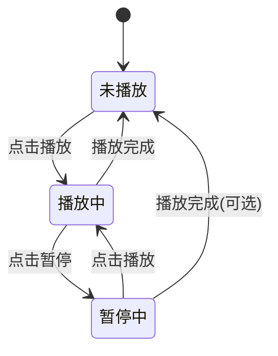

# 播放控制功能实现设计文档

## 1. 概述

本文档描述了在AI直播应用的语音克隆功能中，对音频播放控制功能的改进设计。当前实现中，播放按钮在播放状态下显示为"暂停"，但点击时并未真正暂停播放，而是重新调用播放函数。本设计旨在实现真正的播放/暂停控制功能。

## 2. 当前问题分析

### 2.1 现有问题
- 播放按钮在播放状态下显示为"暂停"，但点击时并未真正暂停播放
- 缺少独立的暂停功能实现
- MediaPlayer实例的控制不够精细

### 2.2 代码分析
在`VoiceCloningScreen.kt`中，播放按钮的实现如下：
```kotlin
Button(
    onClick = {
        tempRecordingFile?.let { filePath ->
            // 检查文件是否存在
            val file = java.io.File(filePath)
            if (file.exists()) {
                playAudio(context, { mediaPlayer = it }, filePath) { isPlaying = it }
            } else {
                // 文件不存在，显示错误信息
                errorMessage = "录音文件不存在，请先录制音频"
            }
        } ?: run {
            errorMessage = "未录制音频文件"
        }
    },
    enabled = hasRecordedAudio && !isRecording,
    colors = ButtonDefaults.buttonColors(
        containerColor = MaterialTheme.colorScheme.primary,
        disabledContainerColor = MaterialTheme.colorScheme.surfaceVariant
    )
) {
    Icon(
        imageVector = if (isPlaying) Icons.Default.Close else Icons.Default.PlayArrow,
        contentDescription = if (isPlaying) "暂停" else "播放",
        modifier = Modifier.size(24.dp)
    )
    Spacer(modifier = Modifier.width(8.dp))
    Text(if (isPlaying) "暂停" else "播放")
}
```

## 3. 设计方案

### 3.1 功能需求
1. 实现真正的播放/暂停切换功能
2. 当处于播放状态时，点击按钮应暂停当前播放
3. 当处于暂停状态时，点击按钮应继续播放
4. 确保MediaPlayer资源得到正确管理

### 3.2 技术实现

#### 3.2.1 新增暂停功能函数
添加一个专门用于暂停播放的函数：
```kotlin
fun pauseAudio(
    mediaPlayer: MediaPlayer?,
    onPlayStateChange: (Boolean) -> Unit
) {
    try {
        mediaPlayer?.let { player ->
            if (player.isPlaying) {
                player.pause()
                onPlayStateChange(false)
            }
        }
    } catch (e: Exception) {
        android.util.Log.e("VoiceCloningScreen", "Error pausing audio: ${e.message}", e)
        onPlayStateChange(false)
    }
}
```

#### 3.2.2 修改播放按钮逻辑
修改播放按钮的onClick事件处理逻辑：
```kotlin
Button(
    onClick = {
        if (isPlaying) {
            // 当前正在播放，需要暂停
            pauseAudio(mediaPlayer) { isPlaying = it }
        } else {
            // 当前未播放，需要开始播放
            tempRecordingFile?.let { filePath ->
                // 检查文件是否存在
                val file = java.io.File(filePath)
                if (file.exists()) {
                    playAudio(context, { mediaPlayer = it }, filePath) { isPlaying = it }
                } else {
                    // 文件不存在，显示错误信息
                    errorMessage = "录音文件不存在，请先录制音频"
                }
            } ?: run {
                errorMessage = "未录制音频文件"
            }
        }
    },
    enabled = hasRecordedAudio && !isRecording,
    colors = ButtonDefaults.buttonColors(
        containerColor = MaterialTheme.colorScheme.primary,
        disabledContainerColor = MaterialTheme.colorScheme.surfaceVariant
    )
)
```

#### 3.2.3 修改playAudio函数
修改playAudio函数以支持从暂停状态恢复播放：
```kotlin
fun playAudio(
    context: android.content.Context,
    setMediaPlayer: (android.media.MediaPlayer?) -> Unit,
    filePath: String,
    onPlayStateChange: (Boolean) -> Unit,
    mediaPlayer: MediaPlayer? = null  // 可选参数，用于传递已存在的MediaPlayer实例
) {
    try {
        // 如果传入了MediaPlayer实例且处于暂停状态，则恢复播放
        if (mediaPlayer != null && !mediaPlayer.isPlaying) {
            mediaPlayer.start()
            onPlayStateChange(true)
            return
        }
        
        // 其余现有逻辑保持不变...
        // [现有playAudio函数的其余实现]
    } catch (e: Exception) {
        // [现有异常处理逻辑]
    }
}
```

### 3.3 状态管理

#### 3.3.1 状态变量
保持现有的状态变量不变：
- `isPlaying`: 表示当前是否正在播放
- `mediaPlayer`: 保存MediaPlayer实例引用

#### 3.3.2 状态转换


## 4. API设计

### 4.1 新增函数

#### 4.1.1 pauseAudio函数
```kotlin
/**
 * 暂停音频播放
 * @param mediaPlayer MediaPlayer实例
 * @param onPlayStateChange 播放状态变更回调
 */
fun pauseAudio(
    mediaPlayer: MediaPlayer?,
    onPlayStateChange: (Boolean) -> Unit
)
```

#### 4.1.2 修改后的playAudio函数
```kotlin
/**
 * 播放音频文件
 * @param context 上下文
 * @param setMediaPlayer MediaPlayer设置回调
 * @param filePath 音频文件路径
 * @param onPlayStateChange 播放状态变更回调
 * @param mediaPlayer 可选的已存在MediaPlayer实例
 */
fun playAudio(
    context: android.content.Context,
    setMediaPlayer: (android.media.MediaPlayer?) -> Unit,
    filePath: String,
    onPlayStateChange: (Boolean) -> Unit,
    mediaPlayer: MediaPlayer? = null
)
```

## 5. 错误处理

### 5.1 异常处理
- 在暂停和播放操作中添加适当的异常处理
- 记录错误日志以便调试
- 在发生错误时正确更新UI状态

### 5.2 资源管理
- 确保MediaPlayer在适当时机释放资源
- 避免内存泄漏

## 6. 测试方案

### 6.1 单元测试
- 测试pauseAudio函数在不同状态下的行为
- 测试playAudio函数在从暂停状态恢复的逻辑

### 6.2 集成测试
- 验证播放/暂停按钮的完整功能流程
- 测试在播放完成后的状态管理

## 7. 兼容性考虑

### 7.1 Android版本兼容性
- 确保在不同Android版本上的兼容性
- 处理不同版本API的差异

### 7.2 设备兼容性
- 在不同设备上测试音频播放功能
- 确保在各种硬件配置下正常工作