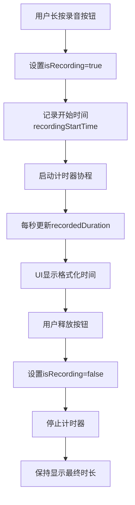

# 录音时长显示功能设计文档

## 1. 概述

本设计文档描述了如何在AI直播应用的语音克隆界面中添加录音时长实时显示功能。该功能将在用户录音过程中实时显示已录制的秒数，以便用户了解当前录音的时长。

## 2. 功能需求

- 在录音过程中实时显示已录制的秒数
- 显示格式为 "00:00" (分钟:秒)
- 录音停止后保持显示最终时长
- 重新开始录音时重置计时器

## 3. 技术实现方案

### 3.1 现有代码分析

当前录音功能通过`MediaRecorder`实现，录音控制在`RecordingButton`组件中处理。录音过程涉及以下关键函数：
- `startRecording`: 开始录音
- `stopRecording`: 停止录音
- `RecordingButton`: 录音按钮UI组件

### 3.2 实现思路

1. 添加新的状态变量来跟踪录音开始时间和当前时长
2. 使用协程定期更新录音时长状态
3. 在UI中显示实时的录音时长
4. 在录音开始和停止时正确管理计时器状态

### 3.3 核心变更点

#### 3.3.1 状态变量添加
在`VoiceCloningScreen` composable函数中添加以下状态变量：
- `recordingStartTime`: 记录录音开始时间戳
- `recordedDuration`: 记录已录制的时长(毫秒)

#### 3.3.4 计时器协程实现

在VoiceCloningScreen中添加计时器协程，用于定期更新录音时长：

```kotlin
LaunchedEffect(isRecording) {
    if (isRecording) {
        recordingStartTime = System.currentTimeMillis()
        while (isRecording) {
            delay(1000) // 每秒更新一次
            recordedDuration = System.currentTimeMillis() - recordingStartTime
        }
    }
}
```

#### 3.3.2 计时器实现
创建一个协程计时器，在录音过程中每秒更新一次录音时长：
- 录音开始时启动计时器
- 录音停止时取消计时器
- 定期计算并更新已录制时长

#### 3.3.3 UI更新
修改`RecordingButton`组件，在按钮下方显示录音时长：
- 添加显示时长的Text组件
- 格式化时间为"MM:SS"格式

## 4. 详细设计

### 4.1 状态管理设计

```kotlin
// 新增状态变量
var recordingStartTime by remember { mutableStateOf<Long>(0) }
var recordedDuration by remember { mutableStateOf<Long>(0) }
var isRecording by remember { mutableStateOf(false) } // 现有状态
```

### 4.2 计时器协程设计

```kotlin
// 录音时长计时器协程
LaunchedEffect(isRecording) {
    if (isRecording) {
        recordingStartTime = System.currentTimeMillis()
        while (isRecording) {
            delay(1000) // 每秒更新一次
            recordedDuration = System.currentTimeMillis() - recordingStartTime
        }
    }
}
```

### 4.3 时间格式化函数

```kotlin
// 格式化时间为 MM:SS 格式
fun formatDuration(durationMillis: Long): String {
    val seconds = (durationMillis / 1000).toInt()
    val minutes = seconds / 60
    val remainingSeconds = seconds % 60
    return String.format("%02d:%02d", minutes, remainingSeconds)
}
```

### 4.4 UI组件更新

修改`RecordingButton`组件，添加时长显示：

```kotlin
@Composable
fun RecordingButton(
    isRecording: Boolean,
    recordedDuration: Long,
    onRecordingStateChange: (Boolean) -> Unit,
    onStartRecording: () -> Unit,
    onStopRecording: () -> Unit
)
```

### 4.5 RecordingButton组件修改

在`RecordingButton`组件中添加显示录音时长的文本：

```kotlin
Column(
    horizontalAlignment = Alignment.CenterHorizontally,
    verticalArrangement = Arrangement.spacedBy(16.dp)
) {
    // 现有的录音按钮...
    
    // 添加录音时长显示
    Text(
        text = formatDuration(recordedDuration),
        fontSize = 16.sp,
        color = MaterialTheme.colorScheme.onBackground
    )
}

### 4.6 在VoiceCloningScreen中调用RecordingButton

在VoiceCloningScreen中调用修改后的RecordingButton组件时，需要传递新增的recordedDuration参数：

```kotlin
RecordingButton(
    isRecording = isRecording,
    recordedDuration = recordedDuration,
    onRecordingStateChange = { recording ->
        isRecording = recording
        // 录音状态变更时重置计时器
        if (recording) {
            recordedDuration = 0
        }
    },
    onStartRecording = {
        // 检查录音权限
        if (checkAudioPermission(context)) {
            startRecording(context, { mediaRecorder = it }, { tempRecordingFile = it })
        } else {
            // 显示权限请求对话框
            showPermissionDialog = true
            android.util.Log.e("VoiceCloningScreen", "Missing audio recording permission")
        }
    },
    onStopRecording = {
        stopRecording(mediaRecorder, { mediaRecorder = null }) { 
            hasRecordedAudio = true
        }
    }
)```

## 5. 完整实现代码示例

### 5.1 状态变量声明

在VoiceCloningScreen函数中添加以下状态变量：

```kotlin
var isRecording by remember { mutableStateOf(false) } // 现有状态
var hasRecordedAudio by remember { mutableStateOf(false) } // 现有状态
var isPlaying by remember { mutableStateOf(false) } // 现有状态
// 新增录音时长相关状态变量
var recordingStartTime by remember { mutableStateOf<Long>(0) }
var recordedDuration by remember { mutableStateOf<Long>(0) }
```

### 5.2 计时器协程实现

在VoiceCloningScreen函数中添加计时器协程：

```kotlin
// 录音时长计时器协程
LaunchedEffect(isRecording) {
    if (isRecording) {
        recordingStartTime = System.currentTimeMillis()
        while (isRecording) {
            delay(1000) // 每秒更新一次
            recordedDuration = System.currentTimeMillis() - recordingStartTime
        }
    }
}
```

### 5.3 时间格式化函数

在VoiceCloningScreen.kt文件中添加时间格式化函数：

```kotlin
// 格式化时间为 MM:SS 格式
fun formatDuration(durationMillis: Long): String {
    val seconds = (durationMillis / 1000).toInt()
    val minutes = seconds / 60
    val remainingSeconds = seconds % 60
    return String.format("%02d:%02d", minutes, remainingSeconds)
}
```

### 5.4 修改RecordingButton组件

更新RecordingButton函数签名：

```kotlin
@Composable
fun RecordingButton(
    isRecording: Boolean,
    recordedDuration: Long,  // 新增参数
    onRecordingStateChange: (Boolean) -> Unit,
    onStartRecording: () -> Unit,
    onStopRecording: () -> Unit
)
```

在RecordingButton组件中添加时长显示：

```kotlin
Column(
    horizontalAlignment = Alignment.CenterHorizontally,
    verticalArrangement = Arrangement.spacedBy(16.dp)
) {
    Box(
        // ... 现有的录音按钮代码 ...
    ) {
        // ... 录音按钮图标 ...
    }
    
    Text(
        text = if (isRecording) "录音中..." else "长按开始录音",
        fontSize = 16.sp,
        color = MaterialTheme.colorScheme.onBackground
    )
    
    // 新增录音时长显示
    Text(
        text = formatDuration(recordedDuration),
        fontSize = 16.sp,
        color = MaterialTheme.colorScheme.onBackground
    )
}
```

### 5.5 更新RecordingButton调用

更新VoiceCloningScreen中对RecordingButton的调用：

```kotlin
RecordingButton(
    isRecording = isRecording,
    recordedDuration = recordedDuration,  // 新增参数
    onRecordingStateChange = { recording ->
        isRecording = recording
        // 录音状态变更时重置计时器
        if (recording) {
            recordedDuration = 0
        }
    },
    onStartRecording = {
        // ... 现有代码 ...
    },
    onStopRecording = {
        // ... 现有代码 ...
    }
)
```

## 6. 数据流设计



## 7. 错误处理

- 确保在组件销毁时正确取消协程
- 处理系统时间变化对计时的影响
- 确保状态在配置变更时正确保存和恢复

## 8. 测试方案

### 8.1 单元测试
- 测试时间格式化函数的正确性
- 验证计时器在不同录音时长下的准确性

### 8.2 UI测试
- 验证录音时长显示UI正确更新
- 测试录音开始/停止时计时器的正确行为
- 验证重新录音时计时器重置功能

## 9. 性能考虑

- 使用`LaunchedEffect`确保协程与组件生命周期绑定
- 每秒更新一次UI，避免过度频繁的重绘
- 合理管理状态变量，避免不必要的重组