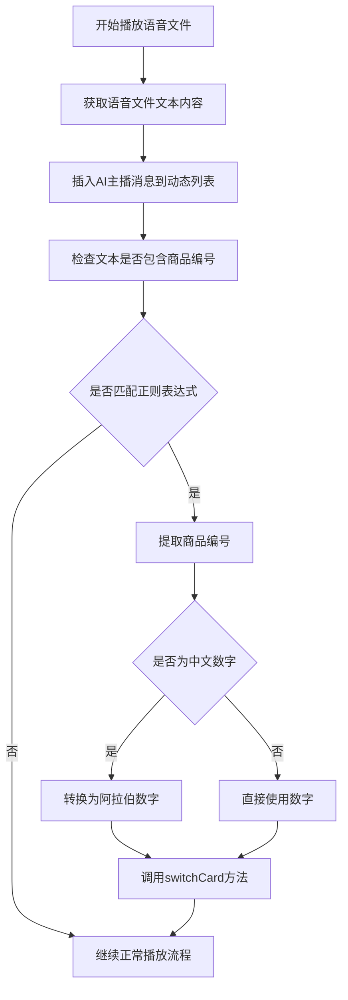

# 正则表达式匹配与商品编号转换设计文档

## 1. 概述

本设计文档旨在实现一个功能，用于在直播语音播放服务中检测语音文件文本内容是否包含特定的商品编号信息，并根据提取的商品编号切换商品卡片。该功能将增强直播服务的交互性，使AI主播能够根据话术内容自动切换到相应的商品展示。

## 2. 功能需求

1. 检测语音文件文本内容是否匹配正则表达式：`([\d]+|[一二三四五六七八九十]+)号(商品|链接)`
2. 提取第一个括号内的内容作为商品编号
3. 将中文数字（如"一"、"十一"）转换为阿拉伯数字
4. 根据商品编号调用`backgroundWebViewManager.switchCard(id)`方法切换商品卡片

## 3. 设计方案

### 3.1 正则表达式匹配

使用正则表达式`([\d]+|[一二三四五六七八九十]+)号(商品|链接)`来匹配文本中的商品编号信息。

### 3.2 中文数字转换

实现一个转换函数，将中文数字转换为对应的阿拉伯数字：
- 一 → 1
- 二 → 2
- ...
- 十 → 10
- 十一 → 11
- ...

### 3.3 商品卡片切换

调用已有的`backgroundWebViewManager.switchCard(id)`方法来切换商品卡片。

## 4. 实现细节

### 4.1 核心函数设计

```kotlin
/**
 * 检查文本是否包含商品编号信息，如果包含则提取编号并切换商品卡片
 */
private fun checkAndSwitchProductCard(text: String) {
    val productNumberStr = extractProductNumber(text)
    if (productNumberStr != null) {
        val productId = convertChineseToArabic(productNumberStr)
        Log.d(TAG, "检测到商品编号: $productNumberStr, 转换为: $productId")
        backgroundWebViewManager.switchCard(productId)
    }
}
```

### 4.2 正则表达式匹配函数

```kotlin
/**
 * 使用正则表达式匹配商品编号
 * @param text 待匹配的文本
 * @return 匹配到的商品编号，如果未匹配到则返回null
 */
private fun extractProductNumber(text: String): String? {
    val regex = "([\\d]+|[一二三四五六七八九十]+)号(商品|链接)".toRegex()
    val matchResult = regex.find(text)
    return matchResult?.groupValues?.get(1)
}
```

### 4.3 中文数字转换函数

```kotlin
/**
 * 将中文数字转换为阿拉伯数字
 * @param chineseNumber 中文数字字符串
 * @return 对应的阿拉伯数字
 */
private fun convertChineseToArabic(chineseNumber: String): Int {
    val chineseNumerals = mapOf(
        "一" to 1, "二" to 2, "三" to 3, "四" to 4, "五" to 5,
        "六" to 6, "七" to 7, "八" to 8, "九" to 9, "十" to 10
    )
    
    // 如果是纯数字，直接返回
    if (chineseNumber.all { it.isDigit() }) {
        return chineseNumber.toInt()
    }
    
    // 特殊处理十开头的情况，如"十三"、"十五"等
    if (chineseNumber.startsWith("十")) {
        val remaining = chineseNumber.substring(1)
        return if (remaining.isEmpty()) 10 else 10 + (chineseNumerals[remaining] ?: 0)
    }
    
    // 处理复合数字，如"二十"、"二十一"等
    if (chineseNumber.contains("十") && chineseNumber.length > 1) {
        val tenIndex = chineseNumber.indexOf("十")
        val tensDigit = if (tenIndex == 0) 1 else (chineseNumerals[chineseNumber.substring(0, tenIndex)] ?: 0)
        val unitsDigit = if (tenIndex == chineseNumber.length - 1) 0 
                         else (chineseNumerals[chineseNumber.substring(tenIndex + 1)] ?: 0)
        return tensDigit * 10 + unitsDigit
    }
    
    // 处理简单数字，如"一"、"三"等
    return chineseNumerals[chineseNumber] ?: 0
}
```

## 5. 流程图



## 6. 示例用例

| 输入文本 | 提取的编号 | 转换后的数字 | 操作 |
|---------|-----------|-------------|------|
| "这是1号商品的介绍" | "1" | 1 | 调用switchCard(1) |
| "这是三号链接的介绍" | "三" | 3 | 调用switchCard(3) |
| "这是10号商品的介绍" | "10" | 10 | 调用switchCard(10) |
| "这是一号商品的介绍" | "一" | 1 | 调用switchCard(1) |
| "这是十一号商品的介绍" | "十一" | 11 | 调用switchCard(11) |
| "这是二十号商品的介绍" | "二十" | 20 | 调用switchCard(20) |
| "这是三十五号商品的介绍" | "三十五" | 35 | 调用switchCard(35) |
| "这是五十号商品的介绍" | "五十" | 50 | 调用switchCard(50) |
| "这是九十九号商品的介绍" | "九十九" | 99 | 调用switchCard(99) |

## 7. 集成点

该功能需要集成到`LiveChattingService`的`playVoiceFile`方法中，在将AI主播的文字内容插入到实时动态列表之后，调用新实现的检查和切换函数。

具体修改点在`playVoiceFile`方法中，找到以下代码：

```kotlin
// 将AI主播的文字内容插入到实时动态列表中
try {
    LiveMessageManager.insertMessage(
        type = MessageType.AI_RESPONSE,
        content = voiceFile.text,
        userName = "AI主播"
    )
    Log.d(TAG, "AI主播消息已插入动态列表: ${voiceFile.text}")
} catch (e: Exception) {
    Log.e(TAG, "插入AI主播消息失败", e)
}
```

在此代码块之后添加：

```kotlin
// 检查并切换商品卡片
checkAndSwitchProductCard(voiceFile.text)
```

## 8. 测试计划

1. 单元测试：测试中文数字到阿拉伯数字的转换函数
2. 集成测试：测试正则表达式匹配和商品卡片切换功能
3. 边界测试：测试各种边界情况，如"二十"、"一百"等复杂中文数字

## 9. 完整示例

以下是在LiveChattingService.kt中的完整实现示例：

1. 首先添加函数实现（在类中的适当位置）：

```kotlin
// 商品编号相关函数

/**
 * 检查文本是否包含商品编号信息，如果包含则提取编号并切换商品卡片
 */
private fun checkAndSwitchProductCard(text: String) {
    val productNumberStr = extractProductNumber(text)
    if (productNumberStr != null) {
        val productId = convertChineseToArabic(productNumberStr)
        Log.d(TAG, "检测到商品编号: $productNumberStr, 转换为: $productId")
        backgroundWebViewManager.switchCard(productId)
    }
}

/**
 * 使用正则表达式匹配商品编号
 * @param text 待匹配的文本
 * @return 匹配到的商品编号，如果未匹配到则返回null
 */
private fun extractProductNumber(text: String): String? {
    val regex = "([\\d]+|[一二三四五六七八九十]+)号(商品|链接)".toRegex()
    val matchResult = regex.find(text)
    return matchResult?.groupValues?.get(1)
}

/**
 * 将中文数字转换为阿拉伯数字
 * @param chineseNumber 中文数字字符串
 * @return 对应的阿拉伯数字
 */
private fun convertChineseToArabic(chineseNumber: String): Int {
    val chineseNumerals = mapOf(
        "一" to 1, "二" to 2, "三" to 3, "四" to 4, "五" to 5,
        "六" to 6, "七" to 7, "八" to 8, "九" to 9, "十" to 10
    )
    
    // 如果是纯数字，直接返回
    if (chineseNumber.all { it.isDigit() }) {
        return chineseNumber.toInt()
    }
    
    // 特殊处理十开头的情况，如"十三"、"十五"等
    if (chineseNumber.startsWith("十")) {
        val remaining = chineseNumber.substring(1)
        return if (remaining.isEmpty()) 10 else 10 + (chineseNumerals[remaining] ?: 0)
    }
    
    // 处理复合数字，如"二十"、"二十一"等
    if (chineseNumber.contains("十") && chineseNumber.length > 1) {
        val tenIndex = chineseNumber.indexOf("十")
        val tensDigit = if (tenIndex == 0) 1 else (chineseNumerals[chineseNumber.substring(0, tenIndex)] ?: 0)
        val unitsDigit = if (tenIndex == chineseNumber.length - 1) 0 
                         else (chineseNumerals[chineseNumber.substring(tenIndex + 1)] ?: 0)
        return tensDigit * 10 + unitsDigit
    }
    
    // 处理简单数字，如"一"、"三"等
    return chineseNumerals[chineseNumber] ?: 0
}
```

2. 然后在playVoiceFile方法中调用该函数：

```kotlin
// 将AI主播的文字内容插入到实时动态列表中
try {
    LiveMessageManager.insertMessage(
        type = MessageType.AI_RESPONSE,
        content = voiceFile.text,
        userName = "AI主播"
    )
    Log.d(TAG, "AI主播消息已插入动态列表: ${voiceFile.text}")
} catch (e: Exception) {
    Log.e(TAG, "插入AI主播消息失败", e)
}

// 检查并切换商品卡片
checkAndSwitchProductCard(voiceFile.text)
```

## 10. 注意事项

1. 需要确保在调用`switchCard`方法时，WebView已经正确初始化
2. 需要考虑网络状态对商品卡片切换的影响
3. 需要处理转换过程中可能出现的异常情况
4. 应该在try-catch块中调用`checkAndSwitchProductCard`函数，以防止异常影响语音播放流程
5. 可以添加日志记录以便调试和监控功能执行情况