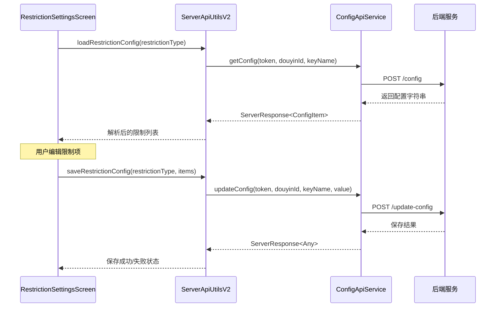
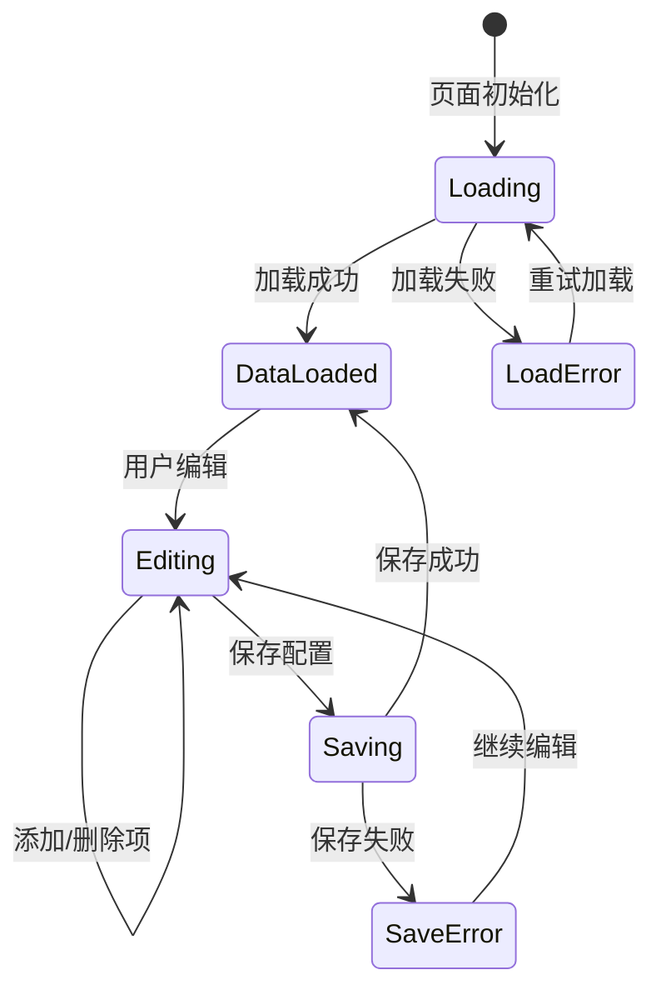
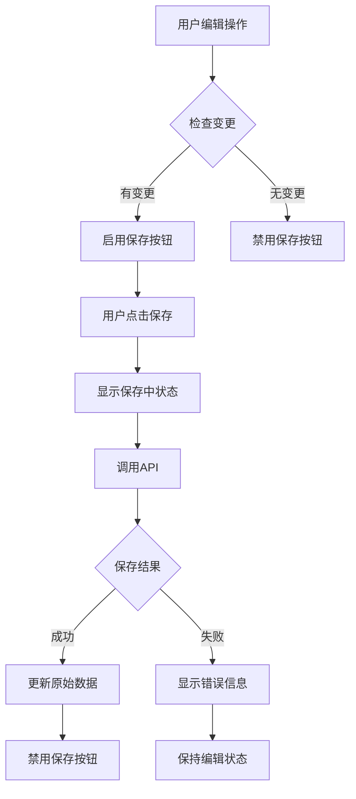

# 呢称与评论限制设置功能设计

## 概述

基于现有的RestrictionSettingsScreen界面，增加与服务器的数据交互功能，实现呢称限制和评论限制的远程配置管理。用户可以从服务器加载现有的限制配置，编辑后保存到服务器。

## 功能需求

### 核心功能
- **数据加载**：页面启动时从服务器获取当前的限制配置
- **数据编辑**：支持添加、删除限制关键词
- **数据保存**：将修改后的配置同步到服务器
- **状态管理**：提供加载、编辑、保存的完整状态反馈

### 业务规则
- 呢称限制类型：`restrictionType = "stop_nickname"`
- 评论限制类型：`restrictionType = "stop_comment"`
- 服务器数据格式：限制项以逗号、空格或换行符分隔
- 提交数据格式：限制项以逗号分隔

## 技术架构

### 组件交互流程



### 数据流设计



## 接口设计

### ServerApiUtilsV2 扩展方法

```kotlin
/**
 * 获取限制配置
 * @param restrictionType 限制类型 ("stop_nickname" | "stop_comment")
 * @return 解析后的限制项列表
 */
suspend fun getRestrictionConfig(
    restrictionType: String
): ServerResponse<List<String>>

/**
 * 更新限制配置
 * @param restrictionType 限制类型
 * @param restrictionItems 限制项列表
 * @return 保存结果
 */
suspend fun updateRestrictionConfig(
    restrictionType: String,
    restrictionItems: List<String>
): ServerResponse<Any>
```

### 数据模型

```kotlin
data class RestrictionConfig(
    val type: String,           // "stop_nickname" | "stop_comment"
    val items: List<String>,    // 限制项列表
    val lastUpdateTime: Long    // 最后更新时间
)

data class RestrictionState(
    val isLoading: Boolean = false,
    val isSaving: Boolean = false,
    val config: RestrictionConfig? = null,
    val error: String? = null,
    val hasUnsavedChanges: Boolean = false
)
```

## UI状态管理

### RestrictionSettingsScreen 状态扩展

```kotlin
@Composable
fun RestrictionSettingsScreen(
    navController: NavigationState,
    restrictionType: String
) {
    // 状态管理
    var restrictionState by remember { mutableStateOf(RestrictionState()) }
    var restrictionItems by remember { mutableStateOf<List<String>>(emptyList()) }
    var originalItems by remember { mutableStateOf<List<String>>(emptyList()) }
    
    // API 客户端
    val context = LocalContext.current
    val apiUtils = remember { 
        ServerApiUtilsV2.createFromContext(context, tokenManager, loginRepository) 
    }
    
    // 加载数据
    LaunchedEffect(restrictionType) {
        loadRestrictionConfig(apiUtils, restrictionType) { state, items ->
            restrictionState = state
            restrictionItems = items
            originalItems = items
        }
    }
}
```

### 加载状态处理

```kotlin
private suspend fun loadRestrictionConfig(
    apiUtils: ServerApiUtilsV2,
    restrictionType: String,
    onResult: (RestrictionState, List<String>) -> Unit
) {
    onResult(RestrictionState(isLoading = true), emptyList())
    
    try {
        when (val response = apiUtils.getRestrictionConfig(restrictionType)) {
            is ServerResponse -> {
                if (response.isSuccess && response.data != null) {
                    onResult(
                        RestrictionState(isLoading = false),
                        response.data
                    )
                } else {
                    onResult(
                        RestrictionState(
                            isLoading = false,
                            error = response.msg ?: "加载失败"
                        ),
                        getDefaultItems(restrictionType)
                    )
                }
            }
        }
    } catch (e: Exception) {
        onResult(
            RestrictionState(
                isLoading = false,
                error = "网络错误: ${e.message}"
            ),
            getDefaultItems(restrictionType)
        )
    }
}
```

## 数据转换逻辑

### 服务器数据解析

```kotlin
/**
 * 解析服务器返回的配置字符串
 * 支持逗号、空格、换行符分隔
 */
private fun parseRestrictionItems(configValue: String): List<String> {
    return configValue
        .split(",", " ", "\n", "\r\n")
        .map { it.trim() }
        .filter { it.isNotEmpty() }
        .distinct()
        .sorted()
}

/**
 * 将限制项列表转换为服务器格式
 * 使用逗号分隔
 */
private fun formatRestrictionItems(items: List<String>): String {
    return items
        .filter { it.isNotBlank() }
        .map { it.trim() }
        .distinct()
        .joinToString(",")
}
```

### 默认配置

```kotlin
private fun getDefaultItems(restrictionType: String): List<String> {
    return when (restrictionType) {
        "stop_nickname" -> listOf(
            "广告号", "机器人", "测试用户", "管理员", "客服号"
        )
        "stop_comment" -> listOf(
            "广告链接", "联系方式", "敏感词汇", "辱骂言论", "垃圾信息"
        )
        else -> emptyList()
    }.sorted()
}
```

## 保存机制

### 保存触发条件



### 保存实现

```kotlin
private suspend fun saveRestrictionConfig(
    apiUtils: ServerApiUtilsV2,
    restrictionType: String,
    items: List<String>,
    onResult: (RestrictionState) -> Unit
) {
    onResult(RestrictionState(isSaving = true))
    
    try {
        val response = apiUtils.updateRestrictionConfig(restrictionType, items)
        if (response.isSuccess) {
            onResult(RestrictionState(isSaving = false))
        } else {
            onResult(RestrictionState(
                isSaving = false,
                error = "保存失败: ${response.msg}"
            ))
        }
    } catch (e: Exception) {
        onResult(RestrictionState(
            isSaving = false,
            error = "网络错误: ${e.message}"
        ))
    }
}
```

## UI增强设计

### 顶部栏扩展

```kotlin
TopAppBar(
    title = { Text(title) },
    navigationIcon = {
        IconButton(onClick = { navController.navigateUp() }) {
            Icon(Icons.AutoMirrored.Filled.ArrowBack, "返回")
        }
    },
    actions = {
        // 保存按钮
        if (restrictionState.hasUnsavedChanges) {
            IconButton(
                onClick = { saveConfig() },
                enabled = !restrictionState.isSaving
            ) {
                if (restrictionState.isSaving) {
                    CircularProgressIndicator(
                        modifier = Modifier.size(20.dp),
                        strokeWidth = 2.dp
                    )
                } else {
                    Icon(Icons.Default.Save, "保存")
                }
            }
        }
        
        // 刷新按钮
        IconButton(onClick = { reloadConfig() }) {
            Icon(Icons.Default.Refresh, "刷新")
        }
    }
)
```

### 加载状态指示

```kotlin
if (restrictionState.isLoading) {
    Box(
        modifier = Modifier.fillMaxSize(),
        contentAlignment = Alignment.Center
    ) {
        Column(horizontalAlignment = Alignment.CenterHorizontally) {
            CircularProgressIndicator()
            Spacer(modifier = Modifier.height(16.dp))
            Text("正在加载配置...")
        }
    }
}
```

### 错误处理

```kotlin
restrictionState.error?.let { error ->
    Card(
        modifier = Modifier
            .fillMaxWidth()
            .padding(16.dp),
        colors = CardDefaults.cardColors(
            containerColor = MaterialTheme.colorScheme.errorContainer
        )
    ) {
        Row(
            modifier = Modifier.padding(16.dp),
            verticalAlignment = Alignment.CenterVertically
        ) {
            Icon(
                Icons.Default.Warning,
                contentDescription = null,
                tint = MaterialTheme.colorScheme.onErrorContainer
            )
            Spacer(modifier = Modifier.width(8.dp))
            Text(
                text = error,
                color = MaterialTheme.colorScheme.onErrorContainer
            )
        }
    }
}
```

## 测试策略

### 单元测试

```kotlin
@Test
fun `parseRestrictionItems should handle various separators`() {
    val input = "广告号,机器人 测试用户\n管理员\r\n客服号"
    val expected = listOf("广告号", "机器人", "测试用户", "管理员", "客服号").sorted()
    val result = parseRestrictionItems(input)
    assertEquals(expected, result)
}

@Test
fun `formatRestrictionItems should join with commas`() {
    val input = listOf("广告号", "机器人", "测试用户")
    val expected = "广告号,机器人,测试用户"
    val result = formatRestrictionItems(input)
    assertEquals(expected, result)
}
```

### 集成测试

```kotlin
@Test
fun `getRestrictionConfig should return parsed items`() = runTest {
    // Mock API response
    val mockResponse = ServerResponse(
        code = 1,
        msg = "success",
        data = ConfigItem(
            key = "stop_nickname",
            value = "广告号,机器人,测试用户",
            updateTime = System.currentTimeMillis()
        )
    )
    
    // Test implementation
    coEvery { mockApiService.getConfig(any(), any(), any()) } returns mockResponse
    
    val result = apiUtils.getRestrictionConfig("stop_nickname")
    
    assertTrue(result.isSuccess)
    assertEquals(3, result.data?.size)
    assertTrue(result.data?.contains("广告号") ?: false)
}
```