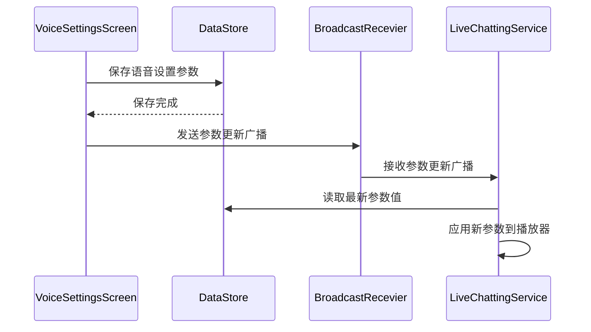

# 保存语音设置到本地存储并通知LiveChattingService的设计方案

## 1. 概述

本设计文档描述了如何将语音设置保存到应用本地存储中，并通知LiveChattingService播放参数发生变化，以及在服务中重新加载参数值的实现方案。

## 2. 架构设计

### 2.1 组件交互图



### 2.2 核心组件

1. **VoiceSettingsScreen**: UI界面，用户在此设置语音参数
2. **DataStore**: 本地数据存储，持久化语音设置参数
3. **BroadcastReceiver**: 广播接收器，用于通知服务参数变化
4. **LiveChattingService**: 语音播放服务，响应参数变化并重新加载参数

## 3. 数据模型

### 3.1 语音设置数据结构

```kotlin
data class VoiceSettingsData(
    val volumeRange: RangeValue,
    val pitchRange: RangeValue,
    val speedRange: RangeValue,
    val silenceRange: RangeValue
)

data class RangeValue(
    val min: Float,
    val max: Float
)
```

### 3.2 DataStore键定义

```kotlin
// 音量范围键
val VOLUME_RANGE_MIN_KEY = floatPreferencesKey("volume_range_min")
val VOLUME_RANGE_MAX_KEY = floatPreferencesKey("volume_range_max")

// 音调范围键
val PITCH_RANGE_MIN_KEY = floatPreferencesKey("pitch_range_min")
val PITCH_RANGE_MAX_KEY = floatPreferencesKey("pitch_range_max")

// 语速范围键
val SPEED_RANGE_MIN_KEY = floatPreferencesKey("speed_range_min")
val SPEED_RANGE_MAX_KEY = floatPreferencesKey("speed_range_max")

// 静音时间范围键
val SILENCE_RANGE_MIN_KEY = floatPreferencesKey("silence_range_min")
val SILENCE_RANGE_MAX_KEY = floatPreferencesKey("silence_range_max")
```

## 4. 实现细节

### 4.1 保存设置到本地存储

在VoiceSettingsScreen中，当用户点击保存按钮时，需要将设置保存到DataStore中：

```kotlin
// 在VoiceSettingsScreen中
fun saveSettings() {
    // 保存到DataStore
    coroutineScope.launch {
        context.dataStore.edit { preferences ->
            preferences[VOLUME_RANGE_MIN_KEY] = volumeRange.min
            preferences[VOLUME_RANGE_MAX_KEY] = volumeRange.max
            preferences[PITCH_RANGE_MIN_KEY] = pitchRange.min
            preferences[PITCH_RANGE_MAX_KEY] = pitchRange.max
            preferences[SPEED_RANGE_MIN_KEY] = speedRange.min
            preferences[SPEED_RANGE_MAX_KEY] = speedRange.max
            preferences[SILENCE_RANGE_MIN_KEY] = silenceRange.min
            preferences[SILENCE_RANGE_MAX_KEY] = silenceRange.max
        }
    }
    
    // 发送广播通知服务参数已更新
    val intent = Intent("com.danshuang.AiLive.VOICE_SETTINGS_CHANGED")
    context.sendBroadcast(intent)
}
```

### 4.2 在LiveChattingService中接收通知

在LiveChattingService中注册广播接收器来监听参数变化：

```kotlin
class LiveChattingService : Service() {
    private lateinit var settingsUpdateReceiver: BroadcastReceiver
    
    override fun onCreate() {
        super.onCreate()
        
        // 注册广播接收器
        settingsUpdateReceiver = object : BroadcastReceiver() {
            override fun onReceive(context: Context, intent: Intent) {
                if (intent.action == "com.danshuang.AiLive.VOICE_SETTINGS_CHANGED") {
                    // 重新加载参数
                    reloadVoiceSettings()
                }
            }
        }
        
        val filter = IntentFilter("com.danshuang.AiLive.VOICE_SETTINGS_CHANGED")
        registerReceiver(settingsUpdateReceiver, filter)
    }
    
    override fun onDestroy() {
        super.onDestroy()
        // 注销广播接收器
        unregisterReceiver(settingsUpdateReceiver)
    }
    
    private fun reloadVoiceSettings() {
        serviceScope.launch {
            // 从DataStore读取最新参数
            val prefs = context.dataStore.data.first()
            
            val volumeRange = RangeValue(
                min = prefs[VOLUME_RANGE_MIN_KEY] ?: 1.0f,
                max = prefs[VOLUME_RANGE_MAX_KEY] ?: 1.0f
            )
            
            val pitchRange = RangeValue(
                min = prefs[PITCH_RANGE_MIN_KEY] ?: 1.0f,
                max = prefs[PITCH_RANGE_MAX_KEY] ?: 1.0f
            )
            
            val speedRange = RangeValue(
                min = prefs[SPEED_RANGE_MIN_KEY] ?: 1.0f,
                max = prefs[SPEED_RANGE_MAX_KEY] ?: 1.0f
            )
            
            val silenceRange = RangeValue(
                min = prefs[SILENCE_RANGE_MIN_KEY] ?: 0f,
                max = prefs[SILENCE_RANGE_MAX_KEY] ?: 2.0f
            )
            
            // 应用新参数到当前播放器实例
            applyVoiceSettings(volumeRange, pitchRange, speedRange, silenceRange)
        }
    }
    
    private fun applyVoiceSettings(
        volumeRange: RangeValue,
        pitchRange: RangeValue,
        speedRange: RangeValue,
        silenceRange: RangeValue
    ) {
        // 在这里应用参数到当前MediaPlayer实例
        // 实现细节取决于具体的播放器参数设置方式
    }
}
```

### 4.3 DataStore扩展

为LoginRepository添加语音设置相关的操作方法：

```kotlin
class LoginRepository(private val context: Context) {
    
    suspend fun saveVoiceSettings(settings: VoiceSettingsData) {
        context.dataStore.edit { preferences ->
            preferences[VOLUME_RANGE_MIN_KEY] = settings.volumeRange.min
            preferences[VOLUME_RANGE_MAX_KEY] = settings.volumeRange.max
            preferences[PITCH_RANGE_MIN_KEY] = settings.pitchRange.min
            preferences[PITCH_RANGE_MAX_KEY] = settings.pitchRange.max
            preferences[SPEED_RANGE_MIN_KEY] = settings.speedRange.min
            preferences[SPEED_RANGE_MAX_KEY] = settings.speedRange.max
            preferences[SILENCE_RANGE_MIN_KEY] = settings.silenceRange.min
            preferences[SILENCE_RANGE_MAX_KEY] = settings.silenceRange.max
        }
    }
    
    fun getVoiceSettingsFlow(): Flow<VoiceSettingsData> = context.dataStore.data
        .map { preferences ->
            VoiceSettingsData(
                volumeRange = RangeValue(
                    min = preferences[VOLUME_RANGE_MIN_KEY] ?: 1.0f,
                    max = preferences[VOLUME_RANGE_MAX_KEY] ?: 1.0f
                ),
                pitchRange = RangeValue(
                    min = preferences[PITCH_RANGE_MIN_KEY] ?: 1.0f,
                    max = preferences[PITCH_RANGE_MAX_KEY] ?: 1.0f
                ),
                speedRange = RangeValue(
                    min = preferences[SPEED_RANGE_MIN_KEY] ?: 1.0f,
                    max = preferences[SPEED_RANGE_MAX_KEY] ?: 1.0f
                ),
                silenceRange = RangeValue(
                    min = preferences[SILENCE_RANGE_MIN_KEY] ?: 0f,
                    max = preferences[SILENCE_RANGE_MAX_KEY] ?: 2.0f
                )
            )
        }
}
```

## 5. 测试方案

### 5.1 单元测试

1. **DataStore操作测试**:
   - 测试保存语音设置到DataStore
   - 测试从DataStore读取语音设置
   - 测试默认值处理

2. **广播通知测试**:
   - 测试发送参数更新广播
   - 测试服务正确接收广播
   - 测试服务重新加载参数

### 5.2 集成测试

1. **端到端测试**:
   - 在UI中修改参数并保存
   - 验证参数正确保存到DataStore
   - 验证服务接收到更新通知
   - 验证服务中参数已更新

## 6. 安全与性能考虑

### 6.1 安全性

- 使用DataStore而非SharedPreferences，提供更好的安全性和类型安全
- 广播使用明确的Action名称，避免被其他应用误接收

### 6.2 性能

- 使用Flow和协程进行异步操作，避免阻塞主线程
- 广播接收器在服务销毁时及时注销，避免内存泄漏
- 参数更新时仅重新加载必要的参数，避免不必要的操作