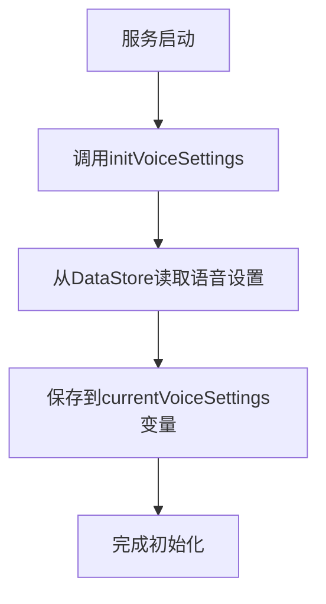
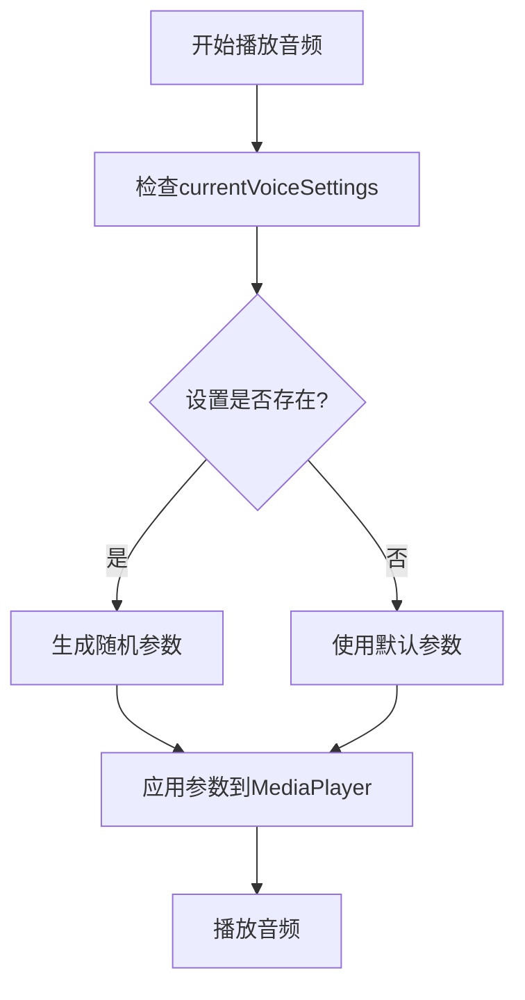
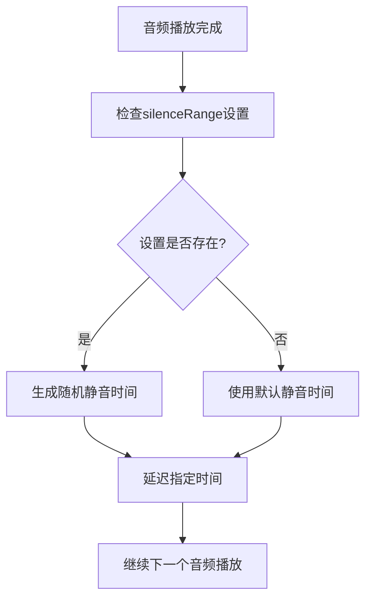

# 服务初始化设置与音频参数随机化设计文档

## 1. 概述

本文档描述了对LiveChattingService服务的增强功能设计，主要包括：
1. 服务启动时加载音量、音调、速度、间隔静音设置值
2. 在播放时设置相应音频的音量、音调、速度为相应区间中的随机值
3. 语音文件播放完后，delay一个随机的间隔静音值

## 2. 架构设计

### 2.1 当前架构
当前系统使用基于MediaPlayer的LiveChattingService服务来播放语音文件。服务通过DataStore持久化存储语音设置参数，包括音量、音调、速度和间隔静音时间的范围值。

### 2.2 设计变更
为了实现音频参数随机化功能，需要对现有服务进行以下增强：

1. 在服务启动时加载语音设置参数
2. 在播放每个音频文件前生成随机参数
3. 应用随机参数到MediaPlayer
4. 播放完成后延迟随机的静音时间

## 3. 核心功能实现

### 3.1 服务启动时加载设置值

在服务初始化阶段，从DataStore中加载语音设置参数：



实现代码：
```kotlin
// 初始化语音设置
private fun initVoiceSettings() {
    serviceScope.launch {
        try {
            currentVoiceSettings = loginRepository.getVoiceSettings()
            Log.d(TAG, "语音设置初始化完成: $currentVoiceSettings")
        } catch (e: Exception) {
            Log.e(TAG, "初始化语音设置时出错", e)
        }
    }
}
```

### 3.2 设置更新广播接收

当UI层修改语音设置后，通过广播通知服务重新加载参数：

```kotlin
// 注册广播接收器
private fun registerSettingsUpdateReceiver() {
    settingsUpdateReceiver = object : BroadcastReceiver() {
        override fun onReceive(context: Context, intent: Intent) {
            if (intent.action == "com.danshuang.AiLive.VOICE_SETTINGS_CHANGED") {
                // 重新加载参数
                reloadVoiceSettings()
            }
        }
    }
    
    val filter = IntentFilter("com.danshuang.AiLive.VOICE_SETTINGS_CHANGED")
    // 根据Android版本使用适当的registerReceiver方法
    if (Build.VERSION.SDK_INT >= Build.VERSION_CODES.TIRAMISU) {
        ContextCompat.registerReceiver(this, settingsUpdateReceiver, filter, ContextCompat.RECEIVER_NOT_EXPORTED)
    } else {
        ContextCompat.registerReceiver(this, settingsUpdateReceiver, filter, ContextCompat.RECEIVER_NOT_EXPORTED)
    }
}

// 重新加载语音设置
private fun reloadVoiceSettings() {
    serviceScope.launch {
        try {
            // 从DataStore读取最新参数
            currentVoiceSettings = loginRepository.getVoiceSettings()
            
            Log.d(TAG, "语音设置已更新: $currentVoiceSettings")
        } catch (e: Exception) {
            Log.e(TAG, "重新加载语音设置时出错", e)
        }
    }
}
```

### 3.3 音频参数随机化

在播放每个音频文件前，根据设置的范围生成随机参数：



### 3.4 随机静音延迟

在音频播放完成后，根据设置的静音时间范围生成随机延迟：



## 4. 数据模型

### 4.1 VoiceSettingsData
语音设置数据模型包含四个范围值参数：

| 字段名 | 类型 | 描述 |
|-------|------|------|
| volumeRange | RangeValue | 音量范围 |
| pitchRange | RangeValue | 音调范围 |
| speedRange | RangeValue | 速度范围 |
| silenceRange | RangeValue | 静音时间范围 |

### 4.2 RangeValue
范围值数据模型：

| 字段名 | 类型 | 描述 |
|-------|------|------|
| min | Float | 最小值 |
| max | Float | 最大值 |

### 4.3 AudioParameters
音频参数数据模型（内部使用）：

| 字段名 | 类型 | 描述 |
|-------|------|------|
| volume | Float | 音量值 (0.0-1.0) |
| pitch | Float | 音调值 (0.5-2.0) |
| speed | Float | 速度值 (0.5-2.0) |

## 5. 业务逻辑层

### 5.1 参数随机化算法

```kotlin
private fun generateRandomParameters(): AudioParameters {
    val voiceSettings = currentVoiceSettings ?: return AudioParameters(1.0f, 1.0f, 1.0f)
    
    val random = Random()
    val volume = voiceSettings.volumeRange.min + 
        random.nextFloat() * (voiceSettings.volumeRange.max - voiceSettings.volumeRange.min)
        
    val pitch = voiceSettings.pitchRange.min + 
        random.nextFloat() * (voiceSettings.pitchRange.max - voiceSettings.pitchRange.min)
        
    val speed = voiceSettings.speedRange.min + 
        random.nextFloat() * (voiceSettings.speedRange.max - voiceSettings.speedRange.min)
        
    // 限制参数范围，确保在合理范围内
    val clampedVolume = volume.coerceIn(0.0f, 1.0f)
    val clampedPitch = pitch.coerceIn(0.5f, 2.0f)
    val clampedSpeed = speed.coerceIn(0.5f, 2.0f)
        
    Log.d(TAG, "生成随机音频参数: 音量=$clampedVolume, 音调=$clampedPitch, 速度=$clampedSpeed")
    return AudioParameters(clampedVolume, clampedPitch, clampedSpeed)
}
```

### 5.2 静音时间随机化算法

```kotlin
private suspend fun delayWithRandomSilence() {
    val voiceSettings = currentVoiceSettings
    if (voiceSettings != null) {
        val random = Random()
        val silenceTime = voiceSettings.silenceRange.min + 
            random.nextFloat() * (voiceSettings.silenceRange.max - voiceSettings.silenceRange.min)
        Log.d(TAG, "随机静音时间: ${silenceTime}秒")
        kotlinx.coroutines.delay((silenceTime * 1000).toLong()) // 转换为毫秒
    } else {
        Log.d(TAG, "使用默认静音时间: 1秒")
        kotlinx.coroutines.delay(1000) // 默认1秒静音
    }
}
```

## 6. 技术实现方案

### 6.1 MediaPlayer参数设置

Android MediaPlayer支持通过PlaybackParams设置播放参数（API 23及以上版本）：

```kotlin
// 设置播放速度和音调
if (Build.VERSION.SDK_INT >= Build.VERSION_CODES.M) {
    try {
        val playbackParams = PlaybackParams()
        playbackParams.setSpeed(speed)
        playbackParams.setPitch(pitch)
        player.playbackParams = playbackParams
    } catch (e: Exception) {
        Log.e(TAG, "设置PlaybackParams失败", e)
    }
}

// 设置音量
player.setVolume(volume, volume) // 左右声道音量
```

### 6.2 音频参数应用流程

在playVoiceFile方法中应用随机参数：

```kotlin
private fun playVoiceFile(voiceFile: VoiceFileInfo) {
    chattingState = CHATTING_STATE_PLAYING
    _chattingStateFlow.value = CHATTING_STATE_PLAYING
    
    Log.d(TAG, "开始播放语音文件: ${voiceFile.id}, URL: ${voiceFile.url}")
    
    // 将AI主播的文字内容插入到实时动态列表中
    try {
        LiveMessageManager.insertMessage(
            type = MessageType.AI_RESPONSE,
            content = voiceFile.text,
            userName = "AI主播"
        )
        Log.d(TAG, "AI主播消息已插入动态列表: ${voiceFile.text}")
    } catch (e: Exception) {
        Log.e(TAG, "插入AI主播消息失败", e)
    }
    
    // 生成随机音频参数
    val audioParams = generateRandomParameters()
    
    // 请求音频焦点
    if (!requestAudioFocus()) {
        Log.w(TAG, "无法获取音频焦点，可能影响播放效果")
    }
    
    // 检查是否需要缓存
    var filePath: String? = null
    if (voiceFile.cache) {
        // 检查文件是否已缓存
        filePath = fileDownloader.getCacheFilePath(voiceFile.id)
        
        // 如果未缓存，则下载并缓存文件
        if (filePath == null) {
            filePath = fileDownloader.downloadAndCacheFile(voiceFile)
        }
    }
    
    // 使用同步锁确保播放完成后再返回
    val lock = java.lang.Object()
    var isPlaybackFinished = false
    var playbackError = false
    
    try {
        // 释放之前的MediaPlayer实例
        mediaPlayer?.let {
            if (it.isPlaying) {
                it.stop()
            }
            it.release()
        }
        
        // 创建新的MediaPlayer实例
        val player = MediaPlayer()
        mediaPlayer = player
        
        // 设置音频属性
        if (Build.VERSION.SDK_INT >= Build.VERSION_CODES.LOLLIPOP) {
            val audioAttributes = AudioAttributes.Builder()
                .setContentType(AudioAttributes.CONTENT_TYPE_SPEECH)
                .setUsage(AudioAttributes.USAGE_MEDIA)
                .setLegacyStreamType(AudioManager.STREAM_MUSIC)
                .build()
            player.setAudioAttributes(audioAttributes)
        } else {
            @Suppress("DEPRECATION")
            player.setAudioStreamType(AudioManager.STREAM_MUSIC)
        }
        
        // 设置音量
        player.setVolume(audioParams.volume, audioParams.volume)
        
        // 设置播放速度和音调（API 23及以上）
        if (Build.VERSION.SDK_INT >= Build.VERSION_CODES.M) {
            try {
                val playbackParams = PlaybackParams()
                playbackParams.setSpeed(audioParams.speed)
                playbackParams.setPitch(audioParams.pitch)
                player.playbackParams = playbackParams
                Log.d(TAG, "设置播放参数: 速度=${audioParams.speed}, 音调=${audioParams.pitch}")
            } catch (e: Exception) {
                Log.e(TAG, "设置PlaybackParams失败", e)
            }
        }
        
        // 设置系统音量
        audioManager?.let { am ->
            val maxVolume = am.getStreamMaxVolume(AudioManager.STREAM_MUSIC)
            val currentVolume = am.getStreamVolume(AudioManager.STREAM_MUSIC)
            Log.d(TAG, "当前系统音量: $currentVolume/$maxVolume")
            
            // 如果系统音量过低，设置为50%
            if (currentVolume < maxVolume * 0.3) {
                Log.d(TAG, "系统音量过低，设置为50%")
                am.setStreamVolume(AudioManager.STREAM_MUSIC, (maxVolume * 0.5).toInt(), 0)
            }
        }
        
        // 设置播放完成监听器
        player.setOnCompletionListener { mp ->
            synchronized(lock) {
                Log.d(TAG, "语音文件播放完成: ${voiceFile.id}")
                
                // 播放完成后释放资源
                mp.release()
                mediaPlayer = null
                
                // 更新播放状态
                chattingState = CHATTING_STATE_STOPPED
                _chattingStateFlow.value = CHATTING_STATE_STOPPED
                
                isPlaybackFinished = true
                lock.notify()
                
                // 添加随机静音延迟
                serviceScope.launch {
                    delayWithRandomSilence()
                }
            }
        }
        
        // 设置错误监听器
        player.setOnErrorListener { mp, what, extra ->
            synchronized(lock) {
                Log.e(TAG, "播放音频文件出错: ${voiceFile.id}, what: $what, extra: $extra")
                
                // 出错时释放资源
                mp.release()
                mediaPlayer = null
                
                // 更新播放状态
                chattingState = CHATTING_STATE_STOPPED
                _chattingStateFlow.value = CHATTING_STATE_STOPPED
                
                isPlaybackFinished = true
                playbackError = true
                lock.notify()
            }
            true // 返回true表示已处理错误
        }
        
        // 设置准备监听器
        player.setOnPreparedListener { mp ->
            Log.d(TAG, "语音文件准备完成，开始播放: ${voiceFile.id}")
            Log.d(TAG, "音频状态 - 是否有音频焦点: $hasAudioFocus")
            
            try {
                // 检查音频焦点
                if (!hasAudioFocus) {
                    Log.w(TAG, "警告：没有音频焦点，尝试重新获取")
                    requestAudioFocus()
                }
                
                mp.start()
                Log.d(TAG, "播放状态: 正在播放=${mp.isPlaying}")
                
                // 检查系统音量
                audioManager?.let { am ->
                    val volume = am.getStreamVolume(AudioManager.STREAM_MUSIC)
                    val maxVolume = am.getStreamMaxVolume(AudioManager.STREAM_MUSIC)
                    Log.d(TAG, "系统音量: $volume/$maxVolume")
                }
                
            } catch (e: Exception) {
                Log.e(TAG, "启动播放失败: ${voiceFile.id}", e)
                synchronized(lock) {
                    mp.release()
                    mediaPlayer = null
                    chattingState = CHATTING_STATE_STOPPED
                    _chattingStateFlow.value = CHATTING_STATE_STOPPED
                    isPlaybackFinished = true
                    playbackError = true
                    lock.notify()
                }
            }
        }
        
        // 设置数据源
        if (filePath != null && File(filePath).exists()) {
            Log.d(TAG, "播放本地文件: $filePath")
            player.setDataSource(filePath)
        } else {
            Log.d(TAG, "播放网络文件: ${voiceFile.url}")
            player.setDataSource(voiceFile.url)
        }
        
        // 异步准备播放器
        player.prepareAsync()
        
        // 等待播放完成
        synchronized(lock) {
            while (!isPlaybackFinished) {
                try {
                    lock.wait(600000) // 最多等待10分钟=600秒，即音频超过10分钟会提前结束播放
                    if (!isPlaybackFinished) {
                        Log.w(TAG, "播放超时，停止播放: ${voiceFile.id}")
                        player.stop()
                        player.release()
                        mediaPlayer = null
                        break
                    }
                } catch (e: InterruptedException) {
                    Log.e(TAG, "等待播放完成时被中断", e)
                    break
                }
            }
        }
        
        if (playbackError) {
            Log.e(TAG, "播放音频文件失败: ${voiceFile.id}")
        } else {
            Log.d(TAG, "播放音频文件成功: ${voiceFile.id}")
        }
    } catch (e: Exception) {
        Log.e(TAG, "播放音频文件失败: ${voiceFile.id}", e)
        
        // 更新播放状态
        chattingState = CHATTING_STATE_STOPPED
        _chattingStateFlow.value = CHATTING_STATE_STOPPED
        
        // 释放资源
        mediaPlayer?.let {
            try {
                if (it.isPlaying) {
                    it.stop()
                }
                it.release()
            } catch (releaseException: Exception) {
                Log.e(TAG, "释放MediaPlayer时出错", releaseException)
            }
            mediaPlayer = null
        }
    }
}
```

### 6.3 静音延迟实现

在播放完成后添加随机静音延迟：

```kotlin
private suspend fun delayWithRandomSilence() {
    val voiceSettings = currentVoiceSettings
    if (voiceSettings != null) {
        val random = Random()
        val silenceTime = voiceSettings.silenceRange.min + 
            random.nextFloat() * (voiceSettings.silenceRange.max - voiceSettings.silenceRange.min)
        Log.d(TAG, "随机静音时间: ${silenceTime}秒")
        kotlinx.coroutines.delay((silenceTime * 1000).toLong()) // 转换为毫秒
    } else {
        Log.d(TAG, "使用默认静音时间: 1秒")
        kotlinx.coroutines.delay(1000) // 默认1秒静音
    }
}
```

## 7. API端点参考

### 7.1 相关类和方法

#### LiveChattingService
- `initVoiceSettings()` - 初始化语音设置
- `generateRandomParameters()` - 生成随机音频参数
- `delayWithRandomSilence()` - 随机静音延迟
- `playVoiceFile()` - 播放单个语音文件

#### VoiceSettingsData
- `volumeRange: RangeValue` - 音量范围
- `pitchRange: RangeValue` - 音调范围
- `speedRange: RangeValue` - 速度范围
- `silenceRange: RangeValue` - 静音时间范围

#### RangeValue
- `min: Float` - 最小值
- `max: Float` - 最大值

## 8. 测试策略

### 8.1 单元测试

1. 测试随机参数生成函数
   - 验证生成的参数在指定范围内
   - 验证参数的随机性
   - 验证参数被正确限制在合理范围内
2. 测试参数应用到MediaPlayer的逻辑
   - 验证不同Android版本的兼容性
   - 验证参数设置的正确性
   - 验证异常情况的处理
3. 测试静音延迟功能
   - 验证延迟时间在指定范围内
   - 验证延迟功能的正确性
   - 验证默认值的使用
4. 测试设置加载功能
   - 验证initVoiceSettings正确加载设置
   - 验证reloadVoiceSettings正确更新设置
   - 验证广播接收器正确响应设置更新

### 8.2 集成测试

1. 测试服务启动时正确加载设置
   - 验证DataStore中的设置被正确加载
   - 验证currentVoiceSettings变量被正确设置
   - 验证日志输出正确
2. 测试播放过程中参数随机化效果
   - 验证每次播放使用不同的随机参数
   - 验证参数在合理范围内
   - 验证参数被正确应用到MediaPlayer
3. 测试静音延迟功能
   - 验证播放完成后有适当的静音延迟
   - 验证延迟时间的随机性
   - 验证日志输出正确
4. 测试设置更新流程
   - 验证UI修改设置后服务能正确接收更新
   - 验证更新后的设置在后续播放中生效
   - 验证广播机制正常工作

## 9. 注意事项

1. **Android版本兼容性**：PlaybackParams仅在API 23及以上版本支持，需要添加版本检查
2. **参数范围限制**：需要确保随机参数在合理范围内，避免产生不自然的音频效果
3. **性能影响**：避免频繁的参数计算影响播放流畅性
4. **异常处理**：需要妥善处理MediaPlayer参数设置可能抛出的异常
5. **资源管理**：确保MediaPlayer资源得到正确释放
6. **日志记录**：添加适当的日志记录便于调试和问题排查