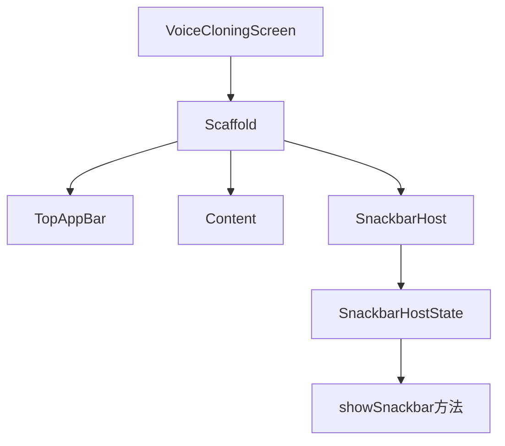

# 声音克隆页面上传结果通知优化设计文档

## 1. 概述

本设计文档旨在优化VoiceCloningScreen组件中上传音频文件后的结果通知方式。当前实现仅通过日志记录上传成功或失败的信息，用户体验不佳。根据需求，需要改为使用Snackbar来显示上传结果，以提供更好的用户反馈。

## 2. 当前实现分析

### 2.1 现有问题
- 上传成功或失败的结果仅通过日志记录，用户无法感知
- 缺乏直观的用户反馈机制
- 不符合Material Design的设计规范

### 2.2 现有代码结构
```kotlin
// 显示错误信息的Snackbar
errorMessage?.let { message ->
    LaunchedEffect(message) {
        // 在实际应用中，这里应该显示一个Snackbar
        // 由于我们没有访问ScaffoldState的权限，暂时只打印日志
        android.util.Log.e("VoiceCloningScreen", message)
        // 清除错误消息
        errorMessage = null
    }
}

// 显示上传结果的Snackbar
uploadMessage?.let { message ->
    LaunchedEffect(message) {
        // 在实际应用中，这里应该显示一个Snackbar
        // 由于我们没有访问ScaffoldState的权限，暂时只打印日志
        android.util.Log.i("VoiceCloningScreen", message)
        // 清除消息
        uploadMessage = null
    }
}
```

## 3. 设计方案

### 3.1 解决方案概述
1. 在VoiceCloningScreen中添加SnackbarHostState
2. 修改Scaffold以包含snackbarHost
3. 更新上传结果处理逻辑，使用SnackbarHostState显示消息

### 3.2 组件架构图


### 3.3 状态管理设计
| 状态变量 | 类型 | 用途 |
|---------|------|------|
| snackbarHostState | SnackbarHostState | 管理Snackbar显示状态 |
| errorMessage | String? | 错误消息内容 |
| uploadMessage | String? | 上传结果消息内容 |

## 4. 实现细节

### 4.1 添加SnackbarHostState
在VoiceCloningScreen的Composable函数中添加SnackbarHostState：

```kotlin
val snackbarHostState = remember { SnackbarHostState() }
```

### 4.2 修改Scaffold
更新Scaffold组件以包含snackbarHost：

```kotlin
Scaffold(
    topBar = {
        TopAppBar(
            title = { Text("声音克隆") },
            navigationIcon = {
                IconButton(onClick = { navController.navigateUp() }) {
                    Icon(
                        imageVector = Icons.AutoMirrored.Filled.ArrowBack,
                        contentDescription = "返回"
                    )
                }
            },
            colors = TopAppBarDefaults.topAppBarColors(
                containerColor = MaterialTheme.colorScheme.primaryContainer,
                titleContentColor = MaterialTheme.colorScheme.onPrimaryContainer
            )
        )
    },
    snackbarHost = {
        SnackbarHost(hostState = snackbarHostState)
    }
)
```

### 4.3 更新消息处理逻辑
修改errorMessage和uploadMessage的LaunchedEffect处理逻辑：

```kotlin
// 显示错误信息的Snackbar
errorMessage?.let { message ->
    LaunchedEffect(message) {
        snackbarHostState.showSnackbar(message)
        errorMessage = null
    }
}

// 显示上传结果的Snackbar
uploadMessage?.let { message ->
    LaunchedEffect(message) {
        snackbarHostState.showSnackbar(message)
        uploadMessage = null
    }
}
```

## 5. API接口设计

### 5.1 上传结果回调接口
```kotlin
fun uploadRecording(
    serverApiUtils: ServerApiUtilsV2,
    filePath: String,
    onUploadResult: (Boolean, String) -> Unit
)
```

### 5.2 成功/失败处理逻辑
```kotlin
// 上传成功
onUploadResult(true, "上传成功")

// 上传失败
onUploadResult(false, "上传失败: ${response.msg}")
```

## 6. 错误处理

### 6.1 网络异常处理
当网络异常发生时，应显示友好的错误消息：
```kotlin
catch (e: Exception) {
    // 网络异常
    kotlinx.coroutines.withContext(kotlinx.coroutines.Dispatchers.Main) {
        onUploadResult(false, "上传异常: ${e.message}")
    }
}
```

### 6.2 权限检查
在录音前检查权限，如果权限不足应提示用户：
```kotlin
if (!checkAudioPermission(context)) {
    showPermissionDialog = true
    return
}
```

## 7. 测试方案

### 7.1 单元测试
1. 测试SnackbarHostState是否正确初始化
2. 测试上传成功时Snackbar是否正确显示
3. 测试上传失败时Snackbar是否正确显示
4. 测试网络异常时Snackbar是否正确显示

### 7.2 集成测试
1. 测试完整的上传流程中Snackbar的显示
2. 测试权限不足时的Snackbar提示
3. 测试多个连续消息的显示顺序

## 8. 性能考虑

### 8.1 内存优化
- SnackbarHostState使用remember进行缓存，避免重复创建
- 及时清理消息状态，防止内存泄漏

### 8.2 用户体验优化
- 确保Snackbar消息显示时间适中，既不会过快消失也不会长时间遮挡界面
- 错误消息使用醒目的颜色显示，成功消息使用标准颜色显示