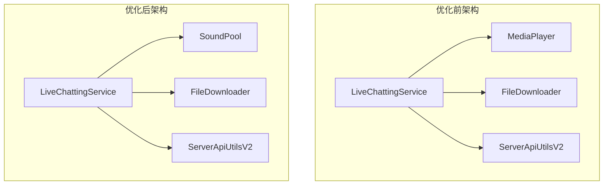
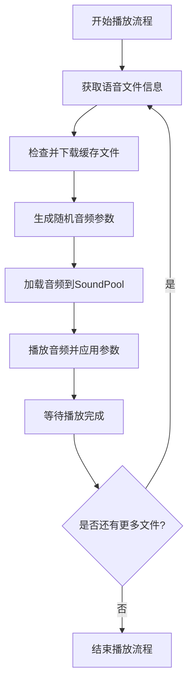

# 基于SoundPool的直播语音播放优化设计

## 1. 概述

本设计文档旨在描述如何将现有的基于MediaPlayer的直播语音播放服务优化为基于SoundPool的实现，以提升语音播放的性能和灵活性。新实现将支持根据音量、音调、速度设置值为播放的音频随机设置音量、音调、速度，从而增强直播语音的自然性和多样性。

## 2. 架构设计

### 2.1 当前架构分析

当前直播语音播放服务采用MediaPlayer实现，主要组件包括：
- LiveChattingService: 核心服务组件
- MediaPlayer: 音频播放器
- FileDownloader: 文件下载与缓存管理
- ServerApiUtilsV2: API通信组件

### 2.2 优化后架构

使用SoundPool替代MediaPlayer后，架构将调整为：
- LiveChattingService: 核心服务组件
- SoundPool: 音频播放器（支持音量、音调、速度控制）
- FileDownloader: 文件下载与缓存管理
- ServerApiUtilsV2: API通信组件

### 2.3 架构图对比



## 3. 核心功能设计

### 3.1 SoundPool集成设计

#### 3.1.1 SoundPool初始化
```kotlin
// 在LiveChattingService中初始化SoundPool
private var soundPool: SoundPool? = null

private fun initializeSoundPool() {
    soundPool = if (Build.VERSION.SDK_INT >= Build.VERSION_CODES.LOLLIPOP) {
        val attributes = AudioAttributes.Builder()
            .setUsage(AudioAttributes.USAGE_MEDIA)
            .setContentType(AudioAttributes.CONTENT_TYPE_SPEECH)
            .build()
        SoundPool.Builder()
            .setMaxStreams(1)
            .setAudioAttributes(attributes)
            .build()
    } else {
        SoundPool(1, AudioManager.STREAM_MUSIC, 0)
    }
}
```

#### 3.1.2 音频加载与播放
```kotlin
// 加载音频文件
private fun loadSound(filePath: String): Int {
    return soundPool?.load(filePath, 1) ?: -1
}

// 播放音频（支持参数控制）
private fun playSound(soundId: Int, volume: Float, pitch: Float, speed: Float) {
    soundPool?.play(soundId, volume, volume, 1, 0, pitch * speed)
}
```

### 3.2 音频参数随机化设计

#### 3.2.1 参数随机化逻辑
```kotlin
// 根据设置的范围生成随机参数
private fun generateRandomParameters(): AudioParameters {
    val voiceSettings = currentVoiceSettings ?: return AudioParameters(1.0f, 1.0f, 1.0f)
    
    val random = Random()
    val volume = voiceSettings.volumeRange.min + 
        random.nextFloat() * (voiceSettings.volumeRange.max - voiceSettings.volumeRange.min)
        
    val pitch = voiceSettings.pitchRange.min + 
        random.nextFloat() * (voiceSettings.pitchRange.max - voiceSettings.pitchRange.min)
        
    val speed = voiceSettings.speedRange.min + 
        random.nextFloat() * (voiceSettings.speedRange.max - voiceSettings.speedRange.min)
        
    return AudioParameters(volume, pitch, speed)
}

data class AudioParameters(val volume: Float, val pitch: Float, val speed: Float)
```

### 3.3 播放流程优化

#### 3.3.1 优化后的播放流程


## 4. 数据模型设计

### 4.1 音频参数模型
```kotlin
data class AudioParameters(
    val volume: Float,  // 音量 (0.0 - 1.0)
    val pitch: Float,   // 音调 (0.5 - 2.0)
    val speed: Float    // 速度 (0.5 - 2.0)
)
```

### 4.2 语音设置数据模型
```kotlin
data class VoiceSettingsData(
    val volumeRange: RangeValue,  // 音量范围
    val pitchRange: RangeValue,   // 音调范围
    val speedRange: RangeValue,   // 速度范围
    val silenceRange: RangeValue  // 静音时间范围
)

data class RangeValue(
    val min: Float,
    val max: Float
)
```

## 5. API接口设计

### 5.1 SoundPool相关接口

#### 5.1.1 初始化接口
```kotlin
fun initializeSoundPool(): SoundPool
```

#### 5.1.2 音频加载接口
```kotlin
fun loadSound(filePath: String): Int
```

#### 5.1.3 音频播放接口
```kotlin
fun playSound(soundId: Int, volume: Float, pitch: Float, speed: Float): Int
```

#### 5.1.4 资源释放接口
```kotlin
fun releaseSoundPool()
```

### 5.2 参数生成接口

#### 5.2.1 随机参数生成接口
```kotlin
fun generateRandomParameters(): AudioParameters
```

## 6. 业务逻辑层设计

### 6.1 播放控制逻辑

#### 6.1.1 播放状态管理
```kotlin
companion object {
    const val CHATTING_STATE_STOPPED = 0
    const val CHATTING_STATE_PLAYING = 1
    
    private val _chattingStateFlow = MutableStateFlow(CHATTING_STATE_STOPPED)
    val chattingStateFlow: StateFlow<Int> = _chattingStateFlow
}
```

#### 6.1.2 播放流程控制
```kotlin
private suspend fun startPlaybackFlow() {
    val stages = listOf("WELCOME", "ROOM", "PRODUCT", "KEEP", "ORDER", "THANKS")
    var currentStageIndex = 0
    
    while (isServiceRunning) {
        val roomId = loginRepository.liveRoomId.first() ?: "default_room_id"
        checkNetworkStatus()
        
        if (!networkAvailable) {
            kotlinx.coroutines.delay(5000)
            continue
        }
        
        val stage = stages[currentStageIndex]
        try {
            // 获取单个话术语音文件
            val voiceFile = fetchAiKnowledge(roomId, stage)
            voiceFile?.let {
                playVoiceFileWithSoundPool(it)
            }
            
            // 获取AI评论列表，即时并依次播放回复评论的语音
            val voiceFiles = fetchAiComments(roomId)
            playVoiceFilesWithSoundPool(voiceFiles)
            
            if (stage == "THANKS") {
                currentStageIndex = 0
            } else {
                currentStageIndex = (currentStageIndex + 1) % stages.size
            }
        } catch (e: Exception) {
            currentStageIndex = (currentStageIndex + 1) % stages.size
        }
        
        if (!isServiceRunning) break
        kotlinx.coroutines.delay(1000)
    }
}
```

### 6.2 音频播放逻辑

#### 6.2.1 单个音频播放
```kotlin
private suspend fun playVoiceFileWithSoundPool(voiceFile: VoiceFileInfo) {
    chattingState = CHATTING_STATE_PLAYING
    _chattingStateFlow.value = CHATTING_STATE_PLAYING
    
    // 将AI主播的文字内容插入到实时动态列表中
    try {
        LiveMessageManager.insertMessage(
            type = MessageType.AI_RESPONSE,
            content = voiceFile.text,
            userName = "AI主播"
        )
    } catch (e: Exception) {
        Log.e(TAG, "插入AI主播消息失败", e)
    }
    
    // 检查是否需要缓存
    var filePath: String? = null
    if (voiceFile.cache) {
        filePath = fileDownloader.getCacheFilePath(voiceFile.id)
        if (filePath == null) {
            filePath = fileDownloader.downloadAndCacheFile(voiceFile)
        }
    }
    
    // 生成随机音频参数
    val audioParams = generateRandomParameters()
    
    // 使用SoundPool播放音频
    val soundId = loadSound(filePath ?: voiceFile.url)
    if (soundId != -1) {
        val streamId = playSound(soundId, audioParams.volume, audioParams.pitch, audioParams.speed)
        
        // 等待播放完成
        waitForPlaybackCompletion(streamId)
    }
    
    chattingState = CHATTING_STATE_STOPPED
    _chattingStateFlow.value = CHATTING_STATE_STOPPED
}
```

#### 6.2.2 批量音频播放
```kotlin
private suspend fun playVoiceFilesWithSoundPool(voiceFiles: List<VoiceFileInfo>?) {
    voiceFiles?.forEach { voiceFile ->
        if (!isServiceRunning) return
        checkNetworkStatus()
        if (!networkAvailable) return
        
        playVoiceFileWithSoundPool(voiceFile)
        
        if (!isServiceRunning) return
    }
}
```

## 7. 测试策略

### 7.1 单元测试

#### 7.1.1 SoundPool初始化测试
```kotlin
@Test
fun testSoundPoolInitialization() {
    // 测试SoundPool是否正确初始化
    // 验证不同Android版本下的兼容性
}
```

#### 7.1.2 音频参数生成测试
```kotlin
@Test
fun testRandomParameterGeneration() {
    // 测试随机参数是否在设定范围内
    // 验证参数分布的均匀性
}
```

#### 7.1.3 音频播放测试
```kotlin
@Test
fun testAudioPlaybackWithParameters() {
    // 测试音频是否能正确播放
    // 验证参数是否正确应用到播放中
}
```

### 7.2 集成测试

#### 7.2.1 播放流程测试
```kotlin
@Test
fun testCompletePlaybackFlow() {
    // 测试完整的播放流程是否正常工作
    // 验证各阶段切换是否正确
}
```

#### 7.2.2 网络状态处理测试
```kotlin
@Test
fun testNetworkStateHandling() {
    // 测试网络断开时的处理逻辑
    // 验证网络恢复后的继续播放功能
}
```

## 8. 性能优化考虑

### 8.1 内存管理
- 及时释放SoundPool资源避免内存泄漏
- 合理设置SoundPool的最大流数
- 对缓存文件进行定期清理

### 8.2 音频质量
- 选择合适的音频采样率和编码格式
- 平衡音质与性能消耗
- 避免频繁的音频参数调整导致的性能问题

### 8.3 兼容性
- 处理不同Android版本的SoundPool API差异
- 确保在低端设备上的流畅运行
- 提供降级方案以应对不支持的设备