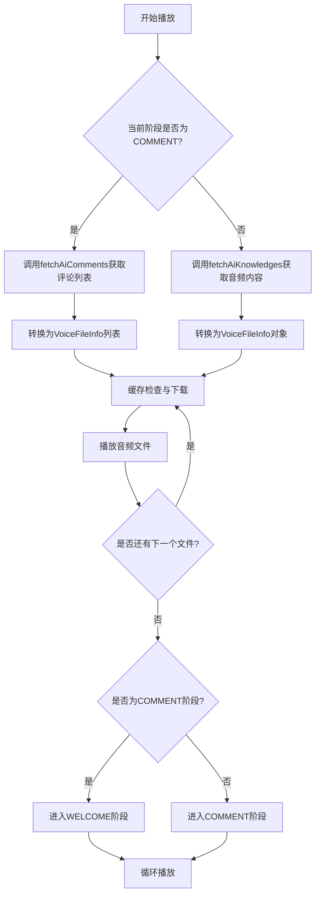

# 直播语音播放服务集成设计文档

## 1. 概述

本设计文档旨在描述如何将直播语音播放服务与现有的服务端接口进行集成，包括 `ServerApiUtilsV2.fetchAiKnowledges` 和 `ServerApiUtilsV2.fetchAiComments` 两个接口。这些接口用于获取播放音频内容和AI评论音频内容列表。

## 2. 系统架构

### 2.1 整体架构
```
+------------------+     +---------------------+     +------------------+
|   服务端API      |     |  直播语音播放服务    |     |   本地缓存系统    |
|                  |     |                     |     |                  |
| fetchAiKnowledges|<--->|  LiveChattingService|<--->|  FileDownloader  |
| fetchAiComments  |     |                     |     |  CacheManager    |
+------------------+     +---------------------+     +------------------+
```

### 2.2 核心组件
- **LiveChattingService**: Android后台服务，负责管理语音播放流程
- **VoiceApiService**: 与服务端API交互的接口层
- **FileDownloader**: 文件下载和缓存管理组件

## 3. 数据模型设计

### 3.1 VoiceFileInfo (语音文件信息)
```kotlin
data class VoiceFileInfo(
    val id: String,
    val url: String,
    val cached: Boolean = false
)
```

### 3.2 AiComment (AI评论)
```kotlin
data class AiComment(
    val id: String,
    val text: String,
    val url: String,
    val cache: Boolean
)
```

### 3.3 接口返回数据结构

#### fetchAiKnowledges 接口返回格式
```json
{
  "id": "1000",
  "text": "语音文件对应的文本内容",
  "url": "https://host/to/audio.mp3",
  "cache": true
}
```

#### fetchAiComments 接口返回格式
```json
[
  {
    "id": "1000",
    "text": "语音文件对应的文本内容",
    "url": "https://host/to/audio.mp3",
    "cache": false
  },
  {
    "id": "1001",
    "text": "另一条语音文件对应的文本内容",
    "url": "https://host/to/audio2.mp3",
    "cache": true
  }
]
```

## 4. 接口集成设计

### 4.1 fetchAiKnowledges 接口集成
获取播放音频内容，用于除COMMENT阶段外的所有播放阶段。

#### 调用方式
```kotlin
val knowledgeData = serverApiUtils.fetchAiKnowledges(roomId, stage.name)
```

#### 数据转换
将返回的Map<String, Any>转换为VoiceFileInfo对象：
```kotlin
val voiceFileInfo = VoiceFileInfo(
    id = knowledgeData["id"].toString(),
    url = knowledgeData["url"].toString(),
    cached = knowledgeData["cache"] as? Boolean ?: false
)
```

### 4.2 fetchAiComments 接口集成
获取AI评论音频内容列表，专门用于COMMENT播放阶段。

#### 调用方式
```kotlin
val commentsData = serverApiUtils.fetchAiComments(roomId, "comment")
```

#### 数据转换
将返回的List<Map<String, Any>>转换为VoiceFileInfo对象列表：
```kotlin
val voiceFiles = commentsData.map { comment ->
    VoiceFileInfo(
        id = comment["id"].toString(),
        url = comment["url"].toString(),
        cached = comment["cache"] as? Boolean ?: false
    )
}
```

## 5. 播放流程设计

### 5.1 播放阶段
```
WELCOME -> ROOM -> PRODUCT -> KEEP -> ORDER -> THANKS -> COMMENT -> WELCOME (循环)
```

### 5.2 播放流程图


### 5.3 缓存策略
1. 对于cache=true的文件，先检查本地缓存是否存在
2. 如果不存在，则下载并缓存到本地
3. 对于COMMENT阶段的文件，根据cache字段决定是否缓存

## 6. 异常处理设计

### 6.1 网络异常处理
- 网络断开时暂停播放服务
- 网络恢复时自动恢复播放

### 6.2 播放异常处理
- 单个文件播放失败时跳过并播放下一个
- 连续失败超过阈值时暂停服务

### 6.3 接口调用异常处理
- 接口调用失败时使用默认模拟数据
- 记录错误日志便于问题排查

## 7. 状态管理

### 7.1 播放状态
- CHATTING_STATE_STOPPED (0): 停止播放
- CHATTING_STATE_PLAYING (1): 正在播放

### 7.2 网络状态
- networkAvailable: 网络是否可用

### 7.3 服务状态
- isServiceRunning: 服务是否正在运行
- isServiceInitialized: 服务是否已初始化

## 8. 测试策略

### 8.1 单元测试
1. VoiceFileInfo数据模型测试
2. 接口返回数据转换测试
3. 缓存逻辑测试
4. 播放流程测试

### 8.2 集成测试
1. 服务端接口调用测试
2. 完整播放流程测试
3. 异常处理测试
4. 网络状态变化测试