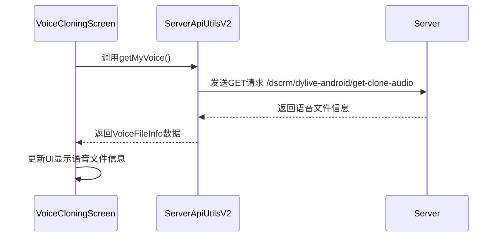
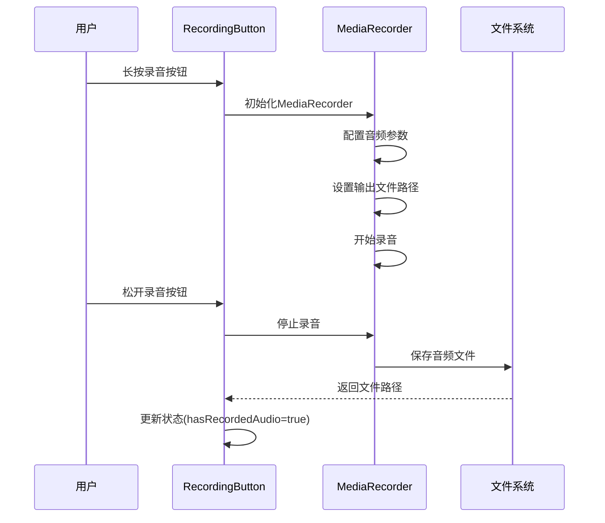
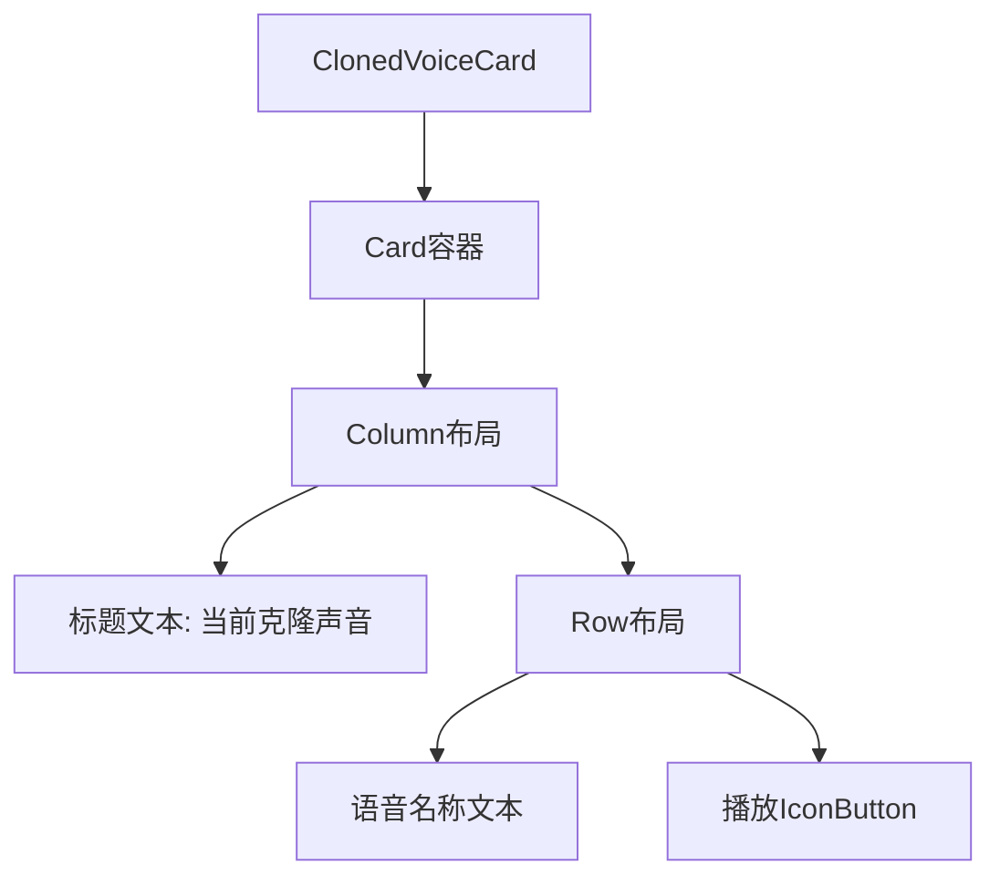
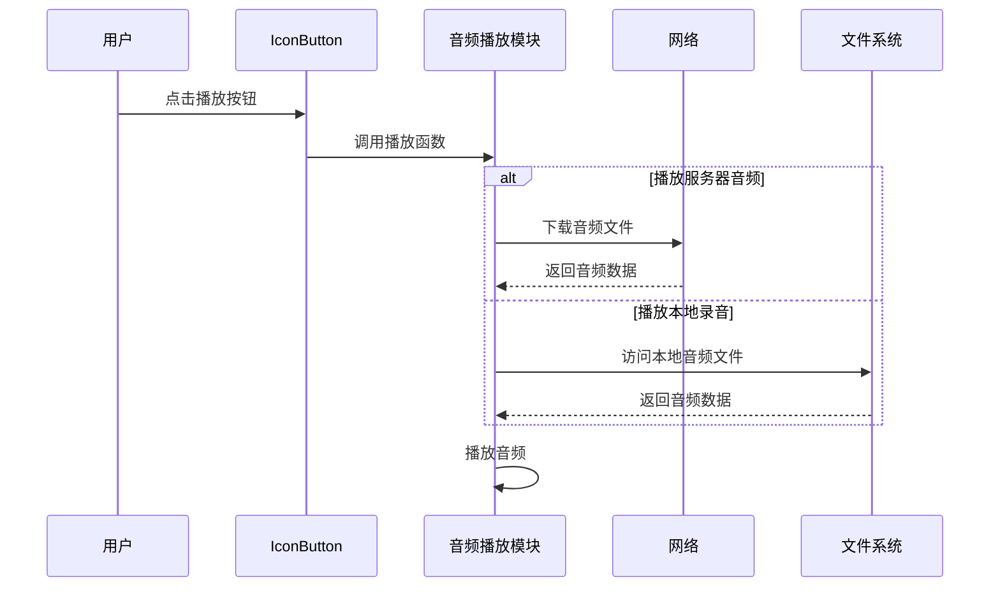
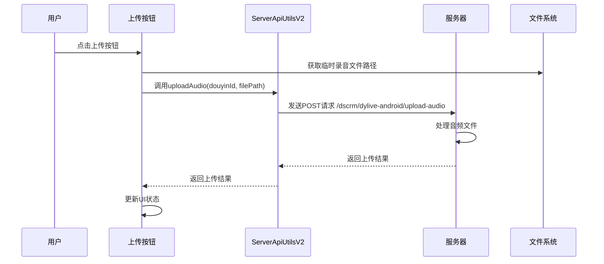

# 语音录制功能实现设计文档

## 1. 概述

本文档描述了在VoiceCloningScreen中实现语音录制功能的设计方案。该功能包括：
1. 页面加载时调用ServerApiUtilsV2.getMyVoice获取服务器上的克隆语音文件
2. 设置ClonedVoiceCard显示语音文件信息
3. 实现IconButton点击播放语音文件功能
4. 为IconButton添加圆形外边框样式
5. 点击RecordingButton开始录音，将录制的声音保存到临时语音文件
6. 点击"播放按钮"时，播放当前录制的临时语音文件
7. 点击"上传按钮"时，调用ServerApiUtilsV2.uploadAudio上传录制的临时语音文件

## 2. 技术架构

### 2.1 组件结构
- **VoiceCloningScreen**: 主屏幕组件，包含录音、播放和上传功能
- **ClonedVoiceCard**: 显示已克隆声音信息的卡片组件
- **RecordingButton**: 录音按钮组件
- **ServerApiUtilsV2**: 与后端API通信的工具类
- **音频录制模块**: 负责录制音频文件
- **音频播放模块**: 负责播放本地和网络音频文件
- **文件管理模块**: 负责临时音频文件的存储和上传

### 2.2 数据模型
根据项目规范，使用VoiceFileInfo数据模型：
```kotlin
data class VoiceFileInfo(
    val id: String,
    val text: String,
    val url: String,
    val cache: Boolean = false
)
```
注意：根据项目规范，VoiceFileInfo不包含duration属性。

## 3. 功能实现设计

### 3.1 页面加载时获取语音文件

#### 3.1.1 流程图


#### 3.1.2 实现要点
1. 在VoiceCloningScreen的初始化阶段调用`ServerApiUtilsV2.getMyVoice()`
2. 处理API调用结果，提取语音文件信息
3. 更新ClonedVoiceCard中的显示内容

根据API文档，`getMyVoice()`方法返回`ServerResponse<Map<String, Any>>`类型数据，需要从中提取语音文件信息。

### 3.2 音频录制功能

#### 3.2.1 录制流程


#### 3.2.2 实现要点
1. 使用Android MediaRecorder API实现音频录制
2. 录制的音频文件保存到应用私有目录
3. 录制过程中更新UI状态
4. 处理录制异常情况

### 3.2 ClonedVoiceCard组件更新

#### 3.2.1 组件结构


#### 3.2.2 数据绑定
- 语音名称文本: 显示从API获取的语音文件名
- 播放IconButton: 点击时播放语音文件URL对应的音频文件

#### 3.2.3 样式改进
- 为IconButton添加圆形外边框样式，提升视觉效果和用户体验

### 3.3 音频播放功能

#### 3.3.1 播放流程


#### 3.3.2 技术选型
基于项目中已有的音频播放实现，选择使用MediaPlayer进行音频播放：
- 支持网络音频流播放
- 支持本地音频文件播放
- 兼容性好
- 与现有代码保持一致

### 3.4 UI样式改进

#### 3.4.1 IconButton圆形外边框
为IconButton添加圆形外边框样式，提升视觉效果：
- 使用`border`修饰符添加边框
- 使用`CircleShape`保持圆形
- 设置合适的边框颜色和宽度

### 3.5 音频上传功能

#### 3.5.1 上传流程


#### 3.5.2 实现要点
1. 使用ServerApiUtilsV2.uploadAudio方法上传音频文件
2. 上传前检查网络状态
3. 上传过程中显示进度指示器
4. 处理上传成功和失败的情况

## 4. 详细实现方案

### 4.1 状态管理

在VoiceCloningScreen中添加以下状态变量：
```kotlin
// 语音文件信息
var voiceFileInfo by remember { mutableStateOf<VoiceFileInfo?>(null) }
// 加载状态
var isLoading by remember { mutableStateOf(true) }
// 错误信息
var errorMessage by remember { mutableStateOf<String?>(null) }
// 播放状态
var isPlaying by remember { mutableStateOf(false) }
// 录音状态
var isRecording by remember { mutableStateOf(false) }
// 已录制音频
var hasRecordedAudio by remember { mutableStateOf(false) }
// 临时录音文件路径
var tempRecordingFile by remember { mutableStateOf<String?>(null) }
// MediaPlayer实例
var mediaPlayer by remember { mutableStateOf<MediaPlayer?>(null) }
// MediaRecorder实例
var mediaRecorder by remember { mutableStateOf<MediaRecorder?>(null) }
```

### 4.2 API调用实现

```kotlin
// 在VoiceCloningScreen初始化时调用
LaunchedEffect(Unit) {
    try {
        val response = serverApiUtils.getMyVoice()
        if (response.isSuccess) {
            // 解析响应数据并更新状态
            // 假设返回的数据结构包含name和url字段
            val data = response.data
            voiceFileInfo = VoiceFileInfo(
                id = data["id"]?.toString() ?: "",
                text = data["name"]?.toString() ?: "默认声音",
                url = data["url"]?.toString() ?: "",
                cache = false
            )
        } else {
            errorMessage = response.msg
        }
    } catch (e: Exception) {
        errorMessage = "获取语音文件失败: ${e.message}"
    } finally {
        isLoading = false
    }
}
```

### 4.3 ClonedVoiceCard更新

```kotlin
@Composable
fun ClonedVoiceCard(voiceFileInfo: VoiceFileInfo?, isLoading: Boolean, onPlayClick: (String) -> Unit) {
    Card(
        modifier = Modifier
            .fillMaxWidth()
            .padding(vertical = 8.dp),
        colors = CardDefaults.cardColors(
            containerColor = MaterialTheme.colorScheme.surfaceVariant
        )
    ) {
        Column(
            modifier = Modifier.padding(16.dp),
            verticalArrangement = Arrangement.spacedBy(12.dp)
        ) {
            Text(
                text = "当前克隆声音",
                fontSize = 16.sp,
                fontWeight = FontWeight.Bold,
                color = MaterialTheme.colorScheme.onSurfaceVariant
            )
            
            if (isLoading) {
                // 显示加载状态
                CircularProgressIndicator()
            } else {
                voiceFileInfo?.let { fileInfo ->
                    Row(
                        modifier = Modifier.fillMaxWidth(),
                        verticalAlignment = Alignment.CenterVertically,
                        horizontalArrangement = Arrangement.SpaceBetween
                    ) {
                        Text(
                            text = fileInfo.text, // 显示语音名称
                            fontSize = 14.sp,
                            color = MaterialTheme.colorScheme.onSurfaceVariant
                        )
                        
                        IconButton(
                            onClick = { onPlayClick(fileInfo.url) }, // 点击播放音频
                            modifier = Modifier
                                .size(40.dp)
                                .border(
                                    width = 2.dp,
                                    color = MaterialTheme.colorScheme.primary,
                                    shape = CircleShape
                                )
                        ) {
                            Icon(
                                imageVector = Icons.Default.PlayArrow,
                                contentDescription = "播放",
                                tint = MaterialTheme.colorScheme.primary
                            )
                        }
                    }
                }
            }
        }
    }
}
```

### 4.4 音频录制实现

使用MediaRecorder实现音频录制功能：

```kotlin
// 开始录音
fun startRecording(context: Context) {
    try {
        // 释放之前的MediaRecorder实例
        mediaRecorder?.release()
        
        // 创建新的MediaRecorder实例
        val recorder = MediaRecorder()
        mediaRecorder = recorder
        
        // 配置音频录制参数
        recorder.setAudioSource(MediaRecorder.AudioSource.MIC)
        recorder.setOutputFormat(MediaRecorder.OutputFormat.THREE_GPP)
        recorder.setAudioEncoder(MediaRecorder.AudioEncoder.AMR_NB)
        
        // 创建临时文件路径
        val fileName = "temp_recording_${System.currentTimeMillis()}.3gp"
        val filePath = File(context.cacheDir, fileName).absolutePath
        recorder.setOutputFile(filePath)
        
        // 准备并开始录制
        recorder.prepare()
        recorder.start()
        
        // 保存文件路径
        tempRecordingFile = filePath
    } catch (e: Exception) {
        // 处理录制错误
        mediaRecorder?.release()
        mediaRecorder = null
        tempRecordingFile = null
    }
}

// 停止录音
fun stopRecording() {
    try {
        mediaRecorder?.apply {
            stop()
            release()
        }
        mediaRecorder = null
        hasRecordedAudio = true
    } catch (e: Exception) {
        // 处理停止录制错误
        mediaRecorder?.release()
        mediaRecorder = null
    }
}

// 更新RecordingButton以支持录音功能
@Composable
fun RecordingButton(
    isRecording: Boolean,
    onRecordingStateChange: (Boolean) -> Unit,
    onStartRecording: () -> Unit,
    onStopRecording: () -> Unit
) {
    val backgroundColor = if (isRecording) Color(0xFF4CAF50) else MaterialTheme.colorScheme.primary
    
    Column(
        horizontalAlignment = Alignment.CenterHorizontally,
        verticalArrangement = Arrangement.spacedBy(16.dp)
    ) {
        Box(
            modifier = Modifier
                .size(120.dp)
                .clip(CircleShape)
                .background(backgroundColor.copy(alpha = 0.1f))
                .border(2.dp, backgroundColor, CircleShape)
                .pointerInput(Unit) {
                    detectTapGestures(
                        onPress = {
                            onRecordingStateChange(true)
                            onStartRecording()
                            tryAwaitRelease()
                            onRecordingStateChange(false)
                            onStopRecording()
                        }
                    )
                },
            contentAlignment = Alignment.Center
        ) {
            Icon(
                imageVector = Icons.Default.Mic,
                contentDescription = "录音",
                tint = backgroundColor,
                modifier = Modifier.size(48.dp)
            )
        }
        
        Text(
            text = if (isRecording) "录音中..." else "长按开始录音",
            fontSize = 16.sp,
            color = MaterialTheme.colorScheme.onBackground
        )
    }
}
```

### 4.5 音频播放实现

使用MediaPlayer实现音频播放功能，支持播放网络音频和本地录音文件：
```kotlin
private var mediaPlayer: MediaPlayer? = null

fun playAudio(filePath: String) {
    try {
        // 释放之前的MediaPlayer实例
        mediaPlayer?.release()
        
        // 创建新的MediaPlayer实例
        val player = MediaPlayer()
        mediaPlayer = player
        
        // 设置音频属性
        if (Build.VERSION.SDK_INT >= Build.VERSION_CODES.LOLLIPOP) {
            val audioAttributes = AudioAttributes.Builder()
                .setContentType(AudioAttributes.CONTENT_TYPE_SPEECH)
                .setUsage(AudioAttributes.USAGE_MEDIA)
                .build()
            player.setAudioAttributes(audioAttributes)
        } else {
            player.setAudioStreamType(AudioManager.STREAM_MUSIC)
        }
        
        // 设置数据源
        player.setDataSource(filePath)
        
        // 设置准备完成监听器
        player.setOnPreparedListener { mp ->
            mp.start()
        }
        
        // 设置播放完成监听器
        player.setOnCompletionListener { mp ->
            mp.release()
            mediaPlayer = null
        }
        
        // 设置错误监听器
        player.setOnErrorListener { mp, what, extra ->
            mp.release()
            mediaPlayer = null
            false
        }
        
        // 异步准备播放器
        player.prepareAsync()
    } catch (e: Exception) {
        // 处理播放错误
        mediaPlayer?.release()
        mediaPlayer = null
    }
}
```

### 4.6 音频上传实现

使用ServerApiUtilsV2.uploadAudio方法实现音频文件上传功能：
```kotlin
// 上传录音文件
fun uploadRecording(
    serverApiUtils: ServerApiUtilsV2,
    douyinId: String,
    filePath: String,
    onUploadResult: (Boolean, String) -> Unit
) {
    // 启动协程处理上传
    CoroutineScope(Dispatchers.IO).launch {
        try {
            val response = serverApiUtils.uploadAudio(douyinId, filePath)
            if (response.isSuccess) {
                // 上传成功
                withContext(Dispatchers.Main) {
                    onUploadResult(true, "上传成功")
                }
            } else {
                // 上传失败
                withContext(Dispatchers.Main) {
                    onUploadResult(false, "上传失败: ${response.msg}")
                }
            }
        } catch (e: Exception) {
            // 网络异常
            withContext(Dispatchers.Main) {
                onUploadResult(false, "上传异常: ${e.message}")
            }
        }
    }
}

// 更新上传按钮以支持上传功能
@Composable
fun UploadButton(
    hasRecordedAudio: Boolean,
    isRecording: Boolean,
    isPlaying: Boolean,
    onUploadClick: () -> Unit
) {
    Button(
        onClick = onUploadClick,
        enabled = hasRecordedAudio && !isRecording && !isPlaying,
        colors = ButtonDefaults.buttonColors(
            containerColor = MaterialTheme.colorScheme.secondary,
            disabledContainerColor = MaterialTheme.colorScheme.surfaceVariant
        )
    ) {
        Icon(
            imageVector = Icons.Default.Upload,
            contentDescription = "上传",
            modifier = Modifier.size(24.dp)
        )
        Spacer(modifier = Modifier.width(8.dp))
        Text("上传")
    }
}
```

## 5. 错误处理

### 5.1 网络错误处理
- 显示友好的错误提示信息
- 提供重试机制

### 5.2 音频播放错误处理
- 捕获播放异常
- 释放MediaPlayer资源
- 显示播放失败提示

### 5.3 音频录制错误处理
- 捕获录制异常
- 释放MediaRecorder资源
- 显示录制失败提示

### 5.4 音频上传错误处理
- 捕获上传异常
- 显示上传失败提示
- 提供重试机制

## 6. 测试策略

### 6.1 单元测试
- 测试API调用结果处理逻辑
- 测试状态更新逻辑
- 测试音频播放功能
- 测试音频录制功能
- 测试音频上传功能

### 6.2 UI测试
- 验证组件正确显示语音信息
- 验证播放按钮功能
- 验证加载状态和错误状态显示
- 验证录音按钮功能
- 验证上传按钮功能

## 7. 性能优化

### 7.1 资源管理
- 及时释放MediaPlayer资源
- 避免内存泄漏

### 7.2 网络优化
- 考虑实现音频文件缓存机制
- 添加网络状态检查
- 使用项目中已有的FileDownloader进行音频文件缓存管理

## 8. 安全考虑

### 8.1 权限检查
- 确保应用具有网络访问权限
- 确保应用具有音频播放权限

### 8.2 数据验证
- 验证API返回数据的完整性
- 验证音频URL的有效性