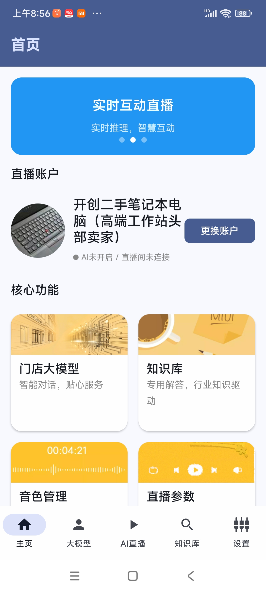
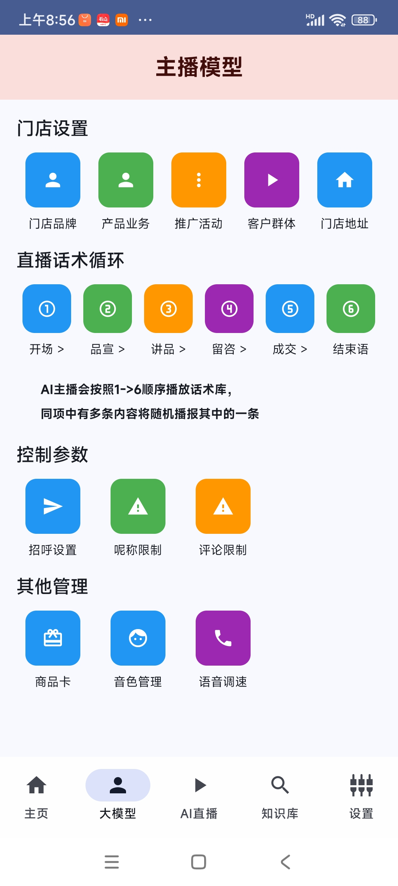

# AI直播助理
一个基于AI的直播助理，连接抖音直播间，循环话术，回答用户评论等

## 截图





## 服务组件

### LiveChattingService
原有的直播语音播放服务，基于MediaPlayer实现。

### LiveChattingServiceOptimized
新的直播语音播放服务，基于SoundPool实现，具有以下优势：

- 更好的性能表现
- 支持音量、音调、速度的随机化设置
- 更流畅的音频播放体验
- 更低的资源消耗

使用方式：
```kotlin
// 启动优化版服务
LiveChattingServiceOptimized.startService(context)

// 停止服务
LiveChattingServiceOptimized.stopService(context)
```

